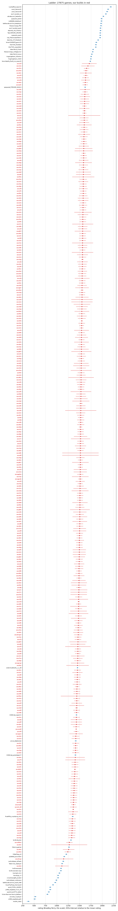

# Ladder

21487 rows of progress/games.csv (15472 local games, 6015 replica matches), rated by a batch Bradley-Terry fit on the Elo scale (`tools/elolib.py`). A local game counts its cell score (`tools/score.py`: a win or loss when kings decide the game, the points share when points do), a replica match its games won. A game between one of our builds and a field bot also fits how hard its map is for us (table at the end), so builds gauntleted on different maps compare on an average map. Each pair of players counts at most 200 games, every player carries one virtual win and loss against a fixed anchor, and ratings are relative to a mean of 1500 over all 330 players. Each of our builds is its own player. Regenerate with `tools/elo.py`; do not edit.

Games against field bots are replica scrimmages only; local games are our builds against each other and the stock players. Record = games won and lost.

Our builds, in attempt order (rating +- 95%; field score = expected score against each of the 51 field players, one game each):

| build | rating | rank | games | record | field score |
|---|---|---|---|---|---|
| s0e | 1150 +- 147 | 315 of 330 | 33 | 15-18 | 29.7% |
| s0m | 1268 +- 69 | 309 of 330 | 148 | 98-50 | 36.3% |
| s0u | 1284 +- 126 | 306 of 330 | 37 | 13-24 | 37.2% |
| v0d | 1575 +- 128 | 65 of 330 | 37 | 27-10 | 52.9% |
| s2o | 1379 +- 13 | 291 of 330 | 2868 | 1214-1654 | 42.3% |
| s3e | 1346 +- 76 | 302 of 330 | 80 | 29-51 | 40.5% |
| s3f | 1404 +- 75 | 276 of 330 | 80 | 46-34 | 43.7% |
| s3g | 1346 +- 76 | 303 of 330 | 80 | 30-50 | 40.5% |
| s2o_id | 1382 +- 75 | 288 of 330 | 80 | 40-40 | 42.5% |
| s3h | 1360 +- 55 | 294 of 330 | 188 | 100-88 | 41.3% |
| s3i | 1355 +- 76 | 299 of 330 | 80 | 27-53 | 41.0% |
| s3k | 1356 +- 76 | 297 of 330 | 80 | 29-51 | 41.1% |
| s3l | 1351 +- 76 | 301 of 330 | 80 | 27-53 | 40.8% |
| s3m | 1356 +- 76 | 298 of 330 | 80 | 30-50 | 41.1% |
| s3n | 1357 +- 76 | 296 of 330 | 80 | 29-51 | 41.1% |
| s3o | 1402 +- 75 | 279 of 330 | 80 | 50-30 | 43.6% |
| s3p | 1383 +- 75 | 287 of 330 | 80 | 43-37 | 42.6% |
| s3q | 1359 +- 75 | 295 of 330 | 80 | 35-45 | 41.3% |
| s3r | 1388 +- 75 | 285 of 330 | 80 | 46-34 | 42.8% |
| s3s | 1388 +- 75 | 286 of 330 | 80 | 46-34 | 42.8% |
| s3t | 1399 +- 75 | 280 of 330 | 80 | 49-31 | 43.4% |
| s3u | 1413 +- 76 | 270 of 330 | 80 | 53-27 | 44.2% |
| s3v | 1395 +- 75 | 283 of 330 | 80 | 54-26 | 43.2% |
| s3w | 1388 +- 75 | 284 of 330 | 80 | 52-28 | 42.8% |
| s3x | 1371 +- 75 | 293 of 330 | 80 | 48-32 | 41.9% |
| s3y | 1459 +- 54 | 232 of 330 | 235 | 134-101 | 46.6% |
| s3z | 1396 +- 75 | 282 of 330 | 80 | 50-30 | 43.2% |
| s4a | 1396 +- 75 | 281 of 330 | 80 | 50-30 | 43.2% |
| s4b | 1450 +- 53 | 243 of 330 | 172 | 117-55 | 46.1% |
| s4c | 1413 +- 76 | 271 of 330 | 80 | 53-27 | 44.1% |
| s4d | 1451 +- 34 | 242 of 330 | 462 | 287-175 | 46.2% |
| arush | 1380 +- 51 | 290 of 330 | 224 | 57-167 | 42.4% |
| s4e | 1436 +- 76 | 254 of 330 | 80 | 61-19 | 45.4% |
| s4f | 1443 +- 54 | 250 of 330 | 160 | 110-50 | 45.8% |
| abrk | 1418 +- 18 | 268 of 330 | 1573 | 466-1107 | 44.4% |
| s4g | 1482 +- 76 | 213 of 330 | 80 | 51-29 | 47.8% |
| s4h | 1459 +- 76 | 233 of 330 | 80 | 52-28 | 46.6% |
| s4i | 1468 +- 65 | 226 of 330 | 134 | 86-48 | 47.1% |
| s4j | 1485 +- 66 | 206 of 330 | 131 | 87-44 | 48.0% |
| s4m | 1505 +- 119 | 176 of 330 | 33 | 22-11 | 49.0% |
| s4n | 1458 +- 76 | 234 of 330 | 80 | 52-28 | 46.6% |
| s4q | 1419 +- 76 | 266 of 330 | 80 | 61-19 | 44.5% |
| s4r | 1419 +- 76 | 267 of 330 | 80 | 61-19 | 44.5% |
| s4t | 1402 +- 67 | 278 of 330 | 122 | 74-48 | 43.6% |
| s5c | 1433 +- 76 | 257 of 330 | 80 | 58-22 | 45.2% |
| s5e | 1382 +- 107 | 289 of 330 | 60 | 31-29 | 42.5% |
| s5g | 1431 +- 63 | 258 of 330 | 140 | 80-60 | 45.1% |
| s5j | 1492 +- 95 | 198 of 330 | 52 | 36-16 | 48.4% |
| araid | 1429 +- 8 | 262 of 330 | 8257 | 2425-5832 | 45.0% |
| s5o | 1435 +- 75 | 255 of 330 | 80 | 41-39 | 45.3% |
| s5r | 1423 +- 49 | 264 of 330 | 202 | 121-81 | 44.7% |
| s5s | 1484 +- 76 | 209 of 330 | 80 | 56-24 | 47.9% |
| s5t | 1431 +- 73 | 260 of 330 | 86 | 42-44 | 45.1% |
| atrap | 1158 +- 212 | 313 of 330 | 22 | 1-21 | 30.1% |
| s5w | 1571 +- 93 | 76 of 330 | 72 | 45-27 | 52.6% |
| s5x | 1422 +- 90 | 265 of 330 | 55 | 30-25 | 44.6% |
| s5y | 1470 +- 76 | 224 of 330 | 80 | 53-27 | 47.2% |
| s6c | 1274 +- 395 | 307 of 330 | 2 | 0-2 | 36.6% |
| s6e | 1445 +- 75 | 248 of 330 | 80 | 51-29 | 45.9% |
| s6f | 1438 +- 75 | 252 of 330 | 80 | 41-39 | 45.5% |
| s6g | 1455 +- 75 | 239 of 330 | 80 | 41-39 | 46.4% |
| s6j | 1449 +- 123 | 245 of 330 | 42 | 18-24 | 46.1% |
| s6m | 1426 +- 51 | 263 of 330 | 219 | 98-121 | 44.8% |
| s6o | 1404 +- 75 | 275 of 330 | 80 | 39-41 | 43.7% |
| s6p | 1464 +- 76 | 229 of 330 | 80 | 47-33 | 46.9% |
| s6s | 1414 +- 75 | 269 of 330 | 80 | 40-40 | 44.2% |
| s6v | 1458 +- 75 | 235 of 330 | 80 | 47-33 | 46.5% |
| s6y | 1497 +- 77 | 186 of 330 | 80 | 53-27 | 48.6% |
| s6z | 1495 +- 77 | 189 of 330 | 80 | 52-28 | 48.5% |
| s7d | 1486 +- 25 | 205 of 330 | 792 | 388-426 | 48.1% |
| s7f | 1465 +- 280 | 228 of 330 | 4 | 2-2 | 46.9% |
| s7h | 1526 +- 59 | 148 of 330 | 150 | 94-56 | 50.2% |
| s7i | 1524 +- 77 | 152 of 330 | 84 | 63-29 | 50.1% |
| s7j | 1468 +- 72 | 225 of 330 | 89 | 56-33 | 47.1% |
| s7k | 1482 +- 207 | 212 of 330 | 9 | 7-2 | 47.8% |
| s7l | 1406 +- 217 | 273 of 330 | 8 | 4-4 | 43.8% |
| s7m | 1488 +- 182 | 203 of 330 | 12 | 6-6 | 48.1% |
| s7n | 1483 +- 182 | 210 of 330 | 12 | 6-6 | 47.9% |
| s7o | 1484 +- 182 | 207 of 330 | 12 | 5-7 | 47.9% |
| s7p | 1521 +- 183 | 158 of 330 | 12 | 8-4 | 49.9% |
| s7q | 1523 +- 56 | 154 of 330 | 180 | 112-68 | 50.0% |
| s7r | 1524 +- 212 | 151 of 330 | 9 | 6-3 | 50.1% |
| s7t | 1503 +- 77 | 179 of 330 | 80 | 51-29 | 48.9% |
| s7u | 1515 +- 67 | 164 of 330 | 108 | 70-38 | 49.6% |
| s7v | 1488 +- 182 | 201 of 330 | 12 | 5-7 | 48.2% |
| s7w | 1477 +- 104 | 219 of 330 | 54 | 25-29 | 47.5% |
| s7x | 1573 +- 231 | 74 of 330 | 8 | 7-1 | 52.7% |
| s7y | 1569 +- 230 | 79 of 330 | 8 | 6-2 | 52.5% |
| s7z | 1527 +- 70 | 145 of 330 | 100 | 62-38 | 50.2% |
| s8a | 1529 +- 68 | 135 of 330 | 118 | 75-43 | 50.3% |
| s8b | 1481 +- 76 | 215 of 330 | 80 | 50-30 | 47.8% |
| s8c | 1487 +- 110 | 204 of 330 | 52 | 27-25 | 48.1% |
| s8d | 1525 +- 167 | 149 of 330 | 16 | 10-6 | 50.1% |
| s8e | 1509 +- 73 | 172 of 330 | 88 | 60-28 | 49.2% |
| s8f | 1481 +- 215 | 214 of 330 | 8 | 4-4 | 47.8% |
| s8h | 1444 +- 72 | 249 of 330 | 88 | 51-37 | 45.8% |
| atrap2 | 1475 +- 90 | 220 of 330 | 56 | 23-33 | 47.5% |
| s8i | 1457 +- 72 | 236 of 330 | 88 | 54-34 | 46.5% |
| s8j | 1495 +- 56 | 190 of 330 | 176 | 105-71 | 48.5% |
| s8k | 1517 +- 65 | 161 of 330 | 126 | 78-48 | 49.7% |
| s8l | 1509 +- 75 | 171 of 330 | 84 | 62-22 | 49.2% |
| s8m | 1538 +- 280 | 122 of 330 | 4 | 3-1 | 50.8% |
| s8n | 1515 +- 66 | 165 of 330 | 112 | 76-36 | 49.6% |
| s8o | 1529 +- 55 | 137 of 330 | 174 | 110-64 | 50.3% |
| s8p | 1529 +- 72 | 136 of 330 | 96 | 68-28 | 50.3% |
| s8q | 1478 +- 70 | 218 of 330 | 96 | 61-35 | 47.6% |
| s8r | 1481 +- 76 | 216 of 330 | 80 | 58-22 | 47.8% |
| s8s | 1516 +- 78 | 162 of 330 | 80 | 57-23 | 49.7% |
| s8t | 1483 +- 64 | 211 of 330 | 126 | 74-52 | 47.9% |
| s8u | 1494 +- 58 | 192 of 330 | 154 | 88-66 | 48.5% |
| s8v | 1501 +- 65 | 180 of 330 | 112 | 67-45 | 48.9% |
| s8w | 1453 +- 49 | 241 of 330 | 198 | 77-121 | 46.3% |
| s8x | 1456 +- 65 | 237 of 330 | 122 | 66-56 | 46.4% |
| s8y | 1527 +- 68 | 146 of 330 | 104 | 69-35 | 50.2% |
| s8z | 1493 +- 93 | 196 of 330 | 53 | 31-22 | 48.4% |
| s9a | 1528 +- 54 | 140 of 330 | 194 | 121-73 | 50.3% |
| s9b | 1496 +- 59 | 188 of 330 | 146 | 85-61 | 48.6% |
| s9c | 1500 +- 145 | 182 of 330 | 20 | 10-10 | 48.8% |
| s9d | 1549 +- 141 | 108 of 330 | 22 | 15-7 | 51.4% |
| s9e | 1535 +- 147 | 128 of 330 | 20 | 12-8 | 50.7% |
| s9g | 1499 +- 77 | 184 of 330 | 80 | 53-27 | 48.7% |
| s9h | 1509 +- 77 | 170 of 330 | 80 | 53-27 | 49.3% |
| s9i | 1471 +- 61 | 223 of 330 | 137 | 71-66 | 47.3% |
| s9k | 1488 +- 56 | 202 of 330 | 162 | 92-80 | 48.1% |
| s9l | 1506 +- 145 | 174 of 330 | 20 | 10-10 | 49.1% |
| s9m | 1491 +- 76 | 199 of 330 | 80 | 54-26 | 48.3% |
| s9n | 1409 +- 207 | 272 of 330 | 9 | 3-6 | 43.9% |
| agrab | 1528 +- 47 | 141 of 330 | 218 | 102-116 | 50.3% |
| s9o | 1494 +- 176 | 194 of 330 | 13 | 6-7 | 48.4% |
| s9q | 1593 +- 200 | 46 of 330 | 12 | 10-2 | 53.8% |
| s9r | 1508 +- 65 | 173 of 330 | 128 | 84-44 | 49.2% |
| agrw | 1430 +- 147 | 261 of 330 | 20 | 6-14 | 45.1% |
| agtr | 1561 +- 148 | 93 of 330 | 20 | 14-6 | 52.1% |
| s9s | 1558 +- 23 | 96 of 330 | 921 | 482-455 | 51.9% |
| agaim | 1527 +- 70 | 147 of 330 | 94 | 46-48 | 50.2% |
| agcap | 1463 +- 146 | 230 of 330 | 20 | 8-12 | 46.8% |
| s9t | 1500 +- 70 | 181 of 330 | 96 | 60-36 | 48.8% |
| s9u | 1536 +- 71 | 124 of 330 | 96 | 69-27 | 50.7% |
| s9v | 1528 +- 78 | 138 of 330 | 80 | 58-22 | 50.3% |
| s9w | 1528 +- 78 | 142 of 330 | 80 | 60-20 | 50.3% |
| s9x | 1500 +- 70 | 183 of 330 | 96 | 59-37 | 48.8% |
| s9y | 1536 +- 71 | 125 of 330 | 96 | 69-27 | 50.7% |
| s9z | 1574 +- 63 | 71 of 330 | 145 | 104-41 | 52.8% |
| t0a | 1404 +- 123 | 277 of 330 | 42 | 16-26 | 43.7% |
| t0b | 1494 +- 88 | 191 of 330 | 59 | 37-22 | 48.5% |
| t0c | 1566 +- 71 | 85 of 330 | 112 | 70-42 | 52.3% |
| t0d | 1534 +- 101 | 132 of 330 | 48 | 32-16 | 50.6% |
| t0e | 1511 +- 77 | 169 of 330 | 80 | 58-22 | 49.4% |
| t0f | 1613 +- 112 | 35 of 330 | 54 | 34-20 | 54.9% |
| t0g | 1546 +- 62 | 111 of 330 | 142 | 94-48 | 51.3% |
| t0h | 1553 +- 73 | 99 of 330 | 103 | 67-36 | 51.6% |
| t0i | 1533 +- 62 | 133 of 330 | 138 | 89-49 | 50.6% |
| t0j | 1528 +- 78 | 139 of 330 | 80 | 58-22 | 50.3% |
| t0k | 1549 +- 161 | 105 of 330 | 16 | 10-6 | 51.4% |
| t0l | 1571 +- 81 | 78 of 330 | 80 | 62-18 | 52.6% |
| t0m | 1558 +- 161 | 95 of 330 | 16 | 9-7 | 51.9% |
| t0n | 1554 +- 72 | 98 of 330 | 96 | 73-23 | 51.7% |
| t0o | 1591 +- 73 | 52 of 330 | 110 | 76-34 | 53.7% |
| t0p | 1603 +- 65 | 40 of 330 | 144 | 104-40 | 54.4% |
| t0r | 1538 +- 76 | 121 of 330 | 86 | 73-29 | 50.8% |
| t0s | 1493 +- 163 | 197 of 330 | 16 | 7-9 | 48.4% |
| t0t | 1576 +- 74 | 64 of 330 | 96 | 75-21 | 52.9% |
| t0u | 1611 +- 163 | 37 of 330 | 16 | 9-7 | 54.8% |
| t0v | 1566 +- 70 | 86 of 330 | 103 | 77-26 | 52.3% |
| t0w | 1443 +- 353 | 251 of 330 | 2 | 1-1 | 45.7% |
| t0x | 1589 +- 243 | 53 of 330 | 6 | 3-3 | 53.6% |
| t0y | 1462 +- 248 | 231 of 330 | 6 | 2-4 | 46.8% |
| u0a | 1546 +- 72 | 112 of 330 | 96 | 67-29 | 51.2% |
| u0b | 1575 +- 106 | 69 of 330 | 44 | 31-13 | 52.8% |
| u0c | 1513 +- 162 | 168 of 330 | 16 | 5-11 | 49.5% |
| u0d | 1592 +- 162 | 49 of 330 | 16 | 11-5 | 53.8% |
| u0e | 1567 +- 109 | 84 of 330 | 51 | 28-23 | 52.4% |
| u0f | 1449 +- 123 | 246 of 330 | 42 | 18-24 | 46.1% |
| u0g | 1596 +- 184 | 45 of 330 | 12 | 8-4 | 54.0% |
| u0h | 1514 +- 162 | 167 of 330 | 16 | 6-10 | 49.5% |
| u0i | 1592 +- 162 | 50 of 330 | 16 | 11-5 | 53.8% |
| u0j | 1472 +- 165 | 222 of 330 | 16 | 7-9 | 47.3% |
| u0k | 1523 +- 399 | 155 of 330 | 1 | 1-0 | 50.0% |
| u0l | 1523 +- 399 | 156 of 330 | 1 | 1-0 | 50.0% |
| u0m | 1568 +- 32 | 82 of 330 | 547 | 337-226 | 52.4% |
| u0n | 1530 +- 146 | 134 of 330 | 20 | 9-11 | 50.4% |
| u0o | 1449 +- 123 | 247 of 330 | 42 | 18-24 | 46.1% |
| u0p | 1586 +- 79 | 56 of 330 | 88 | 75-13 | 53.5% |
| u0q | 1536 +- 38 | 127 of 330 | 337 | 175-162 | 50.7% |
| u0r | 1546 +- 161 | 113 of 330 | 16 | 8-8 | 51.2% |
| u0s | 1551 +- 161 | 102 of 330 | 16 | 8-8 | 51.5% |
| u0t | 1504 +- 147 | 178 of 330 | 20 | 11-9 | 49.0% |
| u0u | 1566 +- 143 | 87 of 330 | 21 | 10-11 | 52.3% |
| u0v | 1645 +- 131 | 27 of 330 | 31 | 26-5 | 56.7% |
| u0w | 1572 +- 74 | 75 of 330 | 96 | 74-22 | 52.7% |
| u0x | 1598 +- 76 | 44 of 330 | 96 | 80-16 | 54.1% |
| u0y | 1549 +- 86 | 107 of 330 | 78 | 46-32 | 51.4% |
| u0z | 1600 +- 119 | 42 of 330 | 45 | 26-19 | 54.2% |
| u1a | 1517 +- 103 | 160 of 330 | 58 | 28-30 | 49.7% |
| u1b | 1518 +- 145 | 159 of 330 | 20 | 8-12 | 49.7% |
| u1e | 1523 +- 145 | 153 of 330 | 20 | 8-12 | 50.0% |
| u1f | 1724 +- 161 | 24 of 330 | 32 | 31-1 | 61.4% |
| u1g | 1547 +- 176 | 110 of 330 | 13 | 6-7 | 51.3% |
| u1h | 1592 +- 116 | 51 of 330 | 36 | 23-13 | 53.8% |
| u1i | 1608 +- 353 | 39 of 330 | 2 | 2-0 | 54.6% |
| u1j | 1504 +- 112 | 177 of 330 | 36 | 19-17 | 49.0% |
| u1k | 1543 +- 113 | 116 of 330 | 36 | 23-13 | 51.1% |
| u1l | 1527 +- 145 | 143 of 330 | 20 | 8-12 | 50.2% |
| u1m | 1527 +- 145 | 144 of 330 | 20 | 10-10 | 50.2% |
| u1n | 1473 +- 147 | 221 of 330 | 20 | 6-14 | 47.4% |
| u1o | 1539 +- 123 | 120 of 330 | 42 | 22-20 | 50.9% |
| u1p | 1537 +- 96 | 123 of 330 | 62 | 32-30 | 50.7% |
| u1q | 1565 +- 181 | 89 of 330 | 16 | 14-2 | 52.3% |
| u1r | 1564 +- 65 | 91 of 330 | 134 | 93-41 | 52.2% |
| u1s | 1541 +- 79 | 118 of 330 | 80 | 59-21 | 51.0% |
| u1t | 1543 +- 79 | 115 of 330 | 80 | 62-18 | 51.1% |
| u1u | 1568 +- 81 | 80 of 330 | 80 | 62-18 | 52.4% |
| u1v | 1551 +- 68 | 101 of 330 | 122 | 87-35 | 51.5% |
| u1w | 1515 +- 139 | 166 of 330 | 22 | 10-12 | 49.6% |
| u1x | 1583 +- 68 | 58 of 330 | 112 | 85-27 | 53.2% |
| u1y | 1549 +- 102 | 104 of 330 | 56 | 30-26 | 51.4% |
| u1z | 1586 +- 117 | 57 of 330 | 32 | 19-13 | 53.4% |
| u2a | 1581 +- 191 | 59 of 330 | 12 | 7-5 | 53.2% |
| u2b | 1534 +- 58 | 131 of 330 | 158 | 108-50 | 50.6% |
| u2c | 1466 +- 112 | 227 of 330 | 36 | 18-18 | 47.0% |
| u2d | 1568 +- 232 | 81 of 330 | 8 | 6-2 | 52.4% |
| u2e | 1580 +- 235 | 62 of 330 | 8 | 7-1 | 53.1% |
| u2g | 1581 +- 26 | 60 of 330 | 822 | 485-375 | 53.2% |
| u2h | 1545 +- 227 | 114 of 330 | 8 | 6-2 | 51.2% |
| u2i | 1581 +- 73 | 61 of 330 | 100 | 82-18 | 53.2% |
| u2j | 1571 +- 115 | 77 of 330 | 39 | 40-15 | 52.6% |
| u2k | 1600 +- 81 | 41 of 330 | 88 | 76-12 | 54.2% |
| u2l | 1574 +- 99 | 72 of 330 | 54 | 45-9 | 52.8% |
| u2m | 1550 +- 228 | 103 of 330 | 8 | 6-2 | 51.5% |
| u2n | 1577 +- 78 | 63 of 330 | 90 | 77-13 | 52.9% |
| u2o | 1506 +- 140 | 175 of 330 | 23 | 18-5 | 49.1% |
| u2p | 1541 +- 187 | 117 of 330 | 12 | 9-3 | 51.0% |
| u2q | 1525 +- 186 | 150 of 330 | 12 | 7-5 | 50.1% |
| u2r | 1497 +- 186 | 187 of 330 | 12 | 8-4 | 48.6% |
| u2s | 1589 +- 70 | 55 of 330 | 122 | 93-31 | 53.6% |
| u2t | 1493 +- 164 | 195 of 330 | 16 | 14-2 | 48.4% |
| u2u | 1567 +- 232 | 83 of 330 | 8 | 7-1 | 52.4% |
| u2v | 1558 +- 100 | 97 of 330 | 64 | 43-21 | 51.9% |
| u2w | 1575 +- 90 | 68 of 330 | 74 | 45-29 | 52.8% |
| u2x | 1455 +- 162 | 240 of 330 | 16 | 11-5 | 46.4% |
| u2y | 1634 +- 93 | 28 of 330 | 74 | 51-23 | 56.1% |
| u2z | 1612 +- 130 | 36 of 330 | 32 | 24-8 | 54.9% |
| u3a | 1697 +- 146 | 26 of 330 | 32 | 28-4 | 59.8% |
| u3b | 1498 +- 146 | 185 of 330 | 20 | 11-9 | 48.7% |
| u3c | 1632 +- 47 | 29 of 330 | 229 | 113-116 | 56.0% |
| u3d | 1627 +- 54 | 30 of 330 | 179 | 110-69 | 55.7% |
| u3e | 1547 +- 98 | 109 of 330 | 48 | 28-20 | 51.3% |
| u3f | 1449 +- 117 | 244 of 330 | 32 | 16-16 | 46.1% |
| u3g | 1599 +- 100 | 43 of 330 | 48 | 29-19 | 54.1% |
| u3h | 1516 +- 99 | 163 of 330 | 48 | 34-14 | 49.6% |
| u3i | 1561 +- 163 | 94 of 330 | 16 | 7-9 | 52.0% |
| u3j | 1575 +- 162 | 67 of 330 | 16 | 7-9 | 52.8% |
| u3k | 1536 +- 101 | 126 of 330 | 48 | 35-13 | 50.7% |
| u3l | 1523 +- 100 | 157 of 330 | 48 | 34-14 | 50.0% |
| u3m | 1480 +- 97 | 217 of 330 | 48 | 31-17 | 47.7% |
| u3n | 1551 +- 102 | 100 of 330 | 48 | 35-13 | 51.5% |
| u3o | 1455 +- 97 | 238 of 330 | 48 | 27-21 | 46.4% |
| u3p | 1593 +- 107 | 47 of 330 | 48 | 39-9 | 53.8% |
| u3q | 1574 +- 70 | 73 of 330 | 101 | 51-50 | 52.8% |
| u3r | 1575 +- 122 | 66 of 330 | 32 | 22-10 | 52.8% |
| u3s | 1624 +- 112 | 31 of 330 | 48 | 40-8 | 55.5% |
| u3t | 1534 +- 343 | 130 of 330 | 2 | 1-1 | 50.6% |
| u3u | 1540 +- 118 | 119 of 330 | 34 | 24-10 | 50.9% |
| u3v | 1566 +- 43 | 88 of 330 | 279 | 151-146 | 52.3% |
| u3w | 1593 +- 81 | 48 of 330 | 80 | 62-18 | 53.8% |
| u3x | 1574 +- 105 | 70 of 330 | 48 | 37-11 | 52.8% |
| u3y | 1549 +- 88 | 106 of 330 | 64 | 48-16 | 51.4% |
| u3z | 1610 +- 48 | 38 of 330 | 226 | 122-104 | 54.8% |
| u4a | 1562 +- 88 | 92 of 330 | 64 | 44-20 | 52.1% |
| u4b | 1589 +- 91 | 54 of 330 | 64 | 48-16 | 53.6% |
| u4c | 1621 +- 107 | 32 of 330 | 52 | 44-8 | 55.4% |
| u4d | 1615 +- 111 | 33 of 330 | 48 | 40-8 | 55.1% |
| u4e | 1489 +- 94 | 200 of 330 | 52 | 36-16 | 48.2% |
| u4f | 1484 +- 89 | 208 of 330 | 58 | 39-19 | 47.9% |
| u4g | 1535 +- 204 | 129 of 330 | 10 | 8-2 | 50.6% |
| pb2 | 1564 +- 164 | 90 of 330 | 18 | 23-9 | 52.2% |
| pb3 | 1377 +- 298 | 292 of 330 | 4 | 1-3 | 42.2% |
| pb4 | 1494 +- 344 | 193 of 330 | 2 | 2-0 | 48.5% |
| ratbot | 1303 +- 70 | 305 of 330 | 154 | 107-47 | 38.2% |

All players:

| # | player | rating | games | record | field score |
|---:|---|---|---|---|---|
| 1 | IvanGeffner_basic51 | 2205 +- 31 | 576 | 390-186 | 91.0% |
| 2 | uravt_Version35 | 2113 +- 30 | 564 | 297-267 | 86.6% |
| 3 | uravt_Version41 | 2110 +- 31 | 540 | 296-244 | 86.4% |
| 4 | awu7_awubot_us | 2086 +- 31 | 540 | 290-250 | 85.1% |
| 5 | abcdezyxwv_bestsofar | 2033 +- 27 | 1020 | 725-295 | 81.9% |
| 6 | quesswho_bot16 | 2011 +- 30 | 543 | 292-251 | 80.5% |
| 7 | nzjt_TheComplexMerlin | 2000 +- 30 | 591 | 334-257 | 79.8% |
| 8 | thewaxmango_PhD | 2000 +- 32 | 513 | 277-236 | 79.8% |
| 9 | battlecode-archive_testplayer | 1992 +- 29 | 585 | 312-273 | 79.3% |
| 10 | nubbbbbb_testplayer | 1991 +- 33 | 456 | 246-210 | 79.3% |
| 11 | awu7_awubot_quals | 1989 +- 32 | 483 | 264-219 | 79.1% |
| 12 | daannte_v52_ThisGuy | 1976 +- 29 | 570 | 302-268 | 78.3% |
| 13 | TeamSPAARK_SPAARK | 1975 +- 32 | 486 | 263-223 | 78.2% |
| 14 | quesswho_quals | 1970 +- 30 | 543 | 291-252 | 77.9% |
| 15 | daannte_v47_Skadoosh | 1923 +- 29 | 603 | 315-288 | 74.8% |
| 16 | AlexT101_finalsbot | 1870 +- 32 | 534 | 280-254 | 71.2% |
| 17 | bman12345678_goonv23 | 1868 +- 33 | 513 | 279-234 | 71.0% |
| 18 | AlexT101_usqualsbot | 1868 +- 24 | 1023 | 688-335 | 71.0% |
| 19 | AdamTan12_Icarus | 1803 +- 28 | 681 | 360-321 | 66.7% |
| 20 | thewaxmango_collegejunior | 1802 +- 29 | 615 | 332-283 | 66.6% |
| 21 | AdamTan12_Finals | 1784 +- 23 | 1017 | 593-424 | 65.4% |
| 22 | HugoIngelsson_YokoOno | 1751 +- 30 | 591 | 317-274 | 63.3% |
| 23 | VarunVejalla_final4_run_away10 | 1745 +- 31 | 579 | 300-279 | 62.9% |
| 24 | us:u1f | 1724 +- 161 | 32 | 31-1 | 61.4% |
| 25 | HugoIngelsson_Xzibit | 1718 +- 30 | 618 | 323-295 | 61.3% |
| 26 | us:u3a | 1697 +- 146 | 32 | 28-4 | 59.8% |
| 27 | us:u0v | 1645 +- 131 | 31 | 26-5 | 56.7% |
| 28 | us:u2y | 1634 +- 93 | 74 | 51-23 | 56.1% |
| 29 | us:u3c | 1632 +- 47 | 229 | 113-116 | 56.0% |
| 30 | us:u3d | 1627 +- 54 | 179 | 110-69 | 55.7% |
| 31 | us:u3s | 1624 +- 112 | 48 | 40-8 | 55.5% |
| 32 | us:u4c | 1621 +- 107 | 52 | 44-8 | 55.4% |
| 33 | us:u4d | 1615 +- 111 | 48 | 40-8 | 55.1% |
| 34 | spsquared_TSPAARK_QUALS | 1614 +- 23 | 1002 | 481-521 | 55.1% |
| 35 | us:t0f | 1613 +- 112 | 54 | 34-20 | 54.9% |
| 36 | us:u2z | 1612 +- 130 | 32 | 24-8 | 54.9% |
| 37 | us:t0u | 1611 +- 163 | 16 | 9-7 | 54.8% |
| 38 | us:u3z | 1610 +- 48 | 226 | 122-104 | 54.8% |
| 39 | us:u1i | 1608 +- 353 | 2 | 2-0 | 54.6% |
| 40 | us:t0p | 1603 +- 65 | 144 | 104-40 | 54.4% |
| 41 | us:u2k | 1600 +- 81 | 88 | 76-12 | 54.2% |
| 42 | us:u0z | 1600 +- 119 | 45 | 26-19 | 54.2% |
| 43 | us:u3g | 1599 +- 100 | 48 | 29-19 | 54.1% |
| 44 | us:u0x | 1598 +- 76 | 96 | 80-16 | 54.1% |
| 45 | us:u0g | 1596 +- 184 | 12 | 8-4 | 54.0% |
| 46 | us:s9q | 1593 +- 200 | 12 | 10-2 | 53.8% |
| 47 | us:u3p | 1593 +- 107 | 48 | 39-9 | 53.8% |
| 48 | us:u3w | 1593 +- 81 | 80 | 62-18 | 53.8% |
| 49 | us:u0d | 1592 +- 162 | 16 | 11-5 | 53.8% |
| 50 | us:u0i | 1592 +- 162 | 16 | 11-5 | 53.8% |
| 51 | us:u1h | 1592 +- 116 | 36 | 23-13 | 53.8% |
| 52 | us:t0o | 1591 +- 73 | 110 | 76-34 | 53.7% |
| 53 | us:t0x | 1589 +- 243 | 6 | 3-3 | 53.6% |
| 54 | us:u4b | 1589 +- 91 | 64 | 48-16 | 53.6% |
| 55 | us:u2s | 1589 +- 70 | 122 | 93-31 | 53.6% |
| 56 | us:u0p | 1586 +- 79 | 88 | 75-13 | 53.5% |
| 57 | us:u1z | 1586 +- 117 | 32 | 19-13 | 53.4% |
| 58 | us:u1x | 1583 +- 68 | 112 | 85-27 | 53.2% |
| 59 | us:u2a | 1581 +- 191 | 12 | 7-5 | 53.2% |
| 60 | us:u2g | 1581 +- 26 | 822 | 485-375 | 53.2% |
| 61 | us:u2i | 1581 +- 73 | 100 | 82-18 | 53.2% |
| 62 | us:u2e | 1580 +- 235 | 8 | 7-1 | 53.1% |
| 63 | us:u2n | 1577 +- 78 | 90 | 77-13 | 52.9% |
| 64 | us:t0t | 1576 +- 74 | 96 | 75-21 | 52.9% |
| 65 | us:v0d | 1575 +- 128 | 37 | 27-10 | 52.9% |
| 66 | us:u3r | 1575 +- 122 | 32 | 22-10 | 52.8% |
| 67 | us:u3j | 1575 +- 162 | 16 | 7-9 | 52.8% |
| 68 | us:u2w | 1575 +- 90 | 74 | 45-29 | 52.8% |
| 69 | us:u0b | 1575 +- 106 | 44 | 31-13 | 52.8% |
| 70 | us:u3x | 1574 +- 105 | 48 | 37-11 | 52.8% |
| 71 | us:s9z | 1574 +- 63 | 145 | 104-41 | 52.8% |
| 72 | us:u2l | 1574 +- 99 | 54 | 45-9 | 52.8% |
| 73 | us:u3q | 1574 +- 70 | 101 | 51-50 | 52.8% |
| 74 | us:s7x | 1573 +- 231 | 8 | 7-1 | 52.7% |
| 75 | us:u0w | 1572 +- 74 | 96 | 74-22 | 52.7% |
| 76 | us:s5w | 1571 +- 93 | 72 | 45-27 | 52.6% |
| 77 | us:u2j | 1571 +- 115 | 39 | 40-15 | 52.6% |
| 78 | us:t0l | 1571 +- 81 | 80 | 62-18 | 52.6% |
| 79 | us:s7y | 1569 +- 230 | 8 | 6-2 | 52.5% |
| 80 | us:u1u | 1568 +- 81 | 80 | 62-18 | 52.4% |
| 81 | us:u2d | 1568 +- 232 | 8 | 6-2 | 52.4% |
| 82 | us:u0m | 1568 +- 32 | 547 | 337-226 | 52.4% |
| 83 | us:u2u | 1567 +- 232 | 8 | 7-1 | 52.4% |
| 84 | us:u0e | 1567 +- 109 | 51 | 28-23 | 52.4% |
| 85 | us:t0c | 1566 +- 71 | 112 | 70-42 | 52.3% |
| 86 | us:t0v | 1566 +- 70 | 103 | 77-26 | 52.3% |
| 87 | us:u0u | 1566 +- 143 | 21 | 10-11 | 52.3% |
| 88 | us:u3v | 1566 +- 43 | 279 | 151-146 | 52.3% |
| 89 | us:u1q | 1565 +- 181 | 16 | 14-2 | 52.3% |
| 90 | us:pb2 | 1564 +- 164 | 18 | 23-9 | 52.2% |
| 91 | us:u1r | 1564 +- 65 | 134 | 93-41 | 52.2% |
| 92 | us:u4a | 1562 +- 88 | 64 | 44-20 | 52.1% |
| 93 | us:agtr | 1561 +- 148 | 20 | 14-6 | 52.1% |
| 94 | us:u3i | 1561 +- 163 | 16 | 7-9 | 52.0% |
| 95 | us:t0m | 1558 +- 161 | 16 | 9-7 | 51.9% |
| 96 | us:s9s | 1558 +- 23 | 921 | 482-455 | 51.9% |
| 97 | us:u2v | 1558 +- 100 | 64 | 43-21 | 51.9% |
| 98 | us:t0n | 1554 +- 72 | 96 | 73-23 | 51.7% |
| 99 | us:t0h | 1553 +- 73 | 103 | 67-36 | 51.6% |
| 100 | us:u3n | 1551 +- 102 | 48 | 35-13 | 51.5% |
| 101 | us:u1v | 1551 +- 68 | 122 | 87-35 | 51.5% |
| 102 | us:u0s | 1551 +- 161 | 16 | 8-8 | 51.5% |
| 103 | us:u2m | 1550 +- 228 | 8 | 6-2 | 51.5% |
| 104 | us:u1y | 1549 +- 102 | 56 | 30-26 | 51.4% |
| 105 | us:t0k | 1549 +- 161 | 16 | 10-6 | 51.4% |
| 106 | us:u3y | 1549 +- 88 | 64 | 48-16 | 51.4% |
| 107 | us:u0y | 1549 +- 86 | 78 | 46-32 | 51.4% |
| 108 | us:s9d | 1549 +- 141 | 22 | 15-7 | 51.4% |
| 109 | us:u3e | 1547 +- 98 | 48 | 28-20 | 51.3% |
| 110 | us:u1g | 1547 +- 176 | 13 | 6-7 | 51.3% |
| 111 | us:t0g | 1546 +- 62 | 142 | 94-48 | 51.3% |
| 112 | us:u0a | 1546 +- 72 | 96 | 67-29 | 51.2% |
| 113 | us:u0r | 1546 +- 161 | 16 | 8-8 | 51.2% |
| 114 | us:u2h | 1545 +- 227 | 8 | 6-2 | 51.2% |
| 115 | us:u1t | 1543 +- 79 | 80 | 62-18 | 51.1% |
| 116 | us:u1k | 1543 +- 113 | 36 | 23-13 | 51.1% |
| 117 | us:u2p | 1541 +- 187 | 12 | 9-3 | 51.0% |
| 118 | us:u1s | 1541 +- 79 | 80 | 59-21 | 51.0% |
| 119 | us:u3u | 1540 +- 118 | 34 | 24-10 | 50.9% |
| 120 | us:u1o | 1539 +- 123 | 42 | 22-20 | 50.9% |
| 121 | us:t0r | 1538 +- 76 | 86 | 73-29 | 50.8% |
| 122 | us:s8m | 1538 +- 280 | 4 | 3-1 | 50.8% |
| 123 | us:u1p | 1537 +- 96 | 62 | 32-30 | 50.7% |
| 124 | us:s9u | 1536 +- 71 | 96 | 69-27 | 50.7% |
| 125 | us:s9y | 1536 +- 71 | 96 | 69-27 | 50.7% |
| 126 | us:u3k | 1536 +- 101 | 48 | 35-13 | 50.7% |
| 127 | us:u0q | 1536 +- 38 | 337 | 175-162 | 50.7% |
| 128 | us:s9e | 1535 +- 147 | 20 | 12-8 | 50.7% |
| 129 | us:u4g | 1535 +- 204 | 10 | 8-2 | 50.6% |
| 130 | us:u3t | 1534 +- 343 | 2 | 1-1 | 50.6% |
| 131 | us:u2b | 1534 +- 58 | 158 | 108-50 | 50.6% |
| 132 | us:t0d | 1534 +- 101 | 48 | 32-16 | 50.6% |
| 133 | us:t0i | 1533 +- 62 | 138 | 89-49 | 50.6% |
| 134 | us:u0n | 1530 +- 146 | 20 | 9-11 | 50.4% |
| 135 | us:s8a | 1529 +- 68 | 118 | 75-43 | 50.3% |
| 136 | us:s8p | 1529 +- 72 | 96 | 68-28 | 50.3% |
| 137 | us:s8o | 1529 +- 55 | 174 | 110-64 | 50.3% |
| 138 | us:s9v | 1528 +- 78 | 80 | 58-22 | 50.3% |
| 139 | us:t0j | 1528 +- 78 | 80 | 58-22 | 50.3% |
| 140 | us:s9a | 1528 +- 54 | 194 | 121-73 | 50.3% |
| 141 | us:agrab | 1528 +- 47 | 218 | 102-116 | 50.3% |
| 142 | us:s9w | 1528 +- 78 | 80 | 60-20 | 50.3% |
| 143 | us:u1l | 1527 +- 145 | 20 | 8-12 | 50.2% |
| 144 | us:u1m | 1527 +- 145 | 20 | 10-10 | 50.2% |
| 145 | us:s7z | 1527 +- 70 | 100 | 62-38 | 50.2% |
| 146 | us:s8y | 1527 +- 68 | 104 | 69-35 | 50.2% |
| 147 | us:agaim | 1527 +- 70 | 94 | 46-48 | 50.2% |
| 148 | us:s7h | 1526 +- 59 | 150 | 94-56 | 50.2% |
| 149 | us:s8d | 1525 +- 167 | 16 | 10-6 | 50.1% |
| 150 | us:u2q | 1525 +- 186 | 12 | 7-5 | 50.1% |
| 151 | us:s7r | 1524 +- 212 | 9 | 6-3 | 50.1% |
| 152 | us:s7i | 1524 +- 77 | 84 | 63-29 | 50.1% |
| 153 | us:u1e | 1523 +- 145 | 20 | 8-12 | 50.0% |
| 154 | us:s7q | 1523 +- 56 | 180 | 112-68 | 50.0% |
| 155 | us:u0k | 1523 +- 399 | 1 | 1-0 | 50.0% |
| 156 | us:u0l | 1523 +- 399 | 1 | 1-0 | 50.0% |
| 157 | us:u3l | 1523 +- 100 | 48 | 34-14 | 50.0% |
| 158 | us:s7p | 1521 +- 183 | 12 | 8-4 | 49.9% |
| 159 | us:u1b | 1518 +- 145 | 20 | 8-12 | 49.7% |
| 160 | us:u1a | 1517 +- 103 | 58 | 28-30 | 49.7% |
| 161 | us:s8k | 1517 +- 65 | 126 | 78-48 | 49.7% |
| 162 | us:s8s | 1516 +- 78 | 80 | 57-23 | 49.7% |
| 163 | us:u3h | 1516 +- 99 | 48 | 34-14 | 49.6% |
| 164 | us:s7u | 1515 +- 67 | 108 | 70-38 | 49.6% |
| 165 | us:s8n | 1515 +- 66 | 112 | 76-36 | 49.6% |
| 166 | us:u1w | 1515 +- 139 | 22 | 10-12 | 49.6% |
| 167 | us:u0h | 1514 +- 162 | 16 | 6-10 | 49.5% |
| 168 | us:u0c | 1513 +- 162 | 16 | 5-11 | 49.5% |
| 169 | us:t0e | 1511 +- 77 | 80 | 58-22 | 49.4% |
| 170 | us:s9h | 1509 +- 77 | 80 | 53-27 | 49.3% |
| 171 | us:s8l | 1509 +- 75 | 84 | 62-22 | 49.2% |
| 172 | us:s8e | 1509 +- 73 | 88 | 60-28 | 49.2% |
| 173 | us:s9r | 1508 +- 65 | 128 | 84-44 | 49.2% |
| 174 | us:s9l | 1506 +- 145 | 20 | 10-10 | 49.1% |
| 175 | us:u2o | 1506 +- 140 | 23 | 18-5 | 49.1% |
| 176 | us:s4m | 1505 +- 119 | 33 | 22-11 | 49.0% |
| 177 | us:u1j | 1504 +- 112 | 36 | 19-17 | 49.0% |
| 178 | us:u0t | 1504 +- 147 | 20 | 11-9 | 49.0% |
| 179 | us:s7t | 1503 +- 77 | 80 | 51-29 | 48.9% |
| 180 | us:s8v | 1501 +- 65 | 112 | 67-45 | 48.9% |
| 181 | us:s9t | 1500 +- 70 | 96 | 60-36 | 48.8% |
| 182 | us:s9c | 1500 +- 145 | 20 | 10-10 | 48.8% |
| 183 | us:s9x | 1500 +- 70 | 96 | 59-37 | 48.8% |
| 184 | us:s9g | 1499 +- 77 | 80 | 53-27 | 48.7% |
| 185 | us:u3b | 1498 +- 146 | 20 | 11-9 | 48.7% |
| 186 | us:s6y | 1497 +- 77 | 80 | 53-27 | 48.6% |
| 187 | us:u2r | 1497 +- 186 | 12 | 8-4 | 48.6% |
| 188 | us:s9b | 1496 +- 59 | 146 | 85-61 | 48.6% |
| 189 | us:s6z | 1495 +- 77 | 80 | 52-28 | 48.5% |
| 190 | us:s8j | 1495 +- 56 | 176 | 105-71 | 48.5% |
| 191 | us:t0b | 1494 +- 88 | 59 | 37-22 | 48.5% |
| 192 | us:s8u | 1494 +- 58 | 154 | 88-66 | 48.5% |
| 193 | us:pb4 | 1494 +- 344 | 2 | 2-0 | 48.5% |
| 194 | us:s9o | 1494 +- 176 | 13 | 6-7 | 48.4% |
| 195 | us:u2t | 1493 +- 164 | 16 | 14-2 | 48.4% |
| 196 | us:s8z | 1493 +- 93 | 53 | 31-22 | 48.4% |
| 197 | us:t0s | 1493 +- 163 | 16 | 7-9 | 48.4% |
| 198 | us:s5j | 1492 +- 95 | 52 | 36-16 | 48.4% |
| 199 | us:s9m | 1491 +- 76 | 80 | 54-26 | 48.3% |
| 200 | us:u4e | 1489 +- 94 | 52 | 36-16 | 48.2% |
| 201 | us:s7v | 1488 +- 182 | 12 | 5-7 | 48.2% |
| 202 | us:s9k | 1488 +- 56 | 162 | 92-80 | 48.1% |
| 203 | us:s7m | 1488 +- 182 | 12 | 6-6 | 48.1% |
| 204 | us:s8c | 1487 +- 110 | 52 | 27-25 | 48.1% |
| 205 | us:s7d | 1486 +- 25 | 792 | 388-426 | 48.1% |
| 206 | us:s4j | 1485 +- 66 | 131 | 87-44 | 48.0% |
| 207 | us:s7o | 1484 +- 182 | 12 | 5-7 | 47.9% |
| 208 | us:u4f | 1484 +- 89 | 58 | 39-19 | 47.9% |
| 209 | us:s5s | 1484 +- 76 | 80 | 56-24 | 47.9% |
| 210 | us:s7n | 1483 +- 182 | 12 | 6-6 | 47.9% |
| 211 | us:s8t | 1483 +- 64 | 126 | 74-52 | 47.9% |
| 212 | us:s7k | 1482 +- 207 | 9 | 7-2 | 47.8% |
| 213 | us:s4g | 1482 +- 76 | 80 | 51-29 | 47.8% |
| 214 | us:s8f | 1481 +- 215 | 8 | 4-4 | 47.8% |
| 215 | us:s8b | 1481 +- 76 | 80 | 50-30 | 47.8% |
| 216 | us:s8r | 1481 +- 76 | 80 | 58-22 | 47.8% |
| 217 | us:u3m | 1480 +- 97 | 48 | 31-17 | 47.7% |
| 218 | us:s8q | 1478 +- 70 | 96 | 61-35 | 47.6% |
| 219 | us:s7w | 1477 +- 104 | 54 | 25-29 | 47.5% |
| 220 | us:atrap2 | 1475 +- 90 | 56 | 23-33 | 47.5% |
| 221 | us:u1n | 1473 +- 147 | 20 | 6-14 | 47.4% |
| 222 | us:u0j | 1472 +- 165 | 16 | 7-9 | 47.3% |
| 223 | us:s9i | 1471 +- 61 | 137 | 71-66 | 47.3% |
| 224 | us:s5y | 1470 +- 76 | 80 | 53-27 | 47.2% |
| 225 | us:s7j | 1468 +- 72 | 89 | 56-33 | 47.1% |
| 226 | us:s4i | 1468 +- 65 | 134 | 86-48 | 47.1% |
| 227 | us:u2c | 1466 +- 112 | 36 | 18-18 | 47.0% |
| 228 | us:s7f | 1465 +- 280 | 4 | 2-2 | 46.9% |
| 229 | us:s6p | 1464 +- 76 | 80 | 47-33 | 46.9% |
| 230 | us:agcap | 1463 +- 146 | 20 | 8-12 | 46.8% |
| 231 | us:t0y | 1462 +- 248 | 6 | 2-4 | 46.8% |
| 232 | us:s3y | 1459 +- 54 | 235 | 134-101 | 46.6% |
| 233 | us:s4h | 1459 +- 76 | 80 | 52-28 | 46.6% |
| 234 | us:s4n | 1458 +- 76 | 80 | 52-28 | 46.6% |
| 235 | us:s6v | 1458 +- 75 | 80 | 47-33 | 46.5% |
| 236 | us:s8i | 1457 +- 72 | 88 | 54-34 | 46.5% |
| 237 | us:s8x | 1456 +- 65 | 122 | 66-56 | 46.4% |
| 238 | us:u3o | 1455 +- 97 | 48 | 27-21 | 46.4% |
| 239 | us:s6g | 1455 +- 75 | 80 | 41-39 | 46.4% |
| 240 | us:u2x | 1455 +- 162 | 16 | 11-5 | 46.4% |
| 241 | us:s8w | 1453 +- 49 | 198 | 77-121 | 46.3% |
| 242 | us:s4d | 1451 +- 34 | 462 | 287-175 | 46.2% |
| 243 | us:s4b | 1450 +- 53 | 172 | 117-55 | 46.1% |
| 244 | us:u3f | 1449 +- 117 | 32 | 16-16 | 46.1% |
| 245 | us:s6j | 1449 +- 123 | 42 | 18-24 | 46.1% |
| 246 | us:u0f | 1449 +- 123 | 42 | 18-24 | 46.1% |
| 247 | us:u0o | 1449 +- 123 | 42 | 18-24 | 46.1% |
| 248 | us:s6e | 1445 +- 75 | 80 | 51-29 | 45.9% |
| 249 | us:s8h | 1444 +- 72 | 88 | 51-37 | 45.8% |
| 250 | us:s4f | 1443 +- 54 | 160 | 110-50 | 45.8% |
| 251 | us:t0w | 1443 +- 353 | 2 | 1-1 | 45.7% |
| 252 | us:s6f | 1438 +- 75 | 80 | 41-39 | 45.5% |
| 253 | outercloudstudio_v_1_18 | 1438 +- 25 | 963 | 344-619 | 45.4% |
| 254 | us:s4e | 1436 +- 76 | 80 | 61-19 | 45.4% |
| 255 | us:s5o | 1435 +- 75 | 80 | 41-39 | 45.3% |
| 256 | CS50Crab_rapierV1 | 1433 +- 24 | 1035 | 409-626 | 45.1% |
| 257 | us:s5c | 1433 +- 76 | 80 | 58-22 | 45.2% |
| 258 | us:s5g | 1431 +- 63 | 140 | 80-60 | 45.1% |
| 259 | amcsz_fighterrats | 1431 +- 35 | 492 | 240-252 | 45.0% |
| 260 | us:s5t | 1431 +- 73 | 86 | 42-44 | 45.1% |
| 261 | us:agrw | 1430 +- 147 | 20 | 6-14 | 45.1% |
| 262 | us:araid | 1429 +- 8 | 8257 | 2425-5832 | 45.0% |
| 263 | us:s6m | 1426 +- 51 | 219 | 98-121 | 44.8% |
| 264 | us:s5r | 1423 +- 49 | 202 | 121-81 | 44.7% |
| 265 | us:s5x | 1422 +- 90 | 55 | 30-25 | 44.6% |
| 266 | us:s4q | 1419 +- 76 | 80 | 61-19 | 44.5% |
| 267 | us:s4r | 1419 +- 76 | 80 | 61-19 | 44.5% |
| 268 | us:abrk | 1418 +- 18 | 1573 | 466-1107 | 44.4% |
| 269 | us:s6s | 1414 +- 75 | 80 | 40-40 | 44.2% |
| 270 | us:s3u | 1413 +- 76 | 80 | 53-27 | 44.2% |
| 271 | us:s4c | 1413 +- 76 | 80 | 53-27 | 44.1% |
| 272 | us:s9n | 1409 +- 207 | 9 | 3-6 | 43.9% |
| 273 | us:s7l | 1406 +- 217 | 8 | 4-4 | 43.8% |
| 274 | CS50Crab_protoSaberV7 | 1406 +- 32 | 549 | 271-278 | 43.6% |
| 275 | us:s6o | 1404 +- 75 | 80 | 39-41 | 43.7% |
| 276 | us:s3f | 1404 +- 75 | 80 | 46-34 | 43.7% |
| 277 | us:t0a | 1404 +- 123 | 42 | 16-26 | 43.7% |
| 278 | us:s4t | 1402 +- 67 | 122 | 74-48 | 43.6% |
| 279 | us:s3o | 1402 +- 75 | 80 | 50-30 | 43.6% |
| 280 | us:s3t | 1399 +- 75 | 80 | 49-31 | 43.4% |
| 281 | us:s4a | 1396 +- 75 | 80 | 50-30 | 43.2% |
| 282 | us:s3z | 1396 +- 75 | 80 | 50-30 | 43.2% |
| 283 | us:s3v | 1395 +- 75 | 80 | 54-26 | 43.2% |
| 284 | us:s3w | 1388 +- 75 | 80 | 52-28 | 42.8% |
| 285 | us:s3r | 1388 +- 75 | 80 | 46-34 | 42.8% |
| 286 | us:s3s | 1388 +- 75 | 80 | 46-34 | 42.8% |
| 287 | us:s3p | 1383 +- 75 | 80 | 43-37 | 42.6% |
| 288 | us:s2o_id | 1382 +- 75 | 80 | 40-40 | 42.5% |
| 289 | us:s5e | 1382 +- 107 | 60 | 31-29 | 42.5% |
| 290 | us:arush | 1380 +- 51 | 224 | 57-167 | 42.4% |
| 291 | us:s2o | 1379 +- 13 | 2868 | 1214-1654 | 42.3% |
| 292 | us:pb3 | 1377 +- 298 | 4 | 1-3 | 42.2% |
| 293 | us:s3x | 1371 +- 75 | 80 | 48-32 | 41.9% |
| 294 | us:s3h | 1360 +- 55 | 188 | 100-88 | 41.3% |
| 295 | us:s3q | 1359 +- 75 | 80 | 35-45 | 41.3% |
| 296 | us:s3n | 1357 +- 76 | 80 | 29-51 | 41.1% |
| 297 | us:s3k | 1356 +- 76 | 80 | 29-51 | 41.1% |
| 298 | us:s3m | 1356 +- 76 | 80 | 30-50 | 41.1% |
| 299 | us:s3i | 1355 +- 76 | 80 | 27-53 | 41.0% |
| 300 | PixelRifts_mushakraj_mk3 | 1351 +- 32 | 579 | 282-297 | 40.6% |
| 301 | us:s3l | 1351 +- 76 | 80 | 27-53 | 40.8% |
| 302 | us:s3e | 1346 +- 76 | 80 | 29-51 | 40.5% |
| 303 | us:s3g | 1346 +- 76 | 80 | 30-50 | 40.5% |
| 304 | bc26vibe_bot | 1327 +- 25 | 1053 | 366-687 | 39.3% |
| 305 | us:ratbot | 1303 +- 70 | 154 | 107-47 | 38.2% |
| 306 | us:s0u | 1284 +- 126 | 37 | 13-24 | 37.2% |
| 307 | us:s6c | 1274 +- 395 | 2 | 0-2 | 36.6% |
| 308 | XSercia_genies | 1273 +- 30 | 672 | 278-394 | 36.3% |
| 309 | us:s0m | 1268 +- 69 | 148 | 98-50 | 36.3% |
| 310 | C0derTang_v6 | 1208 +- 31 | 615 | 264-351 | 32.6% |
| 311 | ask8000_bumchit67 | 1177 +- 31 | 633 | 270-363 | 30.8% |
| 312 | justinottesen_alfredo | 1159 +- 32 | 525 | 250-275 | 29.7% |
| 313 | us:atrap | 1158 +- 212 | 22 | 1-21 | 30.1% |
| 314 | Naton-Cai_ratplayer | 1151 +- 32 | 525 | 254-271 | 29.3% |
| 315 | us:s0e | 1150 +- 147 | 33 | 15-18 | 29.7% |
| 316 | bc26-example | 1120 +- 27 | 865 | 364-501 | 27.5% |
| 317 | bc26-example-copy | 1107 +- 31 | 540 | 255-285 | 26.8% |
| 318 | Camleaf_mk1 | 1089 +- 31 | 543 | 258-285 | 25.8% |
| 319 | vincentwang60_javabot | 1067 +- 31 | 567 | 270-297 | 24.6% |
| 320 | Gavdingo_v1 | 1058 +- 31 | 540 | 251-289 | 24.1% |
| 321 | justinottesen_carbonara | 1026 +- 33 | 498 | 238-260 | 22.4% |
| 322 | battlecode-archive_result_408 | 987 +- 32 | 516 | 242-274 | 20.3% |
| 323 | GuzziFlipFlops_Hermesv8 | 957 +- 31 | 567 | 266-301 | 18.8% |
| 324 | j2399_weighted_micro_v9 | 888 +- 35 | 501 | 244-257 | 15.6% |
| 325 | seru9_TOTAL_AGGRO | 879 +- 33 | 555 | 270-285 | 15.2% |
| 326 | quanticsoul4772_ratbot | 856 +- 33 | 582 | 299-283 | 14.2% |
| 327 | Victor-Ramirez-Garcia_battleca | 821 +- 35 | 555 | 281-274 | 12.8% |
| 328 | anicolao_myplayer | 550 +- 38 | 522 | 158-364 | 4.9% |
| 329 | j2399_weighted_path | 525 +- 41 | 414 | 138-276 | 4.4% |
| 330 | Krak9n_robot | 406 +- 46 | 375 | 75-300 | 2.4% |

Map handicap for our builds (Elo points; + = we score better there than on an average map of the mix, replica = the replica's map rotation):

| map | handicap |
|---|---:|
| DefaultLarge | +181 |
| DefaultMedium | +181 |
| DefaultSmall | +181 |
| EscapeTheNight | +181 |
| Meow | +181 |
| averystrangespace | +181 |
| constrictinglattice | +181 |
| corridorofdoomanddespair | +181 |
| dirtpassageway | +181 |
| hatefullattice | +181 |
| keepout | +181 |
| mercifullattice | +181 |
| minimaze | +181 |
| peaceinourtime | +181 |
| pipes | +181 |
| ratsareants | +181 |
| rift | +181 |
| safelycontained | +181 |
| sittingducks | +181 |
| streetsofnewyork | +181 |
| superioristhmus | +181 |
| trapped | +181 |
| Excavation | +151 |
| uneasy_alliance | +151 |
| wallsofparadis | +151 |
| externalsustenance | +123 |
| jail | +123 |
| replica | +117 |
| Nofreecheese | +97 |
| cheesefarm | +97 |
| evileye | +97 |
| starvation | +97 |
| ZeroDay | +73 |
| bed | +73 |
| closeup | +73 |
| clouds | +73 |
| dirtfulcat | +73 |
| gridlock | +73 |
| knifefight | +73 |
| thunderdome | +73 |
| toomuchcheese | +73 |
| FreeTheCheese | +54 |
| cheeseguardians | +54 |
| houseofcards | +36 |
| sunandmoon | +15 |
| tornadoes | -24 |
| canyoudig | -31 |
| TheHeist | -57 |
| groveisbeingdesecrated | -57 |
| rose | -57 |
| where_are_you | -111 |
| 5t4rv4t10n_1337 | -148 |
| diamond | -156 |
| arrows | -197 |
| uneruesansfin | -237 |
| attack_on_cat | -256 |
| heart | -256 |
| seepastyourgreed | -256 |
| learn_your_lesson | -267 |
| popthecork | -267 |
| krotus | -279 |
| Stash | -306 |
| UncomfortablyClose | -306 |
| cheesebottles | -357 |
| mincemeat | -357 |
| averyfineline | -387 |
| t_minus_five_minutes | -402 |
| tiny | -402 |
| ultimatestarvation | -402 |
| whatsthecatdoin | -402 |
| whereisthecheese | -402 |
| Hike | -466 |
| RUN | -466 |
| clockwisdom | -625 |
| fullofsecrets | -625 |
