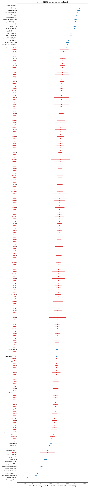

# Ladder

17030 rows of progress/games.csv (12618 local games, 4412 replica matches), rated by a batch Bradley-Terry fit on the Elo scale (`tools/elolib.py`). A local game counts its cell score (`tools/score.py`: a win or loss when kings decide the game, the points share when points do), a replica match its games won. A game between one of our builds and a field bot also fits how hard its map is for us (table at the end), so builds gauntleted on different maps compare on an average map. Each pair of players counts at most 200 games, every player carries one virtual win and loss against a fixed anchor, and ratings are relative to a mean of 1500 over all 269 players. Each of our builds is its own player. Regenerate with `tools/elo.py`; do not edit.

Games against field bots are replica scrimmages only; local games are our builds against each other and the stock players. Record = games won and lost.

Our builds, in attempt order (rating +- 95%; field score = expected score against each of the 51 field players, one game each):

| build | rating | rank | games | record | field score |
|---|---|---|---|---|---|
| s0e | 1184 +- 146 | 251 of 269 | 33 | 15-18 | 30.7% |
| s0m | 1278 +- 69 | 247 of 269 | 148 | 98-50 | 36.0% |
| s0u | 1293 +- 126 | 245 of 269 | 37 | 13-24 | 36.9% |
| v0d | 1584 +- 128 | 50 of 269 | 37 | 27-10 | 52.9% |
| s2o | 1396 +- 13 | 230 of 269 | 2868 | 1214-1654 | 42.6% |
| s3e | 1362 +- 76 | 240 of 269 | 80 | 29-51 | 40.7% |
| s3f | 1420 +- 75 | 213 of 269 | 80 | 46-34 | 43.9% |
| s3g | 1362 +- 76 | 241 of 269 | 80 | 30-50 | 40.7% |
| s2o_id | 1398 +- 75 | 229 of 269 | 80 | 40-40 | 42.7% |
| s3h | 1382 +- 55 | 232 of 269 | 188 | 100-88 | 41.9% |
| s3i | 1371 +- 76 | 238 of 269 | 80 | 27-53 | 41.2% |
| s3k | 1372 +- 75 | 236 of 269 | 80 | 29-51 | 41.3% |
| s3l | 1367 +- 76 | 239 of 269 | 80 | 27-53 | 41.0% |
| s3m | 1372 +- 75 | 237 of 269 | 80 | 30-50 | 41.3% |
| s3n | 1373 +- 75 | 235 of 269 | 80 | 29-51 | 41.3% |
| s3o | 1418 +- 75 | 214 of 269 | 80 | 50-30 | 43.8% |
| s3p | 1400 +- 75 | 228 of 269 | 80 | 43-37 | 42.8% |
| s3q | 1375 +- 75 | 233 of 269 | 80 | 35-45 | 41.5% |
| s3r | 1404 +- 75 | 226 of 269 | 80 | 46-34 | 43.1% |
| s3s | 1404 +- 75 | 227 of 269 | 80 | 46-34 | 43.1% |
| s3t | 1415 +- 75 | 220 of 269 | 80 | 49-31 | 43.7% |
| s3u | 1429 +- 76 | 209 of 269 | 80 | 53-27 | 44.4% |
| s3v | 1411 +- 75 | 223 of 269 | 80 | 54-26 | 43.4% |
| s3w | 1404 +- 75 | 225 of 269 | 80 | 52-28 | 43.1% |
| s3x | 1387 +- 75 | 231 of 269 | 80 | 48-32 | 42.1% |
| s3y | 1485 +- 54 | 166 of 269 | 235 | 134-101 | 47.5% |
| s3z | 1412 +- 75 | 222 of 269 | 80 | 50-30 | 43.5% |
| s4a | 1412 +- 75 | 221 of 269 | 80 | 50-30 | 43.5% |
| s4b | 1456 +- 53 | 188 of 269 | 172 | 117-55 | 45.9% |
| s4c | 1429 +- 76 | 210 of 269 | 80 | 53-27 | 44.4% |
| s4d | 1464 +- 34 | 184 of 269 | 462 | 287-175 | 46.3% |
| arush | 1375 +- 61 | 234 of 269 | 144 | 41-103 | 41.4% |
| s4e | 1452 +- 76 | 190 of 269 | 80 | 61-19 | 45.7% |
| s4f | 1451 +- 54 | 191 of 269 | 160 | 110-50 | 45.6% |
| abrk | 1417 +- 23 | 216 of 269 | 929 | 314-615 | 43.7% |
| s4g | 1481 +- 76 | 169 of 269 | 80 | 51-29 | 47.2% |
| s4h | 1458 +- 76 | 185 of 269 | 80 | 52-28 | 46.0% |
| s4i | 1475 +- 64 | 172 of 269 | 134 | 86-48 | 46.9% |
| s4j | 1491 +- 66 | 160 of 269 | 131 | 87-44 | 47.8% |
| s4m | 1504 +- 119 | 145 of 269 | 33 | 22-11 | 48.5% |
| s4n | 1457 +- 76 | 186 of 269 | 80 | 52-28 | 46.0% |
| s4q | 1435 +- 76 | 205 of 269 | 80 | 61-19 | 44.7% |
| s4r | 1435 +- 76 | 206 of 269 | 80 | 61-19 | 44.7% |
| s4t | 1422 +- 67 | 212 of 269 | 122 | 74-48 | 44.0% |
| s5c | 1449 +- 76 | 194 of 269 | 80 | 58-22 | 45.5% |
| s5e | 1409 +- 106 | 224 of 269 | 60 | 31-29 | 43.3% |
| s5g | 1439 +- 62 | 203 of 269 | 140 | 80-60 | 45.0% |
| s5j | 1491 +- 95 | 159 of 269 | 52 | 36-16 | 47.8% |
| araid | 1441 +- 9 | 200 of 269 | 6743 | 2109-4634 | 45.1% |
| s5o | 1446 +- 75 | 196 of 269 | 80 | 41-39 | 45.4% |
| s5r | 1439 +- 49 | 204 of 269 | 202 | 121-81 | 45.0% |
| s5s | 1495 +- 76 | 153 of 269 | 80 | 56-24 | 48.0% |
| s5t | 1442 +- 73 | 198 of 269 | 86 | 42-44 | 45.1% |
| atrap | 1171 +- 212 | 253 of 269 | 22 | 1-21 | 30.0% |
| s5w | 1590 +- 93 | 43 of 269 | 72 | 45-27 | 53.2% |
| s5x | 1433 +- 90 | 207 of 269 | 55 | 30-25 | 44.7% |
| s5y | 1481 +- 76 | 167 of 269 | 80 | 53-27 | 47.3% |
| s6c | 1280 +- 394 | 246 of 269 | 2 | 0-2 | 36.2% |
| s6e | 1456 +- 75 | 187 of 269 | 80 | 51-29 | 45.9% |
| s6f | 1449 +- 75 | 192 of 269 | 80 | 41-39 | 45.5% |
| s6g | 1467 +- 75 | 182 of 269 | 80 | 41-39 | 46.5% |
| s6j | 1474 +- 122 | 173 of 269 | 42 | 18-24 | 46.9% |
| s6m | 1445 +- 51 | 197 of 269 | 219 | 98-121 | 45.3% |
| s6o | 1416 +- 75 | 217 of 269 | 80 | 39-41 | 43.7% |
| s6p | 1476 +- 76 | 171 of 269 | 80 | 47-33 | 46.9% |
| s6s | 1426 +- 75 | 211 of 269 | 80 | 40-40 | 44.2% |
| s6v | 1469 +- 75 | 180 of 269 | 80 | 47-33 | 46.6% |
| s6y | 1508 +- 77 | 139 of 269 | 80 | 53-27 | 48.7% |
| s6z | 1507 +- 77 | 142 of 269 | 80 | 52-28 | 48.6% |
| s7d | 1498 +- 26 | 150 of 269 | 744 | 373-393 | 48.1% |
| s7f | 1473 +- 279 | 178 of 269 | 4 | 2-2 | 46.8% |
| s7h | 1541 +- 59 | 93 of 269 | 150 | 94-56 | 50.5% |
| s7i | 1536 +- 77 | 102 of 269 | 84 | 63-29 | 50.2% |
| s7j | 1480 +- 72 | 170 of 269 | 89 | 56-33 | 47.2% |
| s7k | 1492 +- 207 | 158 of 269 | 9 | 7-2 | 47.8% |
| s7l | 1415 +- 217 | 218 of 269 | 8 | 4-4 | 43.7% |
| s7m | 1497 +- 182 | 152 of 269 | 12 | 6-6 | 48.1% |
| s7n | 1493 +- 182 | 155 of 269 | 12 | 6-6 | 47.9% |
| s7o | 1494 +- 182 | 154 of 269 | 12 | 5-7 | 47.9% |
| s7p | 1530 +- 183 | 110 of 269 | 12 | 8-4 | 49.9% |
| s7q | 1541 +- 56 | 94 of 269 | 180 | 112-68 | 50.5% |
| s7r | 1534 +- 211 | 107 of 269 | 9 | 6-3 | 50.1% |
| s7t | 1514 +- 77 | 128 of 269 | 80 | 51-29 | 49.0% |
| s7u | 1527 +- 67 | 113 of 269 | 108 | 70-38 | 49.7% |
| s7v | 1498 +- 182 | 151 of 269 | 12 | 5-7 | 48.1% |
| s7w | 1498 +- 104 | 149 of 269 | 54 | 25-29 | 48.2% |
| s7x | 1582 +- 231 | 53 of 269 | 8 | 7-1 | 52.7% |
| s7y | 1578 +- 230 | 57 of 269 | 8 | 6-2 | 52.5% |
| s7z | 1538 +- 70 | 100 of 269 | 100 | 62-38 | 50.4% |
| s8a | 1545 +- 68 | 86 of 269 | 118 | 75-43 | 50.7% |
| s8b | 1493 +- 76 | 156 of 269 | 80 | 50-30 | 47.9% |
| s8c | 1509 +- 109 | 137 of 269 | 52 | 27-25 | 48.8% |
| s8d | 1524 +- 167 | 117 of 269 | 16 | 10-6 | 49.6% |
| s8e | 1520 +- 73 | 125 of 269 | 88 | 60-28 | 49.3% |
| s8f | 1490 +- 215 | 161 of 269 | 8 | 4-4 | 47.7% |
| s8h | 1455 +- 72 | 189 of 269 | 88 | 51-37 | 45.8% |
| atrap2 | 1487 +- 90 | 164 of 269 | 56 | 23-33 | 47.6% |
| s8i | 1468 +- 72 | 181 of 269 | 88 | 54-34 | 46.5% |
| s8j | 1512 +- 56 | 130 of 269 | 176 | 105-71 | 48.9% |
| s8k | 1532 +- 65 | 108 of 269 | 126 | 78-48 | 50.0% |
| s8l | 1520 +- 75 | 124 of 269 | 84 | 62-22 | 49.4% |
| s8m | 1545 +- 280 | 88 of 269 | 4 | 3-1 | 50.7% |
| s8n | 1525 +- 66 | 116 of 269 | 112 | 76-36 | 49.6% |
| s8o | 1543 +- 55 | 91 of 269 | 174 | 110-64 | 50.6% |
| s8p | 1538 +- 72 | 101 of 269 | 96 | 68-28 | 50.3% |
| s8q | 1487 +- 70 | 163 of 269 | 96 | 61-35 | 47.6% |
| s8r | 1492 +- 76 | 157 of 269 | 80 | 58-22 | 47.8% |
| s8s | 1528 +- 78 | 112 of 269 | 80 | 57-23 | 49.8% |
| s8t | 1498 +- 64 | 148 of 269 | 126 | 74-52 | 48.2% |
| s8u | 1509 +- 58 | 138 of 269 | 154 | 88-66 | 48.7% |
| s8v | 1513 +- 65 | 129 of 269 | 112 | 67-45 | 49.0% |
| s8w | 1467 +- 49 | 183 of 269 | 198 | 77-121 | 46.5% |
| s8x | 1471 +- 65 | 179 of 269 | 122 | 66-56 | 46.7% |
| s8y | 1539 +- 68 | 98 of 269 | 104 | 69-35 | 50.4% |
| s8z | 1505 +- 93 | 144 of 269 | 53 | 31-22 | 48.5% |
| s9a | 1545 +- 54 | 84 of 269 | 194 | 121-73 | 50.7% |
| s9b | 1511 +- 59 | 133 of 269 | 146 | 85-61 | 48.8% |
| s9c | 1510 +- 145 | 135 of 269 | 20 | 10-10 | 48.8% |
| s9d | 1559 +- 141 | 72 of 269 | 22 | 15-7 | 51.5% |
| s9e | 1545 +- 147 | 85 of 269 | 20 | 12-8 | 50.7% |
| s9g | 1510 +- 77 | 134 of 269 | 80 | 53-27 | 48.8% |
| s9h | 1521 +- 77 | 123 of 269 | 80 | 53-27 | 49.4% |
| s9i | 1488 +- 61 | 162 of 269 | 137 | 71-66 | 47.6% |
| s9k | 1502 +- 56 | 147 of 269 | 162 | 92-80 | 48.4% |
| s9l | 1517 +- 145 | 127 of 269 | 20 | 10-10 | 49.2% |
| s9m | 1502 +- 76 | 146 of 269 | 80 | 54-26 | 48.4% |
| s9n | 1418 +- 207 | 215 of 269 | 9 | 3-6 | 43.8% |
| agrab | 1538 +- 67 | 99 of 269 | 103 | 58-45 | 50.4% |
| s9o | 1508 +- 176 | 140 of 269 | 13 | 6-7 | 48.7% |
| s9q | 1603 +- 200 | 40 of 269 | 12 | 10-2 | 53.9% |
| s9r | 1523 +- 65 | 118 of 269 | 128 | 84-44 | 49.5% |
| agrw | 1441 +- 147 | 201 of 269 | 20 | 6-14 | 45.0% |
| agtr | 1571 +- 148 | 61 of 269 | 20 | 14-6 | 52.2% |
| s9s | 1574 +- 23 | 58 of 269 | 921 | 482-455 | 52.3% |
| agaim | 1534 +- 81 | 106 of 269 | 70 | 34-36 | 50.1% |
| agcap | 1474 +- 146 | 176 of 269 | 20 | 8-12 | 46.8% |
| s9t | 1511 +- 70 | 131 of 269 | 96 | 60-36 | 48.9% |
| s9u | 1548 +- 72 | 81 of 269 | 96 | 69-27 | 50.9% |
| s9v | 1540 +- 78 | 95 of 269 | 80 | 58-22 | 50.4% |
| s9w | 1539 +- 78 | 97 of 269 | 80 | 60-20 | 50.4% |
| s9x | 1511 +- 70 | 132 of 269 | 96 | 59-37 | 48.9% |
| s9y | 1548 +- 72 | 82 of 269 | 96 | 69-27 | 50.9% |
| s9z | 1590 +- 63 | 44 of 269 | 145 | 104-41 | 53.2% |
| t0a | 1429 +- 123 | 208 of 269 | 42 | 16-26 | 44.4% |
| t0b | 1506 +- 88 | 143 of 269 | 59 | 37-22 | 48.6% |
| t0c | 1583 +- 71 | 51 of 269 | 112 | 70-42 | 52.8% |
| t0d | 1545 +- 100 | 87 of 269 | 48 | 32-16 | 50.7% |
| t0e | 1523 +- 77 | 119 of 269 | 80 | 58-22 | 49.5% |
| t0f | 1637 +- 111 | 27 of 269 | 54 | 34-20 | 55.8% |
| t0g | 1562 +- 62 | 69 of 269 | 142 | 94-48 | 51.6% |
| t0h | 1570 +- 73 | 62 of 269 | 103 | 67-36 | 52.1% |
| t0i | 1549 +- 62 | 79 of 269 | 138 | 89-49 | 50.9% |
| t0j | 1539 +- 78 | 96 of 269 | 80 | 58-22 | 50.4% |
| t0k | 1563 +- 161 | 67 of 269 | 16 | 10-6 | 51.7% |
| t0l | 1582 +- 81 | 52 of 269 | 80 | 62-18 | 52.8% |
| t0m | 1572 +- 161 | 60 of 269 | 16 | 9-7 | 52.2% |
| t0n | 1567 +- 72 | 63 of 269 | 96 | 73-23 | 51.9% |
| t0o | 1608 +- 73 | 37 of 269 | 110 | 76-34 | 54.2% |
| t0p | 1619 +- 65 | 32 of 269 | 144 | 104-40 | 54.8% |
| t0r | 1550 +- 76 | 78 of 269 | 86 | 73-29 | 51.0% |
| t0s | 1507 +- 163 | 141 of 269 | 16 | 7-9 | 48.6% |
| t0t | 1588 +- 74 | 46 of 269 | 96 | 75-21 | 53.1% |
| t0u | 1624 +- 163 | 29 of 269 | 16 | 9-7 | 55.1% |
| t0v | 1578 +- 70 | 56 of 269 | 103 | 77-26 | 52.5% |
| t0w | 1449 +- 353 | 193 of 269 | 2 | 1-1 | 45.5% |
| t0x | 1601 +- 244 | 41 of 269 | 6 | 3-3 | 53.8% |
| t0y | 1474 +- 248 | 177 of 269 | 6 | 2-4 | 46.8% |
| u0a | 1558 +- 72 | 73 of 269 | 96 | 67-29 | 51.4% |
| u0b | 1587 +- 106 | 47 of 269 | 44 | 31-13 | 53.0% |
| u0c | 1527 +- 162 | 114 of 269 | 16 | 5-11 | 49.7% |
| u0d | 1606 +- 162 | 38 of 269 | 16 | 11-5 | 54.1% |
| u0e | 1588 +- 109 | 45 of 269 | 51 | 28-23 | 53.1% |
| u0f | 1474 +- 122 | 174 of 269 | 42 | 18-24 | 46.9% |
| u0g | 1609 +- 184 | 36 of 269 | 12 | 8-4 | 54.3% |
| u0h | 1528 +- 162 | 111 of 269 | 16 | 6-10 | 49.8% |
| u0i | 1606 +- 162 | 39 of 269 | 16 | 11-5 | 54.1% |
| u0j | 1486 +- 165 | 165 of 269 | 16 | 7-9 | 47.5% |
| u0k | 1522 +- 399 | 121 of 269 | 1 | 1-0 | 49.5% |
| u0l | 1522 +- 399 | 122 of 269 | 1 | 1-0 | 49.5% |
| u0m | 1586 +- 36 | 48 of 269 | 418 | 261-157 | 53.0% |
| u0n | 1545 +- 146 | 89 of 269 | 20 | 9-11 | 50.7% |
| u0o | 1474 +- 122 | 175 of 269 | 42 | 18-24 | 46.9% |
| u0q | 1544 +- 42 | 90 of 269 | 277 | 151-126 | 50.7% |
| u0r | 1559 +- 161 | 71 of 269 | 16 | 8-8 | 51.5% |
| u0s | 1564 +- 161 | 65 of 269 | 16 | 8-8 | 51.8% |
| u0t | 1518 +- 147 | 126 of 269 | 20 | 11-9 | 49.2% |
| u0u | 1573 +- 143 | 59 of 269 | 21 | 10-11 | 52.3% |
| u0v | 1658 +- 131 | 26 of 269 | 31 | 26-5 | 57.1% |
| u0w | 1584 +- 74 | 49 of 269 | 96 | 74-22 | 52.9% |
| u0x | 1610 +- 76 | 35 of 269 | 96 | 80-16 | 54.3% |
| u0y | 1562 +- 86 | 68 of 269 | 78 | 46-32 | 51.7% |
| u0z | 1624 +- 119 | 30 of 269 | 45 | 26-19 | 55.1% |
| u1a | 1542 +- 102 | 92 of 269 | 58 | 28-30 | 50.5% |
| u1b | 1525 +- 145 | 115 of 269 | 20 | 8-12 | 49.6% |
| u1e | 1531 +- 145 | 109 of 269 | 20 | 8-12 | 49.9% |
| u1f | 1729 +- 161 | 24 of 269 | 32 | 31-1 | 61.3% |
| u1g | 1556 +- 176 | 74 of 269 | 13 | 6-7 | 51.3% |
| u1h | 1598 +- 116 | 42 of 269 | 36 | 23-13 | 53.6% |
| u1i | 1612 +- 353 | 34 of 269 | 2 | 2-0 | 54.4% |
| u1j | 1510 +- 112 | 136 of 269 | 36 | 19-17 | 48.8% |
| u1k | 1548 +- 113 | 80 of 269 | 36 | 23-13 | 50.9% |
| u1l | 1535 +- 145 | 104 of 269 | 20 | 8-12 | 50.2% |
| u1m | 1535 +- 145 | 105 of 269 | 20 | 10-10 | 50.2% |
| u1n | 1481 +- 147 | 168 of 269 | 20 | 6-14 | 47.2% |
| u1o | 1564 +- 123 | 66 of 269 | 42 | 22-20 | 51.7% |
| u1p | 1555 +- 95 | 75 of 269 | 62 | 32-30 | 51.2% |
| u1q | 1560 +- 181 | 70 of 269 | 16 | 14-2 | 51.6% |
| u1r | 1580 +- 65 | 54 of 269 | 134 | 93-41 | 52.7% |
| u1s | 1552 +- 79 | 77 of 269 | 80 | 59-21 | 51.1% |
| u1t | 1554 +- 79 | 76 of 269 | 80 | 62-18 | 51.2% |
| u1u | 1579 +- 81 | 55 of 269 | 80 | 62-18 | 52.6% |
| u1v | 1566 +- 68 | 64 of 269 | 122 | 87-35 | 51.9% |
| u1w | 1522 +- 139 | 120 of 269 | 22 | 10-12 | 49.5% |
| u1x | 1619 +- 79 | 31 of 269 | 84 | 63-21 | 54.8% |
| u1y | 1546 +- 242 | 83 of 269 | 6 | 4-2 | 50.7% |
| u1z | 1614 +- 283 | 33 of 269 | 4 | 2-2 | 54.6% |
| pb2 | 1535 +- 347 | 103 of 269 | 2 | 8-8 | 50.2% |
| ratbot | 1314 +- 70 | 244 of 269 | 154 | 107-47 | 38.0% |

All players:

| # | player | rating | games | record | field score |
|---:|---|---|---|---|---|
| 1 | IvanGeffner_basic51 | 2219 +- 38 | 387 | 271-116 | 91.3% |
| 2 | uravt_Version41 | 2122 +- 37 | 378 | 214-164 | 86.7% |
| 3 | uravt_Version35 | 2116 +- 36 | 393 | 215-178 | 86.4% |
| 4 | awu7_awubot_us | 2090 +- 37 | 384 | 211-173 | 84.9% |
| 5 | nzjt_TheComplexMerlin | 2046 +- 38 | 360 | 204-156 | 82.3% |
| 6 | abcdezyxwv_bestsofar | 2044 +- 33 | 786 | 586-200 | 82.2% |
| 7 | thewaxmango_PhD | 2025 +- 37 | 378 | 209-169 | 81.0% |
| 8 | nubbbbbb_testplayer | 2011 +- 39 | 333 | 186-147 | 80.1% |
| 9 | battlecode-archive_testplayer | 1997 +- 34 | 444 | 241-203 | 79.3% |
| 10 | quesswho_bot16 | 1994 +- 36 | 396 | 207-189 | 79.0% |
| 11 | daannte_v52_ThisGuy | 1983 +- 35 | 408 | 216-192 | 78.3% |
| 12 | awu7_awubot_quals | 1981 +- 39 | 342 | 191-151 | 78.2% |
| 13 | quesswho_quals | 1972 +- 36 | 381 | 203-178 | 77.6% |
| 14 | TeamSPAARK_SPAARK | 1966 +- 37 | 372 | 200-172 | 77.2% |
| 15 | daannte_v47_Skadoosh | 1937 +- 35 | 432 | 227-205 | 75.3% |
| 16 | bman12345678_goonv23 | 1870 +- 39 | 375 | 204-171 | 70.7% |
| 17 | AlexT101_finalsbot | 1861 +- 36 | 408 | 213-195 | 70.1% |
| 18 | AlexT101_usqualsbot | 1858 +- 27 | 828 | 566-262 | 69.9% |
| 19 | AdamTan12_Icarus | 1804 +- 35 | 450 | 236-214 | 66.3% |
| 20 | thewaxmango_collegejunior | 1802 +- 38 | 384 | 205-179 | 66.2% |
| 21 | AdamTan12_Finals | 1785 +- 27 | 750 | 450-300 | 65.1% |
| 22 | HugoIngelsson_YokoOno | 1756 +- 39 | 375 | 198-177 | 63.3% |
| 23 | VarunVejalla_final4_run_away10 | 1755 +- 41 | 348 | 185-163 | 63.2% |
| 24 | us:u1f | 1729 +- 161 | 32 | 31-1 | 61.3% |
| 25 | HugoIngelsson_Xzibit | 1723 +- 40 | 372 | 198-174 | 61.2% |
| 26 | us:u0v | 1658 +- 131 | 31 | 26-5 | 57.1% |
| 27 | us:t0f | 1637 +- 111 | 54 | 34-20 | 55.8% |
| 28 | spsquared_TSPAARK_QUALS | 1628 +- 28 | 702 | 359-343 | 55.5% |
| 29 | us:t0u | 1624 +- 163 | 16 | 9-7 | 55.1% |
| 30 | us:u0z | 1624 +- 119 | 45 | 26-19 | 55.1% |
| 31 | us:u1x | 1619 +- 79 | 84 | 63-21 | 54.8% |
| 32 | us:t0p | 1619 +- 65 | 144 | 104-40 | 54.8% |
| 33 | us:u1z | 1614 +- 283 | 4 | 2-2 | 54.6% |
| 34 | us:u1i | 1612 +- 353 | 2 | 2-0 | 54.4% |
| 35 | us:u0x | 1610 +- 76 | 96 | 80-16 | 54.3% |
| 36 | us:u0g | 1609 +- 184 | 12 | 8-4 | 54.3% |
| 37 | us:t0o | 1608 +- 73 | 110 | 76-34 | 54.2% |
| 38 | us:u0d | 1606 +- 162 | 16 | 11-5 | 54.1% |
| 39 | us:u0i | 1606 +- 162 | 16 | 11-5 | 54.1% |
| 40 | us:s9q | 1603 +- 200 | 12 | 10-2 | 53.9% |
| 41 | us:t0x | 1601 +- 244 | 6 | 3-3 | 53.8% |
| 42 | us:u1h | 1598 +- 116 | 36 | 23-13 | 53.6% |
| 43 | us:s5w | 1590 +- 93 | 72 | 45-27 | 53.2% |
| 44 | us:s9z | 1590 +- 63 | 145 | 104-41 | 53.2% |
| 45 | us:u0e | 1588 +- 109 | 51 | 28-23 | 53.1% |
| 46 | us:t0t | 1588 +- 74 | 96 | 75-21 | 53.1% |
| 47 | us:u0b | 1587 +- 106 | 44 | 31-13 | 53.0% |
| 48 | us:u0m | 1586 +- 36 | 418 | 261-157 | 53.0% |
| 49 | us:u0w | 1584 +- 74 | 96 | 74-22 | 52.9% |
| 50 | us:v0d | 1584 +- 128 | 37 | 27-10 | 52.9% |
| 51 | us:t0c | 1583 +- 71 | 112 | 70-42 | 52.8% |
| 52 | us:t0l | 1582 +- 81 | 80 | 62-18 | 52.8% |
| 53 | us:s7x | 1582 +- 231 | 8 | 7-1 | 52.7% |
| 54 | us:u1r | 1580 +- 65 | 134 | 93-41 | 52.7% |
| 55 | us:u1u | 1579 +- 81 | 80 | 62-18 | 52.6% |
| 56 | us:t0v | 1578 +- 70 | 103 | 77-26 | 52.5% |
| 57 | us:s7y | 1578 +- 230 | 8 | 6-2 | 52.5% |
| 58 | us:s9s | 1574 +- 23 | 921 | 482-455 | 52.3% |
| 59 | us:u0u | 1573 +- 143 | 21 | 10-11 | 52.3% |
| 60 | us:t0m | 1572 +- 161 | 16 | 9-7 | 52.2% |
| 61 | us:agtr | 1571 +- 148 | 20 | 14-6 | 52.2% |
| 62 | us:t0h | 1570 +- 73 | 103 | 67-36 | 52.1% |
| 63 | us:t0n | 1567 +- 72 | 96 | 73-23 | 51.9% |
| 64 | us:u1v | 1566 +- 68 | 122 | 87-35 | 51.9% |
| 65 | us:u0s | 1564 +- 161 | 16 | 8-8 | 51.8% |
| 66 | us:u1o | 1564 +- 123 | 42 | 22-20 | 51.7% |
| 67 | us:t0k | 1563 +- 161 | 16 | 10-6 | 51.7% |
| 68 | us:u0y | 1562 +- 86 | 78 | 46-32 | 51.7% |
| 69 | us:t0g | 1562 +- 62 | 142 | 94-48 | 51.6% |
| 70 | us:u1q | 1560 +- 181 | 16 | 14-2 | 51.6% |
| 71 | us:u0r | 1559 +- 161 | 16 | 8-8 | 51.5% |
| 72 | us:s9d | 1559 +- 141 | 22 | 15-7 | 51.5% |
| 73 | us:u0a | 1558 +- 72 | 96 | 67-29 | 51.4% |
| 74 | us:u1g | 1556 +- 176 | 13 | 6-7 | 51.3% |
| 75 | us:u1p | 1555 +- 95 | 62 | 32-30 | 51.2% |
| 76 | us:u1t | 1554 +- 79 | 80 | 62-18 | 51.2% |
| 77 | us:u1s | 1552 +- 79 | 80 | 59-21 | 51.1% |
| 78 | us:t0r | 1550 +- 76 | 86 | 73-29 | 51.0% |
| 79 | us:t0i | 1549 +- 62 | 138 | 89-49 | 50.9% |
| 80 | us:u1k | 1548 +- 113 | 36 | 23-13 | 50.9% |
| 81 | us:s9u | 1548 +- 72 | 96 | 69-27 | 50.9% |
| 82 | us:s9y | 1548 +- 72 | 96 | 69-27 | 50.9% |
| 83 | us:u1y | 1546 +- 242 | 6 | 4-2 | 50.7% |
| 84 | us:s9a | 1545 +- 54 | 194 | 121-73 | 50.7% |
| 85 | us:s9e | 1545 +- 147 | 20 | 12-8 | 50.7% |
| 86 | us:s8a | 1545 +- 68 | 118 | 75-43 | 50.7% |
| 87 | us:t0d | 1545 +- 100 | 48 | 32-16 | 50.7% |
| 88 | us:s8m | 1545 +- 280 | 4 | 3-1 | 50.7% |
| 89 | us:u0n | 1545 +- 146 | 20 | 9-11 | 50.7% |
| 90 | us:u0q | 1544 +- 42 | 277 | 151-126 | 50.7% |
| 91 | us:s8o | 1543 +- 55 | 174 | 110-64 | 50.6% |
| 92 | us:u1a | 1542 +- 102 | 58 | 28-30 | 50.5% |
| 93 | us:s7h | 1541 +- 59 | 150 | 94-56 | 50.5% |
| 94 | us:s7q | 1541 +- 56 | 180 | 112-68 | 50.5% |
| 95 | us:s9v | 1540 +- 78 | 80 | 58-22 | 50.4% |
| 96 | us:t0j | 1539 +- 78 | 80 | 58-22 | 50.4% |
| 97 | us:s9w | 1539 +- 78 | 80 | 60-20 | 50.4% |
| 98 | us:s8y | 1539 +- 68 | 104 | 69-35 | 50.4% |
| 99 | us:agrab | 1538 +- 67 | 103 | 58-45 | 50.4% |
| 100 | us:s7z | 1538 +- 70 | 100 | 62-38 | 50.4% |
| 101 | us:s8p | 1538 +- 72 | 96 | 68-28 | 50.3% |
| 102 | us:s7i | 1536 +- 77 | 84 | 63-29 | 50.2% |
| 103 | us:pb2 | 1535 +- 347 | 2 | 8-8 | 50.2% |
| 104 | us:u1l | 1535 +- 145 | 20 | 8-12 | 50.2% |
| 105 | us:u1m | 1535 +- 145 | 20 | 10-10 | 50.2% |
| 106 | us:agaim | 1534 +- 81 | 70 | 34-36 | 50.1% |
| 107 | us:s7r | 1534 +- 211 | 9 | 6-3 | 50.1% |
| 108 | us:s8k | 1532 +- 65 | 126 | 78-48 | 50.0% |
| 109 | us:u1e | 1531 +- 145 | 20 | 8-12 | 49.9% |
| 110 | us:s7p | 1530 +- 183 | 12 | 8-4 | 49.9% |
| 111 | us:u0h | 1528 +- 162 | 16 | 6-10 | 49.8% |
| 112 | us:s8s | 1528 +- 78 | 80 | 57-23 | 49.8% |
| 113 | us:s7u | 1527 +- 67 | 108 | 70-38 | 49.7% |
| 114 | us:u0c | 1527 +- 162 | 16 | 5-11 | 49.7% |
| 115 | us:u1b | 1525 +- 145 | 20 | 8-12 | 49.6% |
| 116 | us:s8n | 1525 +- 66 | 112 | 76-36 | 49.6% |
| 117 | us:s8d | 1524 +- 167 | 16 | 10-6 | 49.6% |
| 118 | us:s9r | 1523 +- 65 | 128 | 84-44 | 49.5% |
| 119 | us:t0e | 1523 +- 77 | 80 | 58-22 | 49.5% |
| 120 | us:u1w | 1522 +- 139 | 22 | 10-12 | 49.5% |
| 121 | us:u0k | 1522 +- 399 | 1 | 1-0 | 49.5% |
| 122 | us:u0l | 1522 +- 399 | 1 | 1-0 | 49.5% |
| 123 | us:s9h | 1521 +- 77 | 80 | 53-27 | 49.4% |
| 124 | us:s8l | 1520 +- 75 | 84 | 62-22 | 49.4% |
| 125 | us:s8e | 1520 +- 73 | 88 | 60-28 | 49.3% |
| 126 | us:u0t | 1518 +- 147 | 20 | 11-9 | 49.2% |
| 127 | us:s9l | 1517 +- 145 | 20 | 10-10 | 49.2% |
| 128 | us:s7t | 1514 +- 77 | 80 | 51-29 | 49.0% |
| 129 | us:s8v | 1513 +- 65 | 112 | 67-45 | 49.0% |
| 130 | us:s8j | 1512 +- 56 | 176 | 105-71 | 48.9% |
| 131 | us:s9t | 1511 +- 70 | 96 | 60-36 | 48.9% |
| 132 | us:s9x | 1511 +- 70 | 96 | 59-37 | 48.9% |
| 133 | us:s9b | 1511 +- 59 | 146 | 85-61 | 48.8% |
| 134 | us:s9g | 1510 +- 77 | 80 | 53-27 | 48.8% |
| 135 | us:s9c | 1510 +- 145 | 20 | 10-10 | 48.8% |
| 136 | us:u1j | 1510 +- 112 | 36 | 19-17 | 48.8% |
| 137 | us:s8c | 1509 +- 109 | 52 | 27-25 | 48.8% |
| 138 | us:s8u | 1509 +- 58 | 154 | 88-66 | 48.7% |
| 139 | us:s6y | 1508 +- 77 | 80 | 53-27 | 48.7% |
| 140 | us:s9o | 1508 +- 176 | 13 | 6-7 | 48.7% |
| 141 | us:t0s | 1507 +- 163 | 16 | 7-9 | 48.6% |
| 142 | us:s6z | 1507 +- 77 | 80 | 52-28 | 48.6% |
| 143 | us:t0b | 1506 +- 88 | 59 | 37-22 | 48.6% |
| 144 | us:s8z | 1505 +- 93 | 53 | 31-22 | 48.5% |
| 145 | us:s4m | 1504 +- 119 | 33 | 22-11 | 48.5% |
| 146 | us:s9m | 1502 +- 76 | 80 | 54-26 | 48.4% |
| 147 | us:s9k | 1502 +- 56 | 162 | 92-80 | 48.4% |
| 148 | us:s8t | 1498 +- 64 | 126 | 74-52 | 48.2% |
| 149 | us:s7w | 1498 +- 104 | 54 | 25-29 | 48.2% |
| 150 | us:s7d | 1498 +- 26 | 744 | 373-393 | 48.1% |
| 151 | us:s7v | 1498 +- 182 | 12 | 5-7 | 48.1% |
| 152 | us:s7m | 1497 +- 182 | 12 | 6-6 | 48.1% |
| 153 | us:s5s | 1495 +- 76 | 80 | 56-24 | 48.0% |
| 154 | us:s7o | 1494 +- 182 | 12 | 5-7 | 47.9% |
| 155 | us:s7n | 1493 +- 182 | 12 | 6-6 | 47.9% |
| 156 | us:s8b | 1493 +- 76 | 80 | 50-30 | 47.9% |
| 157 | us:s8r | 1492 +- 76 | 80 | 58-22 | 47.8% |
| 158 | us:s7k | 1492 +- 207 | 9 | 7-2 | 47.8% |
| 159 | us:s5j | 1491 +- 95 | 52 | 36-16 | 47.8% |
| 160 | us:s4j | 1491 +- 66 | 131 | 87-44 | 47.8% |
| 161 | us:s8f | 1490 +- 215 | 8 | 4-4 | 47.7% |
| 162 | us:s9i | 1488 +- 61 | 137 | 71-66 | 47.6% |
| 163 | us:s8q | 1487 +- 70 | 96 | 61-35 | 47.6% |
| 164 | us:atrap2 | 1487 +- 90 | 56 | 23-33 | 47.6% |
| 165 | us:u0j | 1486 +- 165 | 16 | 7-9 | 47.5% |
| 166 | us:s3y | 1485 +- 54 | 235 | 134-101 | 47.5% |
| 167 | us:s5y | 1481 +- 76 | 80 | 53-27 | 47.3% |
| 168 | us:u1n | 1481 +- 147 | 20 | 6-14 | 47.2% |
| 169 | us:s4g | 1481 +- 76 | 80 | 51-29 | 47.2% |
| 170 | us:s7j | 1480 +- 72 | 89 | 56-33 | 47.2% |
| 171 | us:s6p | 1476 +- 76 | 80 | 47-33 | 46.9% |
| 172 | us:s4i | 1475 +- 64 | 134 | 86-48 | 46.9% |
| 173 | us:s6j | 1474 +- 122 | 42 | 18-24 | 46.9% |
| 174 | us:u0f | 1474 +- 122 | 42 | 18-24 | 46.9% |
| 175 | us:u0o | 1474 +- 122 | 42 | 18-24 | 46.9% |
| 176 | us:agcap | 1474 +- 146 | 20 | 8-12 | 46.8% |
| 177 | us:t0y | 1474 +- 248 | 6 | 2-4 | 46.8% |
| 178 | us:s7f | 1473 +- 279 | 4 | 2-2 | 46.8% |
| 179 | us:s8x | 1471 +- 65 | 122 | 66-56 | 46.7% |
| 180 | us:s6v | 1469 +- 75 | 80 | 47-33 | 46.6% |
| 181 | us:s8i | 1468 +- 72 | 88 | 54-34 | 46.5% |
| 182 | us:s6g | 1467 +- 75 | 80 | 41-39 | 46.5% |
| 183 | us:s8w | 1467 +- 49 | 198 | 77-121 | 46.5% |
| 184 | us:s4d | 1464 +- 34 | 462 | 287-175 | 46.3% |
| 185 | us:s4h | 1458 +- 76 | 80 | 52-28 | 46.0% |
| 186 | us:s4n | 1457 +- 76 | 80 | 52-28 | 46.0% |
| 187 | us:s6e | 1456 +- 75 | 80 | 51-29 | 45.9% |
| 188 | us:s4b | 1456 +- 53 | 172 | 117-55 | 45.9% |
| 189 | us:s8h | 1455 +- 72 | 88 | 51-37 | 45.8% |
| 190 | us:s4e | 1452 +- 76 | 80 | 61-19 | 45.7% |
| 191 | us:s4f | 1451 +- 54 | 160 | 110-50 | 45.6% |
| 192 | us:s6f | 1449 +- 75 | 80 | 41-39 | 45.5% |
| 193 | us:t0w | 1449 +- 353 | 2 | 1-1 | 45.5% |
| 194 | us:s5c | 1449 +- 76 | 80 | 58-22 | 45.5% |
| 195 | CS50Crab_rapierV1 | 1449 +- 26 | 837 | 339-498 | 45.4% |
| 196 | us:s5o | 1446 +- 75 | 80 | 41-39 | 45.4% |
| 197 | us:s6m | 1445 +- 51 | 219 | 98-121 | 45.3% |
| 198 | us:s5t | 1442 +- 73 | 86 | 42-44 | 45.1% |
| 199 | outercloudstudio_v_1_18 | 1441 +- 29 | 747 | 257-490 | 45.0% |
| 200 | us:araid | 1441 +- 9 | 6743 | 2109-4634 | 45.1% |
| 201 | us:agrw | 1441 +- 147 | 20 | 6-14 | 45.0% |
| 202 | amcsz_fighterrats | 1440 +- 40 | 372 | 180-192 | 44.9% |
| 203 | us:s5g | 1439 +- 62 | 140 | 80-60 | 45.0% |
| 204 | us:s5r | 1439 +- 49 | 202 | 121-81 | 45.0% |
| 205 | us:s4q | 1435 +- 76 | 80 | 61-19 | 44.7% |
| 206 | us:s4r | 1435 +- 76 | 80 | 61-19 | 44.7% |
| 207 | us:s5x | 1433 +- 90 | 55 | 30-25 | 44.7% |
| 208 | us:t0a | 1429 +- 123 | 42 | 16-26 | 44.4% |
| 209 | us:s3u | 1429 +- 76 | 80 | 53-27 | 44.4% |
| 210 | us:s4c | 1429 +- 76 | 80 | 53-27 | 44.4% |
| 211 | us:s6s | 1426 +- 75 | 80 | 40-40 | 44.2% |
| 212 | us:s4t | 1422 +- 67 | 122 | 74-48 | 44.0% |
| 213 | us:s3f | 1420 +- 75 | 80 | 46-34 | 43.9% |
| 214 | us:s3o | 1418 +- 75 | 80 | 50-30 | 43.8% |
| 215 | us:s9n | 1418 +- 207 | 9 | 3-6 | 43.8% |
| 216 | us:abrk | 1417 +- 23 | 929 | 314-615 | 43.7% |
| 217 | us:s6o | 1416 +- 75 | 80 | 39-41 | 43.7% |
| 218 | us:s7l | 1415 +- 217 | 8 | 4-4 | 43.7% |
| 219 | CS50Crab_protoSaberV7 | 1415 +- 38 | 408 | 202-206 | 43.5% |
| 220 | us:s3t | 1415 +- 75 | 80 | 49-31 | 43.7% |
| 221 | us:s4a | 1412 +- 75 | 80 | 50-30 | 43.5% |
| 222 | us:s3z | 1412 +- 75 | 80 | 50-30 | 43.5% |
| 223 | us:s3v | 1411 +- 75 | 80 | 54-26 | 43.4% |
| 224 | us:s5e | 1409 +- 106 | 60 | 31-29 | 43.3% |
| 225 | us:s3w | 1404 +- 75 | 80 | 52-28 | 43.1% |
| 226 | us:s3r | 1404 +- 75 | 80 | 46-34 | 43.1% |
| 227 | us:s3s | 1404 +- 75 | 80 | 46-34 | 43.1% |
| 228 | us:s3p | 1400 +- 75 | 80 | 43-37 | 42.8% |
| 229 | us:s2o_id | 1398 +- 75 | 80 | 40-40 | 42.7% |
| 230 | us:s2o | 1396 +- 13 | 2868 | 1214-1654 | 42.6% |
| 231 | us:s3x | 1387 +- 75 | 80 | 48-32 | 42.1% |
| 232 | us:s3h | 1382 +- 55 | 188 | 100-88 | 41.9% |
| 233 | us:s3q | 1375 +- 75 | 80 | 35-45 | 41.5% |
| 234 | us:arush | 1375 +- 61 | 144 | 41-103 | 41.4% |
| 235 | us:s3n | 1373 +- 75 | 80 | 29-51 | 41.3% |
| 236 | us:s3k | 1372 +- 75 | 80 | 29-51 | 41.3% |
| 237 | us:s3m | 1372 +- 75 | 80 | 30-50 | 41.3% |
| 238 | us:s3i | 1371 +- 76 | 80 | 27-53 | 41.2% |
| 239 | us:s3l | 1367 +- 76 | 80 | 27-53 | 41.0% |
| 240 | us:s3e | 1362 +- 76 | 80 | 29-51 | 40.7% |
| 241 | us:s3g | 1362 +- 76 | 80 | 30-50 | 40.7% |
| 242 | PixelRifts_mushakraj_mk3 | 1360 +- 37 | 426 | 203-223 | 40.5% |
| 243 | bc26vibe_bot | 1340 +- 28 | 834 | 291-543 | 39.3% |
| 244 | us:ratbot | 1314 +- 70 | 154 | 107-47 | 38.0% |
| 245 | us:s0u | 1293 +- 126 | 37 | 13-24 | 36.9% |
| 246 | us:s6c | 1280 +- 394 | 2 | 0-2 | 36.2% |
| 247 | us:s0m | 1278 +- 69 | 148 | 98-50 | 36.0% |
| 248 | XSercia_genies | 1275 +- 34 | 549 | 218-331 | 35.6% |
| 249 | C0derTang_v6 | 1232 +- 34 | 498 | 206-292 | 33.1% |
| 250 | ask8000_bumchit67 | 1188 +- 35 | 510 | 209-301 | 30.5% |
| 251 | us:s0e | 1184 +- 146 | 33 | 15-18 | 30.7% |
| 252 | justinottesen_alfredo | 1177 +- 37 | 402 | 191-211 | 29.9% |
| 253 | us:atrap | 1171 +- 212 | 22 | 1-21 | 30.0% |
| 254 | Naton-Cai_ratplayer | 1161 +- 37 | 399 | 191-208 | 29.0% |
| 255 | bc26-example-copy | 1135 +- 36 | 405 | 192-213 | 27.5% |
| 256 | bc26-example | 1129 +- 29 | 760 | 310-450 | 27.2% |
| 257 | Camleaf_mk1 | 1110 +- 38 | 387 | 180-207 | 26.1% |
| 258 | vincentwang60_javabot | 1093 +- 37 | 411 | 192-219 | 25.1% |
| 259 | Gavdingo_v1 | 1086 +- 36 | 411 | 190-221 | 24.7% |
| 260 | justinottesen_carbonara | 1045 +- 39 | 357 | 170-187 | 22.4% |
| 261 | battlecode-archive_result_408 | 1000 +- 38 | 390 | 179-211 | 20.1% |
| 262 | GuzziFlipFlops_Hermesv8 | 978 +- 36 | 411 | 188-223 | 19.0% |
| 263 | j2399_weighted_micro_v9 | 924 +- 41 | 363 | 168-195 | 16.4% |
| 264 | seru9_TOTAL_AGGRO | 885 +- 39 | 420 | 199-221 | 14.6% |
| 265 | quanticsoul4772_ratbot | 881 +- 38 | 420 | 201-219 | 14.5% |
| 266 | Victor-Ramirez-Garcia_battleca | 831 +- 40 | 426 | 204-222 | 12.4% |
| 267 | anicolao_myplayer | 579 +- 46 | 375 | 114-261 | 5.0% |
| 268 | j2399_weighted_path | 555 +- 47 | 321 | 109-212 | 4.5% |
| 269 | Krak9n_robot | 421 +- 56 | 270 | 50-220 | 2.3% |

Map handicap for our builds (Elo points; + = we score better there than on an average map of the mix, replica = the replica's map rotation):

| map | handicap |
|---|---:|
| DefaultLarge | +181 |
| DefaultMedium | +181 |
| DefaultSmall | +181 |
| EscapeTheNight | +181 |
| Meow | +181 |
| averystrangespace | +181 |
| constrictinglattice | +181 |
| corridorofdoomanddespair | +181 |
| dirtpassageway | +181 |
| hatefullattice | +181 |
| keepout | +181 |
| mercifullattice | +181 |
| minimaze | +181 |
| peaceinourtime | +181 |
| pipes | +181 |
| ratsareants | +181 |
| rift | +181 |
| safelycontained | +181 |
| sittingducks | +181 |
| streetsofnewyork | +181 |
| superioristhmus | +181 |
| trapped | +181 |
| Excavation | +151 |
| uneasy_alliance | +151 |
| wallsofparadis | +151 |
| externalsustenance | +123 |
| jail | +123 |
| replica | +98 |
| Nofreecheese | +97 |
| cheesefarm | +97 |
| evileye | +97 |
| starvation | +97 |
| ZeroDay | +73 |
| bed | +73 |
| closeup | +73 |
| clouds | +73 |
| dirtfulcat | +73 |
| gridlock | +73 |
| knifefight | +73 |
| thunderdome | +73 |
| toomuchcheese | +73 |
| cheeseguardians | +54 |
| FreeTheCheese | +54 |
| houseofcards | +36 |
| sunandmoon | +15 |
| tornadoes | -25 |
| canyoudig | -31 |
| TheHeist | -57 |
| groveisbeingdesecrated | -57 |
| rose | -57 |
| where_are_you | -112 |
| 5t4rv4t10n_1337 | -148 |
| diamond | -156 |
| arrows | -197 |
| uneruesansfin | -238 |
| attack_on_cat | -256 |
| heart | -256 |
| seepastyourgreed | -256 |
| learn_your_lesson | -267 |
| popthecork | -267 |
| krotus | -279 |
| Stash | -306 |
| UncomfortablyClose | -306 |
| cheesebottles | -357 |
| mincemeat | -357 |
| averyfineline | -387 |
| t_minus_five_minutes | -402 |
| tiny | -402 |
| ultimatestarvation | -402 |
| whatsthecatdoin | -402 |
| whereisthecheese | -402 |
| Hike | -466 |
| RUN | -466 |
| clockwisdom | -625 |
| fullofsecrets | -625 |
