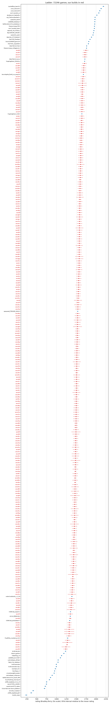

# Ladder

84188 rows of progress/games.csv (42129 local games, 42059 replica matches), rated by a batch Bradley-Terry fit on the Elo scale (`tools/elolib.py`). A local game counts its cell score (`tools/score.py`: a win or loss when kings decide the game, the points share when points do), a replica match its games won. A game between one of our builds and a field bot also fits how hard its map is for us (table at the end), so builds gauntleted on different maps compare on an average map. Each pair of players counts at most 200 games, every player carries one virtual win and loss against a fixed anchor, and ratings are relative to a mean of 1500 over all 340 players. Each of our builds is its own player. Regenerate with `tools/elo.py`; do not edit.

Games against field bots are replica scrimmages only; local games are our builds against each other and the stock players. Record = games won and lost.

Only builds with at least 12 replica matches (a full panel) are listed and plotted; all games are still fitted. Our builds, in attempt order (rating +- 95%; field score = expected score against each of the 51 field players, one game each):

| build | rating | rank | games | record | field score |
|---|---|---|---|---|---|
| s2o | 1254 +- 13 | 316 of 340 | 2868 | 1214-1654 | 41.0% |
| s3h | 1212 +- 56 | 319 of 340 | 188 | 100-88 | 38.9% |
| s3y | 1308 +- 57 | 308 of 340 | 235 | 134-101 | 43.7% |
| s4d | 1334 +- 35 | 303 of 340 | 462 | 287-175 | 44.9% |
| s4i | 1343 +- 66 | 302 of 340 | 134 | 86-48 | 45.3% |
| s4j | 1360 +- 67 | 300 of 340 | 131 | 87-44 | 46.1% |
| s4t | 1266 +- 68 | 314 of 340 | 122 | 74-48 | 41.6% |
| s5e | 1217 +- 111 | 318 of 340 | 60 | 31-29 | 39.1% |
| s5g | 1303 +- 64 | 313 of 340 | 140 | 80-60 | 43.4% |
| s5r | 1315 +- 50 | 306 of 340 | 202 | 121-81 | 44.0% |
| s5w | 1459 +- 94 | 242 of 340 | 72 | 45-27 | 50.9% |
| s6j | 1305 +- 128 | 310 of 340 | 42 | 18-24 | 43.5% |
| s6m | 1310 +- 52 | 307 of 340 | 219 | 98-121 | 43.8% |
| s7d | 1405 +- 23 | 284 of 340 | 989 | 453-558 | 48.3% |
| s7h | 1434 +- 60 | 264 of 340 | 150 | 94-56 | 49.6% |
| s7q | 1421 +- 57 | 278 of 340 | 180 | 112-68 | 49.1% |
| s7w | 1353 +- 108 | 301 of 340 | 54 | 25-29 | 45.8% |
| s8a | 1432 +- 68 | 268 of 340 | 118 | 75-43 | 49.6% |
| s8c | 1361 +- 112 | 298 of 340 | 52 | 27-25 | 46.2% |
| s8j | 1391 +- 56 | 292 of 340 | 176 | 105-71 | 47.6% |
| s8k | 1423 +- 65 | 277 of 340 | 126 | 78-48 | 49.2% |
| s8o | 1431 +- 55 | 269 of 340 | 174 | 110-64 | 49.5% |
| s8t | 1388 +- 65 | 293 of 340 | 126 | 74-52 | 47.5% |
| s8u | 1403 +- 58 | 289 of 340 | 154 | 88-66 | 48.2% |
| s8x | 1361 +- 65 | 299 of 340 | 122 | 66-56 | 46.2% |
| s9a | 1425 +- 54 | 275 of 340 | 194 | 121-73 | 49.2% |
| s9b | 1404 +- 60 | 286 of 340 | 146 | 85-61 | 48.2% |
| s9i | 1372 +- 62 | 297 of 340 | 137 | 71-66 | 46.7% |
| s9k | 1402 +- 56 | 290 of 340 | 162 | 92-80 | 48.1% |
| s9r | 1411 +- 65 | 283 of 340 | 128 | 84-44 | 48.6% |
| s9s | 1463 +- 23 | 237 of 340 | 921 | 482-455 | 51.0% |
| s9z | 1480 +- 63 | 214 of 340 | 145 | 104-41 | 51.8% |
| t0a | 1255 +- 129 | 315 of 340 | 42 | 16-26 | 41.0% |
| t0c | 1465 +- 71 | 232 of 340 | 112 | 70-42 | 51.1% |
| t0f | 1480 +- 116 | 215 of 340 | 54 | 34-20 | 51.8% |
| t0g | 1452 +- 62 | 251 of 340 | 142 | 94-48 | 50.5% |
| t0h | 1450 +- 74 | 254 of 340 | 103 | 67-36 | 50.4% |
| t0i | 1439 +- 62 | 261 of 340 | 138 | 89-49 | 49.9% |
| t0o | 1491 +- 73 | 199 of 340 | 110 | 76-34 | 52.4% |
| t0p | 1508 +- 65 | 175 of 340 | 144 | 104-40 | 53.2% |
| u0e | 1442 +- 112 | 260 of 340 | 51 | 28-23 | 50.0% |
| u0f | 1305 +- 128 | 311 of 340 | 42 | 18-24 | 43.5% |
| u0m | 1463 +- 32 | 235 of 340 | 547 | 337-226 | 51.0% |
| u0o | 1305 +- 128 | 312 of 340 | 42 | 18-24 | 43.5% |
| u0q | 1434 +- 38 | 265 of 340 | 337 | 175-162 | 49.6% |
| u0y | 1430 +- 87 | 271 of 340 | 78 | 46-32 | 49.5% |
| u0z | 1467 +- 123 | 228 of 340 | 45 | 26-19 | 51.2% |
| u1a | 1380 +- 106 | 296 of 340 | 58 | 28-30 | 47.1% |
| u1o | 1403 +- 128 | 288 of 340 | 42 | 22-20 | 48.2% |
| u1p | 1414 +- 98 | 282 of 340 | 62 | 32-30 | 48.7% |
| u1r | 1465 +- 65 | 231 of 340 | 134 | 93-41 | 51.1% |
| u1v | 1457 +- 68 | 246 of 340 | 122 | 87-35 | 50.7% |
| u1y | 1425 +- 109 | 274 of 340 | 53 | 28-25 | 49.3% |
| u2b | 1443 +- 58 | 259 of 340 | 158 | 108-50 | 50.1% |
| u2g | 1470 +- 26 | 227 of 340 | 822 | 485-375 | 51.4% |
| u2s | 1490 +- 70 | 200 of 340 | 122 | 93-31 | 52.3% |
| u2v | 1427 +- 102 | 273 of 340 | 64 | 43-21 | 49.3% |
| u2w | 1472 +- 92 | 226 of 340 | 74 | 45-29 | 51.5% |
| u2y | 1533 +- 94 | 146 of 340 | 74 | 51-23 | 54.4% |
| u3c | 1504 +- 47 | 182 of 340 | 229 | 113-116 | 53.0% |
| u3d | 1517 +- 49 | 164 of 340 | 211 | 125-86 | 53.6% |
| u3q | 1460 +- 70 | 240 of 340 | 101 | 51-50 | 50.9% |
| u3v | 1451 +- 42 | 252 of 340 | 291 | 161-148 | 50.5% |
| u3z | 1488 +- 48 | 206 of 340 | 226 | 122-104 | 52.2% |
| u4e | 1433 +- 39 | 266 of 340 | 337 | 176-161 | 49.6% |
| u4k | 1464 +- 102 | 233 of 340 | 48 | 20-28 | 51.1% |
| u4l | 1476 +- 96 | 219 of 340 | 57 | 28-29 | 51.6% |
| u4m | 1506 +- 85 | 178 of 340 | 68 | 34-34 | 53.1% |
| u4n | 1475 +- 95 | 220 of 340 | 60 | 30-30 | 51.6% |
| u4o | 1429 +- 72 | 272 of 340 | 99 | 53-46 | 49.4% |
| u4p | 1495 +- 57 | 191 of 340 | 162 | 95-67 | 52.5% |
| u4q | 1509 +- 73 | 171 of 340 | 99 | 62-37 | 53.3% |
| u4s | 1506 +- 39 | 177 of 340 | 360 | 208-152 | 53.1% |
| u4r | 1500 +- 71 | 186 of 340 | 106 | 70-36 | 52.8% |
| u4v | 1418 +- 72 | 279 of 340 | 99 | 51-48 | 48.9% |
| u4y | 1456 +- 98 | 248 of 340 | 54 | 24-30 | 50.7% |
| u4z | 1510 +- 101 | 170 of 340 | 48 | 23-25 | 53.3% |
| u5a | 1481 +- 58 | 211 of 340 | 153 | 68-85 | 51.9% |
| u5i | 1498 +- 98 | 187 of 340 | 51 | 24-27 | 52.7% |
| u5j | 1532 +- 98 | 149 of 340 | 51 | 26-25 | 54.3% |
| u5k | 1498 +- 72 | 188 of 340 | 102 | 62-40 | 52.7% |
| u5l | 1540 +- 51 | 143 of 340 | 201 | 117-84 | 54.7% |
| u5m | 1541 +- 51 | 141 of 340 | 213 | 131-82 | 54.8% |
| u5n | 1465 +- 73 | 230 of 340 | 96 | 56-40 | 51.2% |
| u5o | 1556 +- 60 | 135 of 340 | 162 | 107-55 | 55.5% |
| u5p | 1521 +- 59 | 159 of 340 | 159 | 97-62 | 53.8% |
| nul1 | 1524 +- 59 | 156 of 340 | 162 | 100-62 | 54.0% |
| u5t | 1490 +- 72 | 202 of 340 | 102 | 63-39 | 52.3% |
| u5u | 1537 +- 74 | 145 of 340 | 102 | 68-34 | 54.6% |
| u5v | 1509 +- 75 | 172 of 340 | 96 | 60-36 | 53.2% |
| u5w | 1474 +- 69 | 225 of 340 | 111 | 68-43 | 51.5% |
| u5q | 1490 +- 74 | 201 of 340 | 96 | 59-37 | 52.3% |
| u5r | 1474 +- 70 | 224 of 340 | 108 | 63-45 | 51.6% |
| u5s | 1474 +- 73 | 223 of 340 | 99 | 59-40 | 51.6% |
| u5x | 1459 +- 52 | 241 of 340 | 192 | 124-68 | 50.9% |
| u5y | 1455 +- 73 | 249 of 340 | 96 | 54-42 | 50.7% |
| u6a | 1517 +- 57 | 163 of 340 | 167 | 99-68 | 53.6% |
| u6b | 1512 +- 75 | 167 of 340 | 96 | 62-34 | 53.4% |
| u6c | 1493 +- 69 | 195 of 340 | 117 | 76-41 | 52.4% |
| u6g | 1518 +- 75 | 161 of 340 | 99 | 64-35 | 53.7% |
| u6h | 1488 +- 49 | 205 of 340 | 214 | 118-96 | 52.2% |
| u6i | 1477 +- 70 | 217 of 340 | 111 | 68-43 | 51.7% |
| u6j | 1503 +- 72 | 184 of 340 | 105 | 67-38 | 53.0% |
| u6o | 1525 +- 60 | 154 of 340 | 150 | 92-58 | 54.0% |
| u6p | 1463 +- 72 | 238 of 340 | 102 | 62-40 | 51.0% |
| u6q | 1513 +- 74 | 166 of 340 | 99 | 64-35 | 53.4% |
| u6t | 1521 +- 75 | 160 of 340 | 99 | 64-35 | 53.8% |
| u6v | 1527 +- 75 | 152 of 340 | 102 | 67-35 | 54.1% |
| u6x | 1475 +- 35 | 221 of 340 | 420 | 210-210 | 51.6% |
| u6y | 1488 +- 74 | 207 of 340 | 96 | 59-37 | 52.2% |
| u7a | 1491 +- 72 | 198 of 340 | 102 | 62-40 | 52.4% |
| u7b | 1508 +- 75 | 173 of 340 | 96 | 62-34 | 53.2% |
| u7c | 1504 +- 75 | 181 of 340 | 96 | 62-34 | 53.0% |
| u7d | 1522 +- 51 | 157 of 340 | 201 | 117-84 | 53.9% |
| u7h | 1506 +- 71 | 176 of 340 | 108 | 71-37 | 53.1% |
| u7i | 1495 +- 60 | 190 of 340 | 144 | 84-60 | 52.6% |
| u7j | 1474 +- 74 | 222 of 340 | 96 | 59-37 | 51.6% |
| u7m | 1492 +- 74 | 196 of 340 | 96 | 60-36 | 52.4% |
| u7n | 1477 +- 59 | 218 of 340 | 150 | 86-64 | 51.7% |
| u7o | 1404 +- 72 | 285 of 340 | 99 | 51-48 | 48.3% |
| u7p | 1481 +- 59 | 212 of 340 | 150 | 68-82 | 51.9% |
| u7q | 1394 +- 68 | 291 of 340 | 111 | 56-55 | 47.7% |
| u7x | 1491 +- 73 | 197 of 340 | 102 | 68-34 | 52.4% |
| u8d | 1435 +- 71 | 263 of 340 | 102 | 58-44 | 49.7% |
| u8f | 1451 +- 59 | 253 of 340 | 150 | 78-72 | 50.5% |
| u8h | 1463 +- 60 | 234 of 340 | 144 | 79-65 | 51.1% |
| u8j | 1447 +- 72 | 256 of 340 | 99 | 57-42 | 50.3% |
| u8m | 1466 +- 71 | 229 of 340 | 108 | 69-39 | 51.2% |
| u8p | 1445 +- 60 | 257 of 340 | 144 | 73-71 | 50.2% |
| u8q | 1494 +- 59 | 192 of 340 | 150 | 89-61 | 52.5% |
| u8r | 1458 +- 59 | 244 of 340 | 153 | 84-69 | 50.8% |
| u8w | 1455 +- 99 | 250 of 340 | 51 | 21-30 | 50.6% |
| u8x | 1458 +- 59 | 243 of 340 | 150 | 80-70 | 50.8% |
| u9b | 1488 +- 46 | 204 of 340 | 246 | 142-104 | 52.2% |
| u9d | 1415 +- 72 | 281 of 340 | 99 | 55-44 | 48.8% |
| u9i | 1381 +- 73 | 295 of 340 | 96 | 47-49 | 47.2% |
| u9p | 1497 +- 46 | 189 of 340 | 257 | 152-105 | 52.6% |
| u9q | 1532 +- 60 | 147 of 340 | 150 | 98-52 | 54.4% |
| w0c | 1511 +- 58 | 169 of 340 | 159 | 96-63 | 53.3% |
| z0a | 1478 +- 72 | 216 of 340 | 99 | 63-36 | 51.7% |
| z0c | 1483 +- 55 | 209 of 340 | 171 | 96-75 | 52.0% |
| z0g | 1508 +- 48 | 174 of 340 | 224 | 132-92 | 53.2% |
| z0k | 1504 +- 51 | 179 of 340 | 204 | 116-88 | 53.0% |
| z0q | 1525 +- 52 | 153 of 340 | 195 | 116-79 | 54.0% |
| z1l | 1445 +- 73 | 258 of 340 | 96 | 56-40 | 50.2% |
| z1z | 1586 +- 48 | 97 of 340 | 240 | 156-84 | 57.0% |
| z2x | 1517 +- 75 | 162 of 340 | 96 | 65-31 | 53.6% |
| z3b | 1531 +- 76 | 150 of 340 | 96 | 67-29 | 54.3% |
| z3c | 1504 +- 74 | 183 of 340 | 99 | 67-32 | 53.0% |
| z3j | 1504 +- 74 | 180 of 340 | 99 | 67-32 | 53.0% |
| z3q | 1537 +- 68 | 144 of 340 | 108 | 57-51 | 54.6% |
| z3s | 1548 +- 62 | 139 of 340 | 144 | 94-50 | 55.1% |
| z3x | 1588 +- 37 | 94 of 340 | 402 | 277-125 | 57.2% |
| z3z | 1529 +- 76 | 151 of 340 | 96 | 66-30 | 54.2% |
| z5a | 1570 +- 73 | 123 of 340 | 108 | 78-30 | 56.3% |
| z5i | 1641 +- 84 | 48 of 340 | 96 | 78-18 | 59.9% |
| z5n | 1548 +- 59 | 138 of 340 | 168 | 124-44 | 55.2% |
| z6j | 1556 +- 77 | 134 of 340 | 96 | 70-26 | 55.6% |
| z6t | 1532 +- 70 | 148 of 340 | 102 | 52-50 | 54.3% |
| z6u | 1606 +- 61 | 77 of 340 | 156 | 115-41 | 58.1% |
| z6y | 1590 +- 54 | 91 of 340 | 192 | 133-59 | 57.2% |
| z7g | 1623 +- 54 | 63 of 340 | 204 | 150-54 | 59.0% |
| z7u | 1579 +- 60 | 104 of 340 | 153 | 109-44 | 56.7% |
| z7x | 1610 +- 59 | 72 of 340 | 168 | 124-44 | 58.3% |
| z8b | 1572 +- 60 | 116 of 340 | 150 | 107-43 | 56.3% |
| z9d | 1628 +- 55 | 59 of 340 | 195 | 143-52 | 59.3% |
| z9e | 1618 +- 52 | 64 of 340 | 216 | 153-63 | 58.7% |
| z9f | 1640 +- 55 | 52 of 340 | 198 | 146-52 | 59.9% |
| z9m | 1603 +- 96 | 78 of 340 | 55 | 38-17 | 58.0% |
| z9s | 1570 +- 90 | 122 of 340 | 62 | 38-24 | 56.3% |
| z9u | 1594 +- 63 | 87 of 340 | 144 | 106-38 | 57.4% |
| z9v | 1603 +- 63 | 81 of 340 | 147 | 110-37 | 57.9% |
| za3 | 1653 +- 107 | 39 of 340 | 48 | 32-16 | 60.6% |
| za9 | 1567 +- 83 | 127 of 340 | 71 | 43-28 | 56.1% |
| zb2 | 1571 +- 60 | 120 of 340 | 153 | 107-46 | 56.3% |
| zb7 | 1576 +- 76 | 109 of 340 | 85 | 55-30 | 56.6% |
| zb8 | 1574 +- 58 | 114 of 340 | 162 | 114-48 | 56.4% |
| zc2 | 1608 +- 64 | 74 of 340 | 144 | 105-39 | 58.2% |
| zc3 | 1597 +- 64 | 84 of 340 | 136 | 99-37 | 57.6% |
| zc6 | 1638 +- 71 | 53 of 340 | 110 | 77-33 | 59.8% |
| zc8 | 1598 +- 62 | 83 of 340 | 147 | 110-37 | 57.7% |
| zd8 | 1644 +- 64 | 46 of 340 | 156 | 123-33 | 60.1% |
| zdb | 1596 +- 37 | 85 of 340 | 408 | 286-122 | 57.6% |
| zdf | 1653 +- 107 | 40 of 340 | 48 | 32-16 | 60.6% |
| zdk | 1603 +- 62 | 79 of 340 | 150 | 114-36 | 57.9% |
| zdo | 1572 +- 102 | 117 of 340 | 48 | 27-21 | 56.3% |
| zdp | 1632 +- 65 | 57 of 340 | 144 | 112-32 | 59.4% |
| zdq | 1641 +- 66 | 49 of 340 | 144 | 110-34 | 59.9% |
| zdt | 1556 +- 61 | 133 of 340 | 144 | 98-46 | 55.6% |
| zdx | 1588 +- 92 | 96 of 340 | 60 | 36-24 | 57.1% |
| zdy | 1583 +- 53 | 99 of 340 | 192 | 133-59 | 56.9% |
| zeb | 1608 +- 64 | 75 of 340 | 144 | 107-37 | 58.2% |
| zee | 1572 +- 61 | 115 of 340 | 147 | 103-44 | 56.3% |
| zef | 1638 +- 73 | 54 of 340 | 110 | 84-26 | 59.8% |
| zej | 1557 +- 61 | 132 of 340 | 139 | 91-48 | 55.6% |
| zel | 1574 +- 61 | 113 of 340 | 147 | 104-43 | 56.5% |
| zem | 1658 +- 56 | 38 of 340 | 204 | 156-48 | 60.9% |
| zen | 1592 +- 58 | 90 of 340 | 168 | 121-47 | 57.3% |
| zeu | 1611 +- 64 | 71 of 340 | 144 | 110-34 | 58.4% |
| zew | 1618 +- 64 | 66 of 340 | 147 | 114-33 | 58.7% |
| zey | 1603 +- 54 | 80 of 340 | 195 | 139-56 | 57.9% |
| zez | 1579 +- 69 | 106 of 340 | 108 | 62-46 | 56.7% |
| zfj | 1582 +- 66 | 100 of 340 | 121 | 82-39 | 56.8% |
| zfm | 1568 +- 71 | 125 of 340 | 96 | 57-39 | 56.1% |
| zfp | 1581 +- 61 | 101 of 340 | 147 | 104-43 | 56.8% |
| zfv | 1588 +- 77 | 93 of 340 | 84 | 54-30 | 57.2% |
| zfx | 1563 +- 70 | 129 of 340 | 99 | 58-41 | 55.9% |
| zgb | 1524 +- 114 | 155 of 340 | 36 | 20-16 | 54.0% |
| zgc | 1579 +- 61 | 103 of 340 | 150 | 107-43 | 56.7% |
| zgg | 1572 +- 102 | 118 of 340 | 48 | 27-21 | 56.3% |
| zgh | 1581 +- 62 | 102 of 340 | 144 | 102-42 | 56.8% |
| zgj | 1613 +- 53 | 69 of 340 | 204 | 145-59 | 58.5% |
| zgt | 1627 +- 60 | 62 of 340 | 147 | 96-51 | 59.2% |
| zgx | 1599 +- 71 | 82 of 340 | 99 | 62-37 | 57.7% |
| zhf | 1589 +- 72 | 92 of 340 | 96 | 59-37 | 57.2% |
| zhh | 1575 +- 72 | 112 of 340 | 96 | 58-38 | 56.5% |
| zhj | 1560 +- 67 | 131 of 340 | 108 | 61-47 | 55.7% |
| zhk | 1578 +- 63 | 107 of 340 | 139 | 97-42 | 56.6% |
| zhn | 1576 +- 62 | 111 of 340 | 144 | 102-42 | 56.5% |
| zho | 1544 +- 61 | 140 of 340 | 144 | 99-45 | 55.0% |
| zhp | 1618 +- 53 | 65 of 340 | 204 | 146-58 | 58.7% |
| zht | 1588 +- 62 | 95 of 340 | 147 | 108-39 | 57.1% |
| zhw | 1592 +- 61 | 89 of 340 | 150 | 108-42 | 57.4% |
| zhy | 1576 +- 61 | 110 of 340 | 147 | 105-42 | 56.6% |
| zib | 1485 +- 87 | 208 of 340 | 61 | 31-30 | 52.1% |
| zic | 1568 +- 61 | 124 of 340 | 144 | 102-42 | 56.1% |
| zid | 1565 +- 61 | 128 of 340 | 144 | 100-44 | 56.0% |
| zie | 1585 +- 62 | 98 of 340 | 147 | 105-42 | 57.0% |
| zih | 1579 +- 99 | 105 of 340 | 51 | 29-22 | 56.7% |
| zii | 1630 +- 50 | 58 of 340 | 240 | 176-64 | 59.4% |
| zij | 1541 +- 101 | 142 of 340 | 48 | 25-23 | 54.8% |
| zik | 1577 +- 61 | 108 of 340 | 147 | 104-43 | 56.6% |
| zil | 1593 +- 63 | 88 of 340 | 144 | 106-38 | 57.4% |
| zio | 1555 +- 58 | 136 of 340 | 159 | 109-50 | 55.5% |
| zis | 1567 +- 61 | 126 of 340 | 144 | 100-44 | 56.1% |
| zit | 1571 +- 62 | 121 of 340 | 144 | 101-43 | 56.3% |
| ziu | 1560 +- 60 | 130 of 340 | 147 | 102-45 | 55.8% |
| zj3 | 1646 +- 40 | 44 of 340 | 372 | 263-109 | 60.2% |
| zj8 | 1645 +- 57 | 45 of 340 | 192 | 145-47 | 60.1% |
| zja | 1614 +- 64 | 68 of 340 | 144 | 109-35 | 58.5% |
| zjc | 1640 +- 62 | 51 of 340 | 165 | 129-36 | 59.9% |
| zjd | 1609 +- 67 | 73 of 340 | 132 | 96-36 | 58.2% |
| zjf | 1643 +- 68 | 47 of 340 | 138 | 110-28 | 60.0% |
| xa5 | 1640 +- 56 | 50 of 340 | 195 | 145-50 | 59.9% |
| xb8 | 1648 +- 57 | 42 of 340 | 192 | 144-48 | 60.3% |
| xc3 | 1717 +- 60 | 23 of 340 | 204 | 161-43 | 64.2% |
| xc6 | 1714 +- 61 | 25 of 340 | 195 | 155-40 | 64.0% |
| xd6 | 1688 +- 57 | 28 of 340 | 210 | 162-48 | 62.5% |
| xe6 | 1614 +- 74 | 67 of 340 | 96 | 59-37 | 58.5% |
| xf3 | 1717 +- 59 | 24 of 340 | 210 | 166-44 | 64.1% |
| xf7 | 1682 +- 58 | 30 of 340 | 201 | 153-48 | 62.2% |
| xg2 | 1628 +- 65 | 61 of 340 | 147 | 105-42 | 59.2% |
| xh1 | 1633 +- 71 | 56 of 340 | 108 | 69-39 | 59.5% |
| xh4 | 1648 +- 57 | 43 of 340 | 192 | 139-53 | 60.3% |
| xh6 | 1684 +- 59 | 29 of 340 | 192 | 147-45 | 62.3% |
| xi1 | 1704 +- 60 | 26 of 340 | 195 | 153-42 | 63.4% |
| xi9 | 1740 +- 67 | 21 of 340 | 180 | 149-31 | 65.5% |
| xj6 | 1678 +- 72 | 32 of 340 | 132 | 101-31 | 62.0% |
| xj9 | 1432 +- 59 | 267 of 340 | 162 | 49-113 | 49.6% |
| xk2 | 1638 +- 62 | 55 of 340 | 138 | 88-50 | 59.8% |
| xk6 | 1549 +- 26 | 137 of 340 | 807 | 310-497 | 55.2% |
| xr6 | 1672 +- 65 | 34 of 340 | 138 | 93-45 | 61.6% |
| xr8 | 1650 +- 59 | 41 of 340 | 159 | 103-56 | 60.4% |
| xr13 | 1665 +- 60 | 37 of 340 | 153 | 101-52 | 61.2% |
| xr16 | 1667 +- 61 | 35 of 340 | 150 | 100-50 | 61.3% |
| xr19 | 1438 +- 65 | 262 of 340 | 129 | 38-91 | 49.9% |
| xr25 | 1430 +- 53 | 270 of 340 | 264 | 55-209 | 49.5% |
| xr39 | 1462 +- 64 | 239 of 340 | 129 | 42-87 | 51.0% |
| xr45 | 1456 +- 65 | 247 of 340 | 126 | 40-86 | 50.7% |
| xr47 | 1489 +- 62 | 203 of 340 | 129 | 47-82 | 52.3% |
| xr49 | 1483 +- 57 | 210 of 340 | 153 | 54-99 | 52.0% |
| xr53 | 1511 +- 61 | 168 of 340 | 129 | 51-78 | 53.4% |
| xr55 | 1457 +- 64 | 245 of 340 | 129 | 41-88 | 50.7% |
| xr56 | 1493 +- 62 | 194 of 340 | 129 | 47-82 | 52.4% |
| xr59 | 1424 +- 67 | 276 of 340 | 126 | 35-91 | 49.2% |
| xr60 | 1503 +- 62 | 185 of 340 | 129 | 49-80 | 53.0% |
| xr68 | 1494 +- 62 | 193 of 340 | 129 | 48-81 | 52.5% |
| xr75 | 1480 +- 63 | 213 of 340 | 129 | 45-84 | 51.9% |
| xr76 | 1463 +- 64 | 236 of 340 | 129 | 42-87 | 51.0% |
| xr85 | 1449 +- 64 | 255 of 340 | 132 | 41-91 | 50.3% |
| xr87 | 1417 +- 68 | 280 of 340 | 126 | 34-92 | 48.9% |
| xr88 | 1403 +- 69 | 287 of 340 | 126 | 32-94 | 48.2% |
| ya0 | 1612 +- 92 | 70 of 340 | 54 | 30-24 | 58.4% |
| yb9 | 1514 +- 96 | 165 of 340 | 51 | 22-29 | 53.5% |
| yd1 | 1607 +- 97 | 76 of 340 | 48 | 25-23 | 58.1% |
| yl19 | 1595 +- 112 | 86 of 340 | 36 | 18-18 | 57.5% |
| yl25 | 1666 +- 110 | 36 of 340 | 42 | 28-14 | 61.3% |
| yl54 | 1673 +- 109 | 33 of 340 | 39 | 21-18 | 61.7% |
| sw83 | 1571 +- 112 | 119 of 340 | 36 | 17-19 | 56.3% |

All players:

| # | player | rating | games | record | field score |
|---:|---|---|---|---|---|
| 1 | IvanGeffner_basic51 | 2197 +- 24 | 4515 | 2986-1529 | 91.9% |
| 2 | uravt_Version41 | 2121 +- 19 | 4578 | 2416-2162 | 88.6% |
| 3 | awu7_awubot_us | 2090 +- 16 | 4488 | 2261-2227 | 87.0% |
| 4 | uravt_Version35 | 2090 +- 17 | 4473 | 2241-2232 | 87.0% |
| 5 | abcdezyxwv_bestsofar | 2014 +- 14 | 4659 | 2494-2165 | 82.8% |
| 6 | nubbbbbb_testplayer | 1976 +- 14 | 3936 | 2015-1921 | 80.6% |
| 7 | battlecode-archive_testplayer | 1975 +- 14 | 4050 | 2065-1985 | 80.5% |
| 8 | nzjt_TheComplexMerlin | 1974 +- 11 | 5841 | 3423-2418 | 80.5% |
| 9 | awu7_awubot_quals | 1974 +- 13 | 4059 | 2045-2014 | 80.5% |
| 10 | quesswho_bot16 | 1963 +- 13 | 4107 | 2081-2026 | 79.8% |
| 11 | daannte_v52_ThisGuy | 1957 +- 14 | 4125 | 2093-2032 | 79.4% |
| 12 | thewaxmango_PhD | 1957 +- 14 | 4047 | 2059-1988 | 79.4% |
| 13 | TeamSPAARK_SPAARK | 1940 +- 14 | 4152 | 2142-2010 | 78.4% |
| 14 | quesswho_quals | 1920 +- 14 | 3966 | 2061-1905 | 77.1% |
| 15 | daannte_v47_Skadoosh | 1891 +- 13 | 4224 | 2173-2051 | 75.3% |
| 16 | AlexT101_finalsbot | 1843 +- 14 | 3984 | 2023-1961 | 72.2% |
| 17 | bman12345678_goonv23 | 1813 +- 13 | 4831 | 2639-2192 | 70.3% |
| 18 | AlexT101_usqualsbot | 1794 +- 12 | 5641 | 3199-2442 | 69.1% |
| 19 | AdamTan12_Finals | 1760 +- 10 | 6522 | 3415-3107 | 67.0% |
| 20 | thewaxmango_collegejunior | 1759 +- 11 | 6018 | 3085-2933 | 67.0% |
| 21 | us:xi9 | 1740 +- 67 | 180 | 149-31 | 65.5% |
| 22 | AdamTan12_Icarus | 1734 +- 10 | 6688 | 3299-3389 | 65.5% |
| 23 | us:xc3 | 1717 +- 60 | 204 | 161-43 | 64.2% |
| 24 | us:xf3 | 1717 +- 59 | 210 | 166-44 | 64.1% |
| 25 | us:xc6 | 1714 +- 61 | 195 | 155-40 | 64.0% |
| 26 | us:xi1 | 1704 +- 60 | 195 | 153-42 | 63.4% |
| 27 | HugoIngelsson_YokoOno | 1701 +- 11 | 6258 | 3157-3101 | 63.5% |
| 28 | us:xd6 | 1688 +- 57 | 210 | 162-48 | 62.5% |
| 29 | us:xh6 | 1684 +- 59 | 192 | 147-45 | 62.3% |
| 30 | us:xf7 | 1682 +- 58 | 201 | 153-48 | 62.2% |
| 31 | VarunVejalla_final4_run_away10 | 1678 +- 11 | 6096 | 2933-3163 | 62.2% |
| 32 | us:xj6 | 1678 +- 72 | 132 | 101-31 | 62.0% |
| 33 | us:yl54 | 1673 +- 109 | 39 | 21-18 | 61.7% |
| 34 | us:xr6 | 1672 +- 65 | 138 | 93-45 | 61.6% |
| 35 | us:xr16 | 1667 +- 61 | 150 | 100-50 | 61.3% |
| 36 | us:yl25 | 1666 +- 110 | 42 | 28-14 | 61.3% |
| 37 | us:xr13 | 1665 +- 60 | 153 | 101-52 | 61.2% |
| 38 | us:zem | 1658 +- 56 | 204 | 156-48 | 60.9% |
| 39 | us:za3 | 1653 +- 107 | 48 | 32-16 | 60.6% |
| 40 | us:zdf | 1653 +- 107 | 48 | 32-16 | 60.6% |
| 41 | us:xr8 | 1650 +- 59 | 159 | 103-56 | 60.4% |
| 42 | us:xb8 | 1648 +- 57 | 192 | 144-48 | 60.3% |
| 43 | us:xh4 | 1648 +- 57 | 192 | 139-53 | 60.3% |
| 44 | us:zj3 | 1646 +- 40 | 372 | 263-109 | 60.2% |
| 45 | us:zj8 | 1645 +- 57 | 192 | 145-47 | 60.1% |
| 46 | us:zd8 | 1644 +- 64 | 156 | 123-33 | 60.1% |
| 47 | us:zjf | 1643 +- 68 | 138 | 110-28 | 60.0% |
| 48 | us:z5i | 1641 +- 84 | 96 | 78-18 | 59.9% |
| 49 | us:zdq | 1641 +- 66 | 144 | 110-34 | 59.9% |
| 50 | us:xa5 | 1640 +- 56 | 195 | 145-50 | 59.9% |
| 51 | us:zjc | 1640 +- 62 | 165 | 129-36 | 59.9% |
| 52 | us:z9f | 1640 +- 55 | 198 | 146-52 | 59.9% |
| 53 | us:zc6 | 1638 +- 71 | 110 | 77-33 | 59.8% |
| 54 | us:zef | 1638 +- 73 | 110 | 84-26 | 59.8% |
| 55 | us:xk2 | 1638 +- 62 | 138 | 88-50 | 59.8% |
| 56 | us:xh1 | 1633 +- 71 | 108 | 69-39 | 59.5% |
| 57 | us:zdp | 1632 +- 65 | 144 | 112-32 | 59.4% |
| 58 | us:zii | 1630 +- 50 | 240 | 176-64 | 59.4% |
| 59 | us:z9d | 1628 +- 55 | 195 | 143-52 | 59.3% |
| 60 | HugoIngelsson_Xzibit | 1628 +- 11 | 5877 | 2664-3213 | 59.4% |
| 61 | us:xg2 | 1628 +- 65 | 147 | 105-42 | 59.2% |
| 62 | us:zgt | 1627 +- 60 | 147 | 96-51 | 59.2% |
| 63 | us:z7g | 1623 +- 54 | 204 | 150-54 | 59.0% |
| 64 | us:z9e | 1618 +- 52 | 216 | 153-63 | 58.7% |
| 65 | us:zhp | 1618 +- 53 | 204 | 146-58 | 58.7% |
| 66 | us:zew | 1618 +- 64 | 147 | 114-33 | 58.7% |
| 67 | us:xe6 | 1614 +- 74 | 96 | 59-37 | 58.5% |
| 68 | us:zja | 1614 +- 64 | 144 | 109-35 | 58.5% |
| 69 | us:zgj | 1613 +- 53 | 204 | 145-59 | 58.5% |
| 70 | us:ya0 | 1612 +- 92 | 54 | 30-24 | 58.4% |
| 71 | us:zeu | 1611 +- 64 | 144 | 110-34 | 58.4% |
| 72 | us:z7x | 1610 +- 59 | 168 | 124-44 | 58.3% |
| 73 | us:zjd | 1609 +- 67 | 132 | 96-36 | 58.2% |
| 74 | us:zc2 | 1608 +- 64 | 144 | 105-39 | 58.2% |
| 75 | us:zeb | 1608 +- 64 | 144 | 107-37 | 58.2% |
| 76 | us:yd1 | 1607 +- 97 | 48 | 25-23 | 58.1% |
| 77 | us:z6u | 1606 +- 61 | 156 | 115-41 | 58.1% |
| 78 | us:z9m | 1603 +- 96 | 55 | 38-17 | 58.0% |
| 79 | us:zdk | 1603 +- 62 | 150 | 114-36 | 57.9% |
| 80 | us:zey | 1603 +- 54 | 195 | 139-56 | 57.9% |
| 81 | us:z9v | 1603 +- 63 | 147 | 110-37 | 57.9% |
| 82 | us:zgx | 1599 +- 71 | 99 | 62-37 | 57.7% |
| 83 | us:zc8 | 1598 +- 62 | 147 | 110-37 | 57.7% |
| 84 | us:zc3 | 1597 +- 64 | 136 | 99-37 | 57.6% |
| 85 | us:zdb | 1596 +- 37 | 408 | 286-122 | 57.6% |
| 86 | us:yl19 | 1595 +- 112 | 36 | 18-18 | 57.5% |
| 87 | us:z9u | 1594 +- 63 | 144 | 106-38 | 57.4% |
| 88 | us:zil | 1593 +- 63 | 144 | 106-38 | 57.4% |
| 89 | us:zhw | 1592 +- 61 | 150 | 108-42 | 57.4% |
| 90 | us:zen | 1592 +- 58 | 168 | 121-47 | 57.3% |
| 91 | us:z6y | 1590 +- 54 | 192 | 133-59 | 57.2% |
| 92 | us:zhf | 1589 +- 72 | 96 | 59-37 | 57.2% |
| 93 | us:zfv | 1588 +- 77 | 84 | 54-30 | 57.2% |
| 94 | us:z3x | 1588 +- 37 | 402 | 277-125 | 57.2% |
| 95 | us:zht | 1588 +- 62 | 147 | 108-39 | 57.1% |
| 96 | us:zdx | 1588 +- 92 | 60 | 36-24 | 57.1% |
| 97 | us:z1z | 1586 +- 48 | 240 | 156-84 | 57.0% |
| 98 | us:zie | 1585 +- 62 | 147 | 105-42 | 57.0% |
| 99 | us:zdy | 1583 +- 53 | 192 | 133-59 | 56.9% |
| 100 | us:zfj | 1582 +- 66 | 121 | 82-39 | 56.8% |
| 101 | us:zfp | 1581 +- 61 | 147 | 104-43 | 56.8% |
| 102 | us:zgh | 1581 +- 62 | 144 | 102-42 | 56.8% |
| 103 | us:zgc | 1579 +- 61 | 150 | 107-43 | 56.7% |
| 104 | us:z7u | 1579 +- 60 | 153 | 109-44 | 56.7% |
| 105 | us:zih | 1579 +- 99 | 51 | 29-22 | 56.7% |
| 106 | us:zez | 1579 +- 69 | 108 | 62-46 | 56.7% |
| 107 | us:zhk | 1578 +- 63 | 139 | 97-42 | 56.6% |
| 108 | us:zik | 1577 +- 61 | 147 | 104-43 | 56.6% |
| 109 | us:zb7 | 1576 +- 76 | 85 | 55-30 | 56.6% |
| 110 | us:zhy | 1576 +- 61 | 147 | 105-42 | 56.6% |
| 111 | us:zhn | 1576 +- 62 | 144 | 102-42 | 56.5% |
| 112 | us:zhh | 1575 +- 72 | 96 | 58-38 | 56.5% |
| 113 | us:zel | 1574 +- 61 | 147 | 104-43 | 56.5% |
| 114 | us:zb8 | 1574 +- 58 | 162 | 114-48 | 56.4% |
| 115 | us:zee | 1572 +- 61 | 147 | 103-44 | 56.3% |
| 116 | us:z8b | 1572 +- 60 | 150 | 107-43 | 56.3% |
| 117 | us:zdo | 1572 +- 102 | 48 | 27-21 | 56.3% |
| 118 | us:zgg | 1572 +- 102 | 48 | 27-21 | 56.3% |
| 119 | us:sw83 | 1571 +- 112 | 36 | 17-19 | 56.3% |
| 120 | us:zb2 | 1571 +- 60 | 153 | 107-46 | 56.3% |
| 121 | us:zit | 1571 +- 62 | 144 | 101-43 | 56.3% |
| 122 | us:z9s | 1570 +- 90 | 62 | 38-24 | 56.3% |
| 123 | us:z5a | 1570 +- 73 | 108 | 78-30 | 56.3% |
| 124 | us:zic | 1568 +- 61 | 144 | 102-42 | 56.1% |
| 125 | us:zfm | 1568 +- 71 | 96 | 57-39 | 56.1% |
| 126 | us:zis | 1567 +- 61 | 144 | 100-44 | 56.1% |
| 127 | us:za9 | 1567 +- 83 | 71 | 43-28 | 56.1% |
| 128 | us:zid | 1565 +- 61 | 144 | 100-44 | 56.0% |
| 129 | us:zfx | 1563 +- 70 | 99 | 58-41 | 55.9% |
| 130 | us:ziu | 1560 +- 60 | 147 | 102-45 | 55.8% |
| 131 | us:zhj | 1560 +- 67 | 108 | 61-47 | 55.7% |
| 132 | us:zej | 1557 +- 61 | 139 | 91-48 | 55.6% |
| 133 | us:zdt | 1556 +- 61 | 144 | 98-46 | 55.6% |
| 134 | us:z6j | 1556 +- 77 | 96 | 70-26 | 55.6% |
| 135 | us:u5o | 1556 +- 60 | 162 | 107-55 | 55.5% |
| 136 | us:zio | 1555 +- 58 | 159 | 109-50 | 55.5% |
| 137 | us:xk6 | 1549 +- 26 | 807 | 310-497 | 55.2% |
| 138 | us:z5n | 1548 +- 59 | 168 | 124-44 | 55.2% |
| 139 | us:z3s | 1548 +- 62 | 144 | 94-50 | 55.1% |
| 140 | us:zho | 1544 +- 61 | 144 | 99-45 | 55.0% |
| 141 | us:u5m | 1541 +- 51 | 213 | 131-82 | 54.8% |
| 142 | us:zij | 1541 +- 101 | 48 | 25-23 | 54.8% |
| 143 | us:u5l | 1540 +- 51 | 201 | 117-84 | 54.7% |
| 144 | us:z3q | 1537 +- 68 | 108 | 57-51 | 54.6% |
| 145 | us:u5u | 1537 +- 74 | 102 | 68-34 | 54.6% |
| 146 | us:u2y | 1533 +- 94 | 74 | 51-23 | 54.4% |
| 147 | us:u9q | 1532 +- 60 | 150 | 98-52 | 54.4% |
| 148 | us:z6t | 1532 +- 70 | 102 | 52-50 | 54.3% |
| 149 | us:u5j | 1532 +- 98 | 51 | 26-25 | 54.3% |
| 150 | us:z3b | 1531 +- 76 | 96 | 67-29 | 54.3% |
| 151 | us:z3z | 1529 +- 76 | 96 | 66-30 | 54.2% |
| 152 | us:u6v | 1527 +- 75 | 102 | 67-35 | 54.1% |
| 153 | us:z0q | 1525 +- 52 | 195 | 116-79 | 54.0% |
| 154 | us:u6o | 1525 +- 60 | 150 | 92-58 | 54.0% |
| 155 | us:zgb | 1524 +- 114 | 36 | 20-16 | 54.0% |
| 156 | us:nul1 | 1524 +- 59 | 162 | 100-62 | 54.0% |
| 157 | us:u7d | 1522 +- 51 | 201 | 117-84 | 53.9% |
| 158 | spsquared_TSPAARK_QUALS | 1521 +- 12 | 6573 | 2621-3952 | 53.9% |
| 159 | us:u5p | 1521 +- 59 | 159 | 97-62 | 53.8% |
| 160 | us:u6t | 1521 +- 75 | 99 | 64-35 | 53.8% |
| 161 | us:u6g | 1518 +- 75 | 99 | 64-35 | 53.7% |
| 162 | us:z2x | 1517 +- 75 | 96 | 65-31 | 53.6% |
| 163 | us:u6a | 1517 +- 57 | 167 | 99-68 | 53.6% |
| 164 | us:u3d | 1517 +- 49 | 211 | 125-86 | 53.6% |
| 165 | us:yb9 | 1514 +- 96 | 51 | 22-29 | 53.5% |
| 166 | us:u6q | 1513 +- 74 | 99 | 64-35 | 53.4% |
| 167 | us:u6b | 1512 +- 75 | 96 | 62-34 | 53.4% |
| 168 | us:xr53 | 1511 +- 61 | 129 | 51-78 | 53.4% |
| 169 | us:w0c | 1511 +- 58 | 159 | 96-63 | 53.3% |
| 170 | us:u4z | 1510 +- 101 | 48 | 23-25 | 53.3% |
| 171 | us:u4q | 1509 +- 73 | 99 | 62-37 | 53.3% |
| 172 | us:u5v | 1509 +- 75 | 96 | 60-36 | 53.2% |
| 173 | us:u7b | 1508 +- 75 | 96 | 62-34 | 53.2% |
| 174 | us:z0g | 1508 +- 48 | 224 | 132-92 | 53.2% |
| 175 | us:t0p | 1508 +- 65 | 144 | 104-40 | 53.2% |
| 176 | us:u7h | 1506 +- 71 | 108 | 71-37 | 53.1% |
| 177 | us:u4s | 1506 +- 39 | 360 | 208-152 | 53.1% |
| 178 | us:u4m | 1506 +- 85 | 68 | 34-34 | 53.1% |
| 179 | us:z0k | 1504 +- 51 | 204 | 116-88 | 53.0% |
| 180 | us:z3j | 1504 +- 74 | 99 | 67-32 | 53.0% |
| 181 | us:u7c | 1504 +- 75 | 96 | 62-34 | 53.0% |
| 182 | us:u3c | 1504 +- 47 | 229 | 113-116 | 53.0% |
| 183 | us:z3c | 1504 +- 74 | 99 | 67-32 | 53.0% |
| 184 | us:u6j | 1503 +- 72 | 105 | 67-38 | 53.0% |
| 185 | us:xr60 | 1503 +- 62 | 129 | 49-80 | 53.0% |
| 186 | us:u4r | 1500 +- 71 | 106 | 70-36 | 52.8% |
| 187 | us:u5i | 1498 +- 98 | 51 | 24-27 | 52.7% |
| 188 | us:u5k | 1498 +- 72 | 102 | 62-40 | 52.7% |
| 189 | us:u9p | 1497 +- 46 | 257 | 152-105 | 52.6% |
| 190 | us:u7i | 1495 +- 60 | 144 | 84-60 | 52.6% |
| 191 | us:u4p | 1495 +- 57 | 162 | 95-67 | 52.5% |
| 192 | us:u8q | 1494 +- 59 | 150 | 89-61 | 52.5% |
| 193 | us:xr68 | 1494 +- 62 | 129 | 48-81 | 52.5% |
| 194 | us:xr56 | 1493 +- 62 | 129 | 47-82 | 52.4% |
| 195 | us:u6c | 1493 +- 69 | 117 | 76-41 | 52.4% |
| 196 | us:u7m | 1492 +- 74 | 96 | 60-36 | 52.4% |
| 197 | us:u7x | 1491 +- 73 | 102 | 68-34 | 52.4% |
| 198 | us:u7a | 1491 +- 72 | 102 | 62-40 | 52.4% |
| 199 | us:t0o | 1491 +- 73 | 110 | 76-34 | 52.4% |
| 200 | us:u2s | 1490 +- 70 | 122 | 93-31 | 52.3% |
| 201 | us:u5q | 1490 +- 74 | 96 | 59-37 | 52.3% |
| 202 | us:u5t | 1490 +- 72 | 102 | 63-39 | 52.3% |
| 203 | us:xr47 | 1489 +- 62 | 129 | 47-82 | 52.3% |
| 204 | us:u9b | 1488 +- 46 | 246 | 142-104 | 52.2% |
| 205 | us:u6h | 1488 +- 49 | 214 | 118-96 | 52.2% |
| 206 | us:u3z | 1488 +- 48 | 226 | 122-104 | 52.2% |
| 207 | us:u6y | 1488 +- 74 | 96 | 59-37 | 52.2% |
| 208 | us:zib | 1485 +- 87 | 61 | 31-30 | 52.1% |
| 209 | us:z0c | 1483 +- 55 | 171 | 96-75 | 52.0% |
| 210 | us:xr49 | 1483 +- 57 | 153 | 54-99 | 52.0% |
| 211 | us:u5a | 1481 +- 58 | 153 | 68-85 | 51.9% |
| 212 | us:u7p | 1481 +- 59 | 150 | 68-82 | 51.9% |
| 213 | us:xr75 | 1480 +- 63 | 129 | 45-84 | 51.9% |
| 214 | us:s9z | 1480 +- 63 | 145 | 104-41 | 51.8% |
| 215 | us:t0f | 1480 +- 116 | 54 | 34-20 | 51.8% |
| 216 | us:z0a | 1478 +- 72 | 99 | 63-36 | 51.7% |
| 217 | us:u6i | 1477 +- 70 | 111 | 68-43 | 51.7% |
| 218 | us:u7n | 1477 +- 59 | 150 | 86-64 | 51.7% |
| 219 | us:u4l | 1476 +- 96 | 57 | 28-29 | 51.6% |
| 220 | us:u4n | 1475 +- 95 | 60 | 30-30 | 51.6% |
| 221 | us:u6x | 1475 +- 35 | 420 | 210-210 | 51.6% |
| 222 | us:u7j | 1474 +- 74 | 96 | 59-37 | 51.6% |
| 223 | us:u5s | 1474 +- 73 | 99 | 59-40 | 51.6% |
| 224 | us:u5r | 1474 +- 70 | 108 | 63-45 | 51.6% |
| 225 | us:u5w | 1474 +- 69 | 111 | 68-43 | 51.5% |
| 226 | us:u2w | 1472 +- 92 | 74 | 45-29 | 51.5% |
| 227 | us:u2g | 1470 +- 26 | 822 | 485-375 | 51.4% |
| 228 | us:u0z | 1467 +- 123 | 45 | 26-19 | 51.2% |
| 229 | us:u8m | 1466 +- 71 | 108 | 69-39 | 51.2% |
| 230 | us:u5n | 1465 +- 73 | 96 | 56-40 | 51.2% |
| 231 | us:u1r | 1465 +- 65 | 134 | 93-41 | 51.1% |
| 232 | us:t0c | 1465 +- 71 | 112 | 70-42 | 51.1% |
| 233 | us:u4k | 1464 +- 102 | 48 | 20-28 | 51.1% |
| 234 | us:u8h | 1463 +- 60 | 144 | 79-65 | 51.1% |
| 235 | us:u0m | 1463 +- 32 | 547 | 337-226 | 51.0% |
| 236 | us:xr76 | 1463 +- 64 | 129 | 42-87 | 51.0% |
| 237 | us:s9s | 1463 +- 23 | 921 | 482-455 | 51.0% |
| 238 | us:u6p | 1463 +- 72 | 102 | 62-40 | 51.0% |
| 239 | us:xr39 | 1462 +- 64 | 129 | 42-87 | 51.0% |
| 240 | us:u3q | 1460 +- 70 | 101 | 51-50 | 50.9% |
| 241 | us:u5x | 1459 +- 52 | 192 | 124-68 | 50.9% |
| 242 | us:s5w | 1459 +- 94 | 72 | 45-27 | 50.9% |
| 243 | us:u8x | 1458 +- 59 | 150 | 80-70 | 50.8% |
| 244 | us:u8r | 1458 +- 59 | 153 | 84-69 | 50.8% |
| 245 | us:xr55 | 1457 +- 64 | 129 | 41-88 | 50.7% |
| 246 | us:u1v | 1457 +- 68 | 122 | 87-35 | 50.7% |
| 247 | us:xr45 | 1456 +- 65 | 126 | 40-86 | 50.7% |
| 248 | us:u4y | 1456 +- 98 | 54 | 24-30 | 50.7% |
| 249 | us:u5y | 1455 +- 73 | 96 | 54-42 | 50.7% |
| 250 | us:u8w | 1455 +- 99 | 51 | 21-30 | 50.6% |
| 251 | us:t0g | 1452 +- 62 | 142 | 94-48 | 50.5% |
| 252 | us:u3v | 1451 +- 42 | 291 | 161-148 | 50.5% |
| 253 | us:u8f | 1451 +- 59 | 150 | 78-72 | 50.5% |
| 254 | us:t0h | 1450 +- 74 | 103 | 67-36 | 50.4% |
| 255 | us:xr85 | 1449 +- 64 | 132 | 41-91 | 50.3% |
| 256 | us:u8j | 1447 +- 72 | 99 | 57-42 | 50.3% |
| 257 | us:u8p | 1445 +- 60 | 144 | 73-71 | 50.2% |
| 258 | us:z1l | 1445 +- 73 | 96 | 56-40 | 50.2% |
| 259 | us:u2b | 1443 +- 58 | 158 | 108-50 | 50.1% |
| 260 | us:u0e | 1442 +- 112 | 51 | 28-23 | 50.0% |
| 261 | us:t0i | 1439 +- 62 | 138 | 89-49 | 49.9% |
| 262 | us:xr19 | 1438 +- 65 | 129 | 38-91 | 49.9% |
| 263 | us:u8d | 1435 +- 71 | 102 | 58-44 | 49.7% |
| 264 | us:s7h | 1434 +- 60 | 150 | 94-56 | 49.6% |
| 265 | us:u0q | 1434 +- 38 | 337 | 175-162 | 49.6% |
| 266 | us:u4e | 1433 +- 39 | 337 | 176-161 | 49.6% |
| 267 | us:xj9 | 1432 +- 59 | 162 | 49-113 | 49.6% |
| 268 | us:s8a | 1432 +- 68 | 118 | 75-43 | 49.6% |
| 269 | us:s8o | 1431 +- 55 | 174 | 110-64 | 49.5% |
| 270 | us:xr25 | 1430 +- 53 | 264 | 55-209 | 49.5% |
| 271 | us:u0y | 1430 +- 87 | 78 | 46-32 | 49.5% |
| 272 | us:u4o | 1429 +- 72 | 99 | 53-46 | 49.4% |
| 273 | us:u2v | 1427 +- 102 | 64 | 43-21 | 49.3% |
| 274 | us:u1y | 1425 +- 109 | 53 | 28-25 | 49.3% |
| 275 | us:s9a | 1425 +- 54 | 194 | 121-73 | 49.2% |
| 276 | us:xr59 | 1424 +- 67 | 126 | 35-91 | 49.2% |
| 277 | us:s8k | 1423 +- 65 | 126 | 78-48 | 49.2% |
| 278 | us:s7q | 1421 +- 57 | 180 | 112-68 | 49.1% |
| 279 | us:u4v | 1418 +- 72 | 99 | 51-48 | 48.9% |
| 280 | us:xr87 | 1417 +- 68 | 126 | 34-92 | 48.9% |
| 281 | us:u9d | 1415 +- 72 | 99 | 55-44 | 48.8% |
| 282 | us:u1p | 1414 +- 98 | 62 | 32-30 | 48.7% |
| 283 | us:s9r | 1411 +- 65 | 128 | 84-44 | 48.6% |
| 284 | us:s7d | 1405 +- 23 | 989 | 453-558 | 48.3% |
| 285 | us:u7o | 1404 +- 72 | 99 | 51-48 | 48.3% |
| 286 | us:s9b | 1404 +- 60 | 146 | 85-61 | 48.2% |
| 287 | us:xr88 | 1403 +- 69 | 126 | 32-94 | 48.2% |
| 288 | us:u1o | 1403 +- 128 | 42 | 22-20 | 48.2% |
| 289 | us:s8u | 1403 +- 58 | 154 | 88-66 | 48.2% |
| 290 | us:s9k | 1402 +- 56 | 162 | 92-80 | 48.1% |
| 291 | us:u7q | 1394 +- 68 | 111 | 56-55 | 47.7% |
| 292 | us:s8j | 1391 +- 56 | 176 | 105-71 | 47.6% |
| 293 | us:s8t | 1388 +- 65 | 126 | 74-52 | 47.5% |
| 294 | outercloudstudio_v_1_18 | 1381 +- 16 | 4596 | 2059-2537 | 47.1% |
| 295 | us:u9i | 1381 +- 73 | 96 | 47-49 | 47.2% |
| 296 | us:u1a | 1380 +- 106 | 58 | 28-30 | 47.1% |
| 297 | us:s9i | 1372 +- 62 | 137 | 71-66 | 46.7% |
| 298 | us:s8c | 1361 +- 112 | 52 | 27-25 | 46.2% |
| 299 | us:s8x | 1361 +- 65 | 122 | 66-56 | 46.2% |
| 300 | us:s4j | 1360 +- 67 | 131 | 87-44 | 46.1% |
| 301 | us:s7w | 1353 +- 108 | 54 | 25-29 | 45.8% |
| 302 | us:s4i | 1343 +- 66 | 134 | 86-48 | 45.3% |
| 303 | us:s4d | 1334 +- 35 | 462 | 287-175 | 44.9% |
| 304 | CS50Crab_rapierV1 | 1329 +- 16 | 4518 | 2137-2381 | 44.5% |
| 305 | amcsz_fighterrats | 1320 +- 17 | 4365 | 2067-2298 | 44.1% |
| 306 | us:s5r | 1315 +- 50 | 202 | 121-81 | 44.0% |
| 307 | us:s6m | 1310 +- 52 | 219 | 98-121 | 43.8% |
| 308 | us:s3y | 1308 +- 57 | 235 | 134-101 | 43.7% |
| 309 | CS50Crab_protoSaberV7 | 1306 +- 17 | 4089 | 2032-2057 | 43.4% |
| 310 | us:s6j | 1305 +- 128 | 42 | 18-24 | 43.5% |
| 311 | us:u0f | 1305 +- 128 | 42 | 18-24 | 43.5% |
| 312 | us:u0o | 1305 +- 128 | 42 | 18-24 | 43.5% |
| 313 | us:s5g | 1303 +- 64 | 140 | 80-60 | 43.4% |
| 314 | us:s4t | 1266 +- 68 | 122 | 74-48 | 41.6% |
| 315 | us:t0a | 1255 +- 129 | 42 | 16-26 | 41.0% |
| 316 | us:s2o | 1254 +- 13 | 2868 | 1214-1654 | 41.0% |
| 317 | PixelRifts_mushakraj_mk3 | 1245 +- 17 | 4251 | 2072-2179 | 40.3% |
| 318 | us:s5e | 1217 +- 111 | 60 | 31-29 | 39.1% |
| 319 | us:s3h | 1212 +- 56 | 188 | 100-88 | 38.9% |
| 320 | bc26vibe_bot | 1178 +- 15 | 4602 | 2118-2484 | 36.8% |
| 321 | XSercia_genies | 1155 +- 16 | 4410 | 2106-2304 | 35.6% |
| 322 | C0derTang_v6 | 1096 +- 15 | 4284 | 2060-2224 | 32.3% |
| 323 | ask8000_bumchit67 | 1066 +- 15 | 4332 | 2094-2238 | 30.6% |
| 324 | justinottesen_alfredo | 1032 +- 15 | 4083 | 1997-2086 | 28.6% |
| 325 | Naton-Cai_ratplayer | 1000 +- 15 | 4293 | 2127-2166 | 26.8% |
| 326 | Gavdingo_v1 | 969 +- 14 | 4101 | 2044-2057 | 25.0% |
| 327 | bc26-example-copy | 958 +- 14 | 4083 | 2010-2073 | 24.4% |
| 328 | bc26-example | 958 +- 14 | 4531 | 2187-2344 | 24.4% |
| 329 | Camleaf_mk1 | 950 +- 14 | 4125 | 2024-2101 | 24.0% |
| 330 | vincentwang60_javabot | 938 +- 14 | 4380 | 2157-2223 | 23.3% |
| 331 | justinottesen_carbonara | 903 +- 14 | 4221 | 2108-2113 | 21.4% |
| 332 | j2399_weighted_micro_v9 | 864 +- 15 | 3927 | 2057-1870 | 19.3% |
| 333 | battlecode-archive_result_408 | 858 +- 15 | 4122 | 2066-2056 | 19.0% |
| 334 | GuzziFlipFlops_Hermesv8 | 851 +- 15 | 4284 | 2156-2128 | 18.6% |
| 335 | Victor-Ramirez-Garcia_battleca | 849 +- 15 | 4191 | 2430-1761 | 18.5% |
| 336 | quanticsoul4772_ratbot | 795 +- 18 | 4134 | 2339-1795 | 15.9% |
| 337 | seru9_TOTAL_AGGRO | 791 +- 18 | 4149 | 2156-1993 | 15.7% |
| 338 | anicolao_myplayer | 467 +- 25 | 3561 | 1214-2347 | 5.1% |
| 339 | j2399_weighted_path | 423 +- 27 | 2940 | 985-1955 | 4.3% |
| 340 | Krak9n_robot | 264 +- 34 | 2418 | 403-2015 | 1.9% |

Map handicap for our builds (Elo points; + = we score better there than on an average map of the mix, replica = the replica's map rotation):

| map | handicap |
|---|---:|
| replica | +191 |
| DefaultLarge | +178 |
| DefaultMedium | +178 |
| DefaultSmall | +178 |
| EscapeTheNight | +178 |
| Meow | +178 |
| averystrangespace | +178 |
| constrictinglattice | +178 |
| corridorofdoomanddespair | +178 |
| dirtpassageway | +178 |
| hatefullattice | +178 |
| keepout | +178 |
| mercifullattice | +178 |
| minimaze | +178 |
| peaceinourtime | +178 |
| pipes | +178 |
| ratsareants | +178 |
| rift | +178 |
| safelycontained | +178 |
| sittingducks | +178 |
| streetsofnewyork | +178 |
| superioristhmus | +178 |
| trapped | +178 |
| Excavation | +147 |
| uneasy_alliance | +147 |
| wallsofparadis | +147 |
| externalsustenance | +119 |
| jail | +119 |
| Nofreecheese | +93 |
| cheesefarm | +93 |
| evileye | +93 |
| starvation | +93 |
| ZeroDay | +69 |
| bed | +69 |
| closeup | +69 |
| clouds | +69 |
| dirtfulcat | +69 |
| gridlock | +69 |
| knifefight | +69 |
| thunderdome | +69 |
| toomuchcheese | +69 |
| FreeTheCheese | +48 |
| cheeseguardians | +48 |
| houseofcards | +30 |
| sunandmoon | +11 |
| tornadoes | -29 |
| canyoudig | -38 |
| TheHeist | -64 |
| groveisbeingdesecrated | -64 |
| rose | -64 |
| where_are_you | -116 |
| 5t4rv4t10n_1337 | -153 |
| diamond | -163 |
| arrows | -206 |
| uneruesansfin | -243 |
| attack_on_cat | -264 |
| heart | -264 |
| seepastyourgreed | -264 |
| learn_your_lesson | -277 |
| popthecork | -277 |
| krotus | -290 |
| Stash | -317 |
| UncomfortablyClose | -317 |
| cheesebottles | -369 |
| mincemeat | -369 |
| averyfineline | -399 |
| t_minus_five_minutes | -407 |
| tiny | -407 |
| ultimatestarvation | -407 |
| whatsthecatdoin | -407 |
| whereisthecheese | -407 |
| Hike | -480 |
| RUN | -480 |
| clockwisdom | -640 |
| fullofsecrets | -640 |
