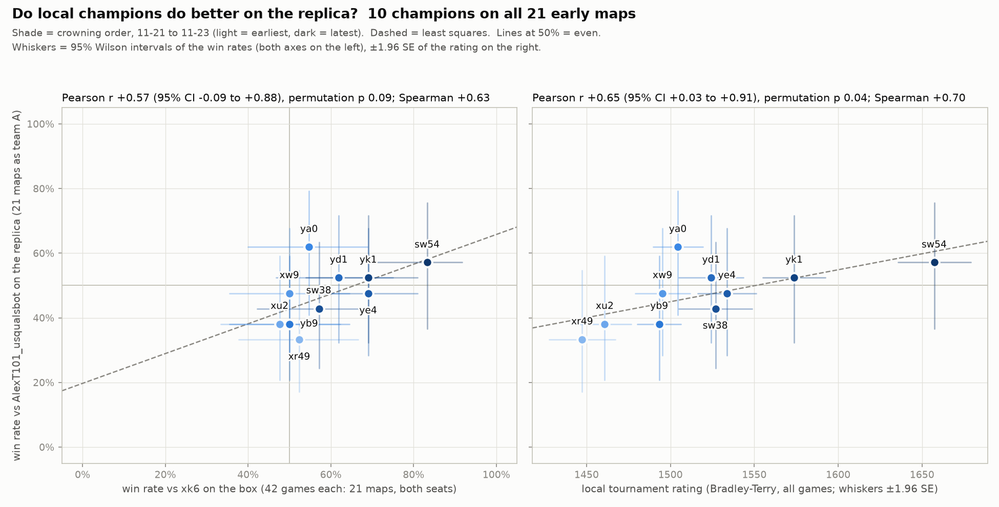

# Local champions vs the replica (scatterplot)

Owner 11-23 14:04 PDT: the scatterplot in progress/. From the 21-map study (11-23 14:28 PDT): 10 champions, each
42 games locally against xk6 on the 21 e21 maps (both seats) and 21 games on the replica against
AlexT101_usqualsbot (as team A). Details, method and per-map results:
[research/champ-corr/README.md](../research/champ-corr/README.md). The fit from local to replica rating, with the
projection to #15, #10 and #1: [local-to-replica.md](local-to-replica.md).

| bot | crowned (PDT) | local vs xk6: W-L (as A / as B) | replica vs AlexT101_usqualsbot: W-L | tournament rating |
|---|---|---|---|---|
| xr49 | 11-21 09:13 | 22-20 (52%; 12 / 10) | 7-14 (33%) | 1447 ± 10 |
| xu2 | 11-21 15:07 | 20-22 (48%; 10 / 10) | 8-13 (38%) | 1461 ± 8 |
| xw9 | 11-21 19:55 | 21-21 (50%; 12 / 9) | 10-11 (48%) | 1495 ± 8 |
| ya0 | 11-22 00:55 | 23-19 (55%; 13 / 10) | 13-8 (62%) | 1504 ± 8 |
| yb9 | 11-22 06:17 | 21-21 (50%; 11 / 10) | 8-13 (38%) | 1493 ± 7 |
| yd1 | 11-22 12:56 | 26-16 (62%; 13 / 13) | 11-10 (52%) | 1524 ± 10 |
| ye4 | 11-22 16:57 | 29-13 (69%; 14 / 15) | 10-11 (48%) | 1534 ± 9 |
| sw38 | 11-22 22:36 | 24-18 (57%; 13 / 11) | 9-12 (43%) | 1527 ± 11 |
| yk1 | 11-23 06:36 | 29-13 (69%; 15 / 14) | 11-10 (52%) | 1574 ± 9 |
| sw54 | 11-23 10:34 | 35-7 (83%; 16 / 19) | 12-9 (57%) | 1657 ± 11 |

| pair | Pearson r (95% CI) | permutation p | Spearman ρ (p) |
|---|---|---|---|
| local rate vs xk6 ~ replica rate | **+0.57** (-0.09 to +0.88) | 0.086 | +0.63 (0.058) |
| tournament rating ~ replica rate | **+0.65** (+0.03 to +0.91) | 0.036 | +0.70 (0.027) |
| tournament rating ~ local rate vs xk6 | **+0.93** (+0.73 to +0.98) | 0.000 | +0.91 (0.001) |

- The rating and the replica rate correlate at r +0.65 (p 0.036). The split-half reliabilities (local
  0.70, replica 0.51) cap any correlation between the two
  measures near 0.60.
- Leave one out: rating ~ replica +0.55 (without xr49) to +0.87 (without ya0).
