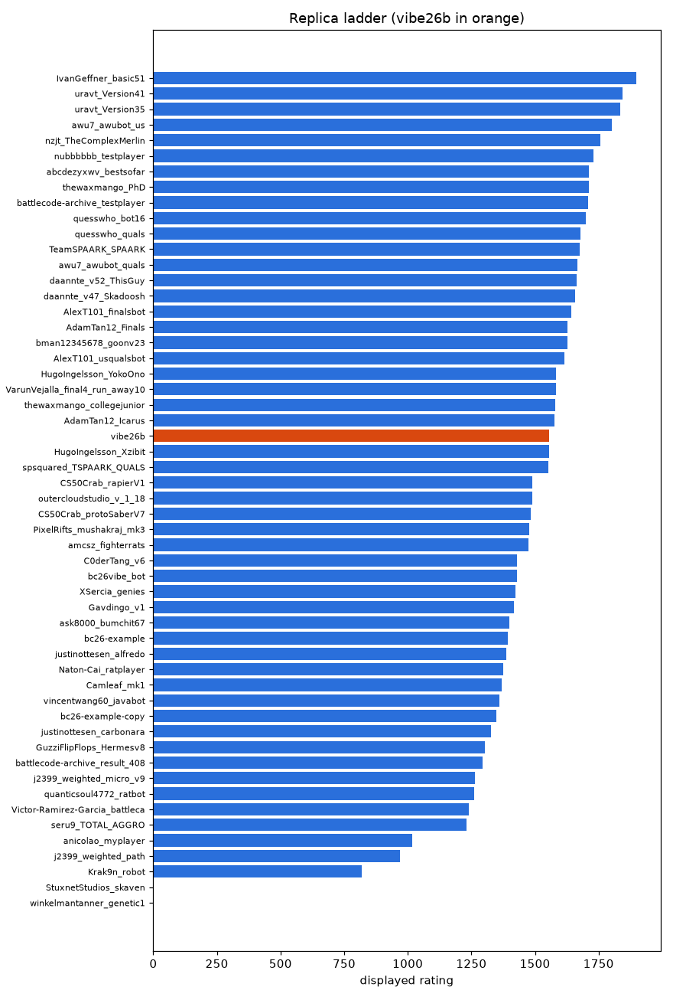

# Galaxy replica ladder

Snapshot of the Rankings page of our private galaxy replica, taken Nov 04 10:44 PDT. Written by `tools/replica_report.py`: regenerate it, do not edit it.

**Rating** is the replica's displayed rating (galaxy's penalized Elo, which starts every team low and climbs over its first rated matches); it is not the Bradley-Terry fit of `progress/ELO.md`. Games W-L counts the replica games in `progress/games.csv`. Our team is **vibe26b**.

| # | Team | Rating | Games W-L | Submission |
|---:|---|---:|---|---|
| 1 | IvanGeffner\_basic51 | 1899.5 | 946-509 | accepted |
| 2 | uravt\_Version41 | 1833.6 | 762-654 | accepted |
| 3 | uravt\_Version35 | 1830.2 | 722-673 | accepted |
| 4 | awu7\_awubot\_us | 1789.1 | 714-642 | accepted |
| 5 | quesswho\_bot16 | 1727.7 | 649-623 | accepted |
| 6 | battlecode-archive\_testplayer | 1717.6 | 682-608 | accepted |
| 7 | nzjt\_TheComplexMerlin | 1714.4 | 1051-824 | accepted |
| 8 | nubbbbbb\_testplayer | 1711.8 | 587-514 | accepted |
| 9 | thewaxmango\_PhD | 1710.5 | 631-608 | accepted |
| 10 | abcdezyxwv\_bestsofar | 1692.6 | 1086-738 | accepted |
| 11 | TeamSPAARK\_SPAARK | 1681.6 | 684-606 | accepted |
| 12 | daannte\_v52\_ThisGuy | 1670.3 | 658-650 | accepted |
| 13 | awu7\_awubot\_quals | 1652.7 | 629-598 | accepted |
| 14 | quesswho\_quals | 1649.9 | 633-537 | accepted |
| 15 | daannte\_v47\_Skadoosh | 1639.8 | 728-673 | accepted |
| 16 | AlexT101\_finalsbot | 1639.2 | 651-630 | accepted |
| 17 | bman12345678\_goonv23 | 1625.6 | 700-563 | accepted |
| 18 | thewaxmango\_collegejunior | 1618.1 | 1009-920 | accepted |
| 19 | AlexT101\_usqualsbot | 1613.9 | 1105-671 | accepted |
| 20 | HugoIngelsson\_YokoOno | 1596.3 | 986-892 | accepted |
| 21 | AdamTan12\_Finals | 1588.9 | 1320-990 | accepted |
| 22 | AdamTan12\_Icarus | 1579.6 | 923-976 | accepted |
| 23 | **vibe26b** | 1570.0 | 4921-4979 | accepted |
| 24 | HugoIngelsson\_Xzibit | 1569.7 | 938-892 | accepted |
| 25 | VarunVejalla\_final4\_run\_away10 | 1563.1 | 911-910 | accepted |
| 26 | spsquared\_TSPAARK\_QUALS | 1538.7 | 1041-1242 | accepted |
| 27 | CS50Crab\_rapierV1 | 1491.7 | 786-954 | accepted |
| 28 | outercloudstudio\_v\_1\_18 | 1488.8 | 669-1017 | accepted |
| 29 | CS50Crab\_protoSaberV7 | 1486.2 | 690-609 | accepted |
| 30 | amcsz\_fighterrats | 1481.3 | 580-689 | accepted |
| 31 | PixelRifts\_mushakraj\_mk3 | 1481.0 | 588-690 | accepted |
| 32 | bc26vibe\_bot | 1444.2 | 722-1051 | accepted |
| 33 | ask8000\_bumchit67 | 1439.4 | 661-752 | accepted |
| 34 | C0derTang\_v6 | 1429.8 | 647-760 | accepted |
| 35 | XSercia\_genies | 1426.2 | 674-802 | accepted |
| 36 | Gavdingo\_v1 | 1392.4 | 640-665 | accepted |
| 37 | bc26-example-copy | 1379.7 | 587-637 | accepted |
| 38 | Naton-Cai\_ratplayer | 1375.2 | 656-670 | accepted |
| 39 | vincentwang60\_javabot | 1372.2 | 670-722 | accepted |
| 40 | justinottesen\_alfredo | 1362.8 | 587-643 | accepted |
| 41 | Camleaf\_mk1 | 1361.0 | 592-665 | accepted |
| 42 | bc26-example | 1360.8 | 580-599 | accepted |
| 43 | battlecode-archive\_result\_408 | 1339.3 | 645-624 | accepted |
| 44 | justinottesen\_carbonara | 1324.7 | 622-620 | accepted |
| 45 | GuzziFlipFlops\_Hermesv8 | 1300.3 | 627-705 | accepted |
| 46 | quanticsoul4772\_ratbot | 1259.3 | 734-625 | accepted |
| 47 | j2399\_weighted\_micro\_v9 | 1251.4 | 651-624 | accepted |
| 48 | seru9\_TOTAL\_AGGRO | 1250.3 | 637-710 | accepted |
| 49 | Victor-Ramirez-Garcia\_battleca | 1235.4 | 757-569 | accepted |
| 50 | anicolao\_myplayer | 1016.2 | 372-762 | accepted |
| 51 | j2399\_weighted\_path | 985.2 | 336-600 | accepted |
| 52 | Krak9n\_robot | 840.4 | 158-649 | accepted |
| 53 | StuxnetStudios\_skaven | 0.0 | 0-0 | none |
| 54 | winkelmantanner\_genetic1 | 0.0 | 0-0 | none |
