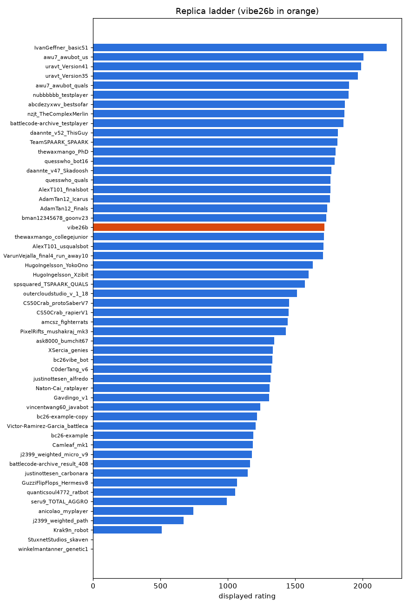

# Galaxy replica ladder

Snapshot of the Rankings page of our private galaxy replica, taken Nov 22 11:38 PDT. Written by `tools/replica_report.py`: regenerate it, do not edit it.

**Rating** is the replica's displayed rating (galaxy's penalized Elo, which starts every team low and climbs over its first rated matches); it is not the Bradley-Terry fit of `progress/ELO.md`. Games W-L counts the replica games in `progress/games.csv`. Our team is **vibe26b**.

| # | Team | Rating | Games W-L | Submission |
|---:|---|---:|---|---|
| 1 | IvanGeffner\_basic51 | 2177.9 | 2564-1360 | accepted |
| 2 | awu7\_awubot\_us | 2013.5 | 1888-1877 | accepted |
| 3 | uravt\_Version35 | 1989.0 | 1900-1892 | accepted |
| 4 | uravt\_Version41 | 1985.8 | 2055-1827 | accepted |
| 5 | awu7\_awubot\_quals | 1900.5 | 1729-1679 | accepted |
| 6 | nubbbbbb\_testplayer | 1893.9 | 1670-1558 | accepted |
| 7 | abcdezyxwv\_bestsofar | 1852.7 | 2142-1809 | accepted |
| 8 | battlecode-archive\_testplayer | 1851.8 | 1735-1652 | accepted |
| 9 | nzjt\_TheComplexMerlin | 1842.4 | 3073-2060 | accepted |
| 10 | TeamSPAARK\_SPAARK | 1827.9 | 1771-1631 | accepted |
| 11 | daannte\_v52\_ThisGuy | 1819.1 | 1746-1689 | accepted |
| 12 | quesswho\_bot16 | 1809.4 | 1723-1685 | accepted |
| 13 | thewaxmango\_PhD | 1800.1 | 1720-1652 | accepted |
| 14 | quesswho\_quals | 1758.6 | 1699-1541 | accepted |
| 15 | daannte\_v47\_Skadoosh | 1756.0 | 1838-1720 | accepted |
| 16 | AlexT101\_finalsbot | 1755.6 | 1678-1628 | accepted |
| 17 | bman12345678\_goonv23 | 1743.3 | 2240-1799 | accepted |
| 18 | AdamTan12\_Finals | 1739.4 | 2990-2716 | accepted |
| 19 | AdamTan12\_Icarus | 1735.9 | 2899-2997 | accepted |
| 20 | **vibe26b** | 1732.2 | 12694-11723 | accepted |
| 21 | thewaxmango\_collegejunior | 1719.5 | 2682-2556 | accepted |
| 22 | AlexT101\_usqualsbot | 1713.6 | 2691-1984 | accepted |
| 23 | VarunVejalla\_final4\_run\_away10 | 1671.8 | 2532-2820 | accepted |
| 24 | HugoIngelsson\_Xzibit | 1641.9 | 2278-2846 | accepted |
| 25 | HugoIngelsson\_YokoOno | 1637.7 | 2732-2716 | accepted |
| 26 | spsquared\_TSPAARK\_QUALS | 1593.5 | 2254-3557 | accepted |
| 27 | outercloudstudio\_v\_1\_18 | 1478.3 | 1709-2140 | accepted |
| 28 | CS50Crab\_protoSaberV7 | 1460.4 | 1667-1639 | accepted |
| 29 | amcsz\_fighterrats | 1449.4 | 1706-1909 | accepted |
| 30 | PixelRifts\_mushakraj\_mk3 | 1437.2 | 1669-1775 | accepted |
| 31 | CS50Crab\_rapierV1 | 1427.6 | 1763-1996 | accepted |
| 32 | justinottesen\_alfredo | 1336.6 | 1592-1672 | accepted |
| 33 | C0derTang\_v6 | 1335.7 | 1660-1817 | accepted |
| 34 | ask8000\_bumchit67 | 1334.8 | 1738-1874 | accepted |
| 35 | XSercia\_genies | 1329.1 | 1730-1897 | accepted |
| 36 | bc26vibe\_bot | 1317.0 | 1766-2101 | accepted |
| 37 | Gavdingo\_v1 | 1293.9 | 1688-1705 | accepted |
| 38 | Naton-Cai\_ratplayer | 1282.8 | 1732-1763 | accepted |
| 39 | vincentwang60\_javabot | 1257.2 | 1749-1815 | accepted |
| 40 | bc26-example-copy | 1220.9 | 1629-1713 | accepted |
| 41 | Camleaf\_mk1 | 1195.2 | 1658-1759 | accepted |
| 42 | Victor-Ramirez-Garcia\_battleca | 1193.1 | 2019-1365 | accepted |
| 43 | bc26-example | 1187.2 | 1638-1698 | accepted |
| 44 | j2399\_weighted\_micro\_v9 | 1182.2 | 1694-1525 | accepted |
| 45 | justinottesen\_carbonara | 1153.0 | 1704-1704 | accepted |
| 46 | battlecode-archive\_result\_408 | 1142.3 | 1686-1662 | accepted |
| 47 | GuzziFlipFlops\_Hermesv8 | 1087.9 | 1710-1770 | accepted |
| 48 | quanticsoul4772\_ratbot | 1050.2 | 1878-1497 | accepted |
| 49 | seru9\_TOTAL\_AGGRO | 981.8 | 1740-1674 | accepted |
| 50 | anicolao\_myplayer | 726.5 | 1008-1917 | accepted |
| 51 | j2399\_weighted\_path | 668.7 | 817-1616 | accepted |
| 52 | Krak9n\_robot | 508.5 | 363-1659 | accepted |
| 53 | StuxnetStudios\_skaven | 0.0 | 0-0 | none |
| 54 | winkelmantanner\_genetic1 | 0.0 | 0-0 | none |
