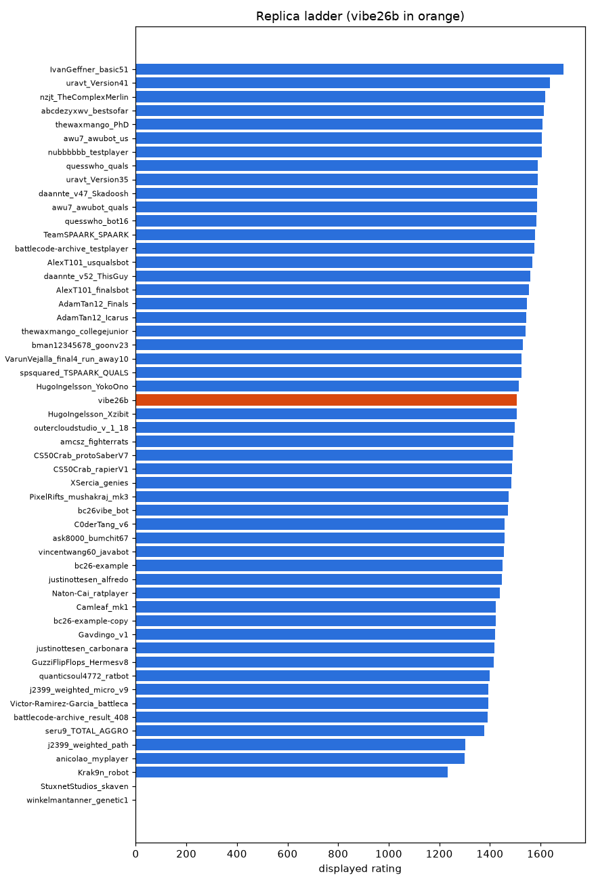

# Galaxy replica ladder

Snapshot of the Rankings page of our private galaxy replica, taken Oct 28 20:51 PDT. Written by `tools/replica_report.py`: regenerate it, do not edit it.

**Rating** is the replica's displayed rating (galaxy's penalized Elo, which starts every team low and climbs over its first rated matches); it is not the Bradley-Terry fit of `progress/ELO.md`. Games W-L counts the replica games in `progress/games.csv`. Our team is **vibe26b**.

| # | Team | Rating | Games W-L | Submission |
|---:|---|---:|---|---|
| 1 | IvanGeffner\_basic51 | 1690.7 | 94-38 | accepted |
| 2 | uravt\_Version41 | 1637.4 | 86-37 | accepted |
| 3 | nzjt\_TheComplexMerlin | 1619.4 | 81-36 | accepted |
| 4 | abcdezyxwv\_bestsofar | 1613.3 | 134-49 | accepted |
| 5 | thewaxmango\_PhD | 1608.8 | 80-40 | accepted |
| 6 | awu7\_awubot\_us | 1606.5 | 78-42 | accepted |
| 7 | nubbbbbb\_testplayer | 1606.2 | 73-41 | accepted |
| 8 | quesswho\_quals | 1589.3 | 79-53 | accepted |
| 9 | uravt\_Version35 | 1588.0 | 82-56 | accepted |
| 10 | daannte\_v47\_Skadoosh | 1587.5 | 95-67 | accepted |
| 11 | awu7\_awubot\_quals | 1586.8 | 81-51 | accepted |
| 12 | quesswho\_bot16 | 1584.8 | 86-67 | accepted |
| 13 | TeamSPAARK\_SPAARK | 1577.4 | 87-63 | accepted |
| 14 | battlecode-archive\_testplayer | 1576.9 | 93-63 | accepted |
| 15 | AlexT101\_usqualsbot | 1567.9 | 132-75 | accepted |
| 16 | daannte\_v52\_ThisGuy | 1558.9 | 76-65 | accepted |
| 17 | AlexT101\_finalsbot | 1555.6 | 92-79 | accepted |
| 18 | AdamTan12\_Finals | 1547.0 | 83-70 | accepted |
| 19 | AdamTan12\_Icarus | 1544.9 | 94-80 | accepted |
| 20 | thewaxmango\_collegejunior | 1540.4 | 78-57 | accepted |
| 21 | bman12345678\_goonv23 | 1530.4 | 74-49 | accepted |
| 22 | VarunVejalla\_final4\_run\_away10 | 1525.7 | 58-41 | accepted |
| 23 | spsquared\_TSPAARK\_QUALS | 1524.9 | 74-55 | accepted |
| 24 | HugoIngelsson\_YokoOno | 1514.5 | 76-65 | accepted |
| 25 | **vibe26b** | 1506.8 | 405-339 | accepted |
| 26 | HugoIngelsson\_Xzibit | 1504.8 | 74-61 | accepted |
| 27 | outercloudstudio\_v\_1\_18 | 1498.4 | 73-80 | accepted |
| 28 | amcsz\_fighterrats | 1492.6 | 62-64 | accepted |
| 29 | CS50Crab\_protoSaberV7 | 1489.9 | 69-69 | accepted |
| 30 | CS50Crab\_rapierV1 | 1488.0 | 93-99 | accepted |
| 31 | XSercia\_genies | 1485.8 | 88-161 | accepted |
| 32 | PixelRifts\_mushakraj\_mk3 | 1472.7 | 67-80 | accepted |
| 33 | bc26vibe\_bot | 1472.2 | 85-98 | accepted |
| 34 | C0derTang\_v6 | 1459.3 | 66-120 | accepted |
| 35 | ask8000\_bumchit67 | 1457.9 | 75-135 | accepted |
| 36 | vincentwang60\_javabot | 1456.3 | 63-81 | accepted |
| 37 | bc26-example | 1448.9 | 68-94 | accepted |
| 38 | justinottesen\_alfredo | 1446.5 | 70-92 | accepted |
| 39 | Naton-Cai\_ratplayer | 1438.6 | 52-65 | accepted |
| 40 | Camleaf\_mk1 | 1424.4 | 53-76 | accepted |
| 41 | bc26-example-copy | 1421.9 | 52-80 | accepted |
| 42 | Gavdingo\_v1 | 1421.3 | 64-98 | accepted |
| 43 | justinottesen\_carbonara | 1417.2 | 50-67 | accepted |
| 44 | GuzziFlipFlops\_Hermesv8 | 1415.0 | 63-90 | accepted |
| 45 | quanticsoul4772\_ratbot | 1400.1 | 58-83 | accepted |
| 46 | j2399\_weighted\_micro\_v9 | 1393.5 | 55-83 | accepted |
| 47 | Victor-Ramirez-Garcia\_battleca | 1392.9 | 53-97 | accepted |
| 48 | battlecode-archive\_result\_408 | 1390.7 | 51-84 | accepted |
| 49 | seru9\_TOTAL\_AGGRO | 1377.4 | 51-90 | accepted |
| 50 | j2399\_weighted\_path | 1302.3 | 21-66 | accepted |
| 51 | anicolao\_myplayer | 1300.7 | 35-109 | accepted |
| 52 | Krak9n\_robot | 1233.7 | 10-92 | accepted |
| 53 | StuxnetStudios\_skaven | 0.0 | 0-0 | none |
| 54 | winkelmantanner\_genetic1 | 0.0 | 0-0 | none |
