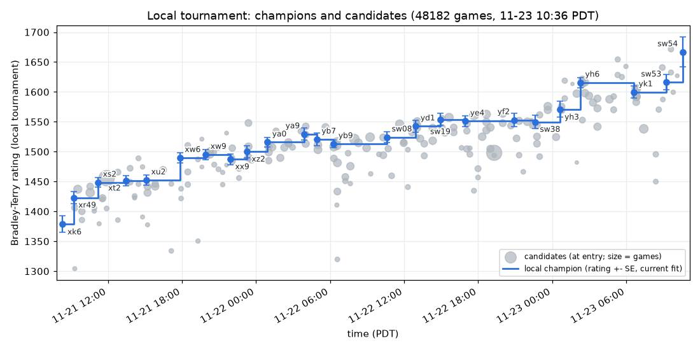

# Local tournament Elo

Bradley-Terry ratings of our own bots in the local tournament (`tools/tourney.py`), all 48182 games in one fit as of 2026-11-23 10:36 PDT, so every point is on the same scale; earlier champions are shown at their current rating. Regenerate with `tools/tourney.py chart`.

| Champion from (PDT) | Bot | Change on base | Submission | Rating +- SE | Games |
|---|---|---|---:|---:|---:|
| 2026-11-21 08:20 | xk6 | starting champion (tournament began) |  | 1379 +- 14 | 662 |
| 2026-11-21 09:13 | xr49 | MAX_BABIES 14 on xk6 | #432 | 1423 +- 10 | 1167 |
| 2026-11-21 11:12 | xs2 | KING_THREAT_D2 26 on xr49 | #433 | 1449 +- 8 | 1848 |
| 2026-11-21 13:27 | xt2 | MAX_BABIES 15 on xs2 | #434 | 1451 +- 9 | 1689 |
| 2026-11-21 15:07 | xu2 | KING_THREAT_D2 30 on xt2 | #435 | 1452 +- 8 | 2042 |
| 2026-11-21 17:50 | xw6 | THROW_HOLD 10 on xu2 | #436 | 1490 +- 9 | 1747 |
| 2026-11-21 19:55 | xw9 | MAX_BABIES 16 on xw6 | #437 | 1495 +- 8 | 1872 |
| 2026-11-21 21:55 | xx9 | GRAB_THREAT 15 on xw9 | #438 | 1487 +- 9 | 1666 |
| 2026-11-21 23:15 | xz2 | LOW_FLOOR 200 on xx9 | #439 | 1500 +- 10 | 1373 |
| 2026-11-22 00:55 | ya0 | KING_RESERVE 400 on xz2 | #440 | 1516 +- 8 | 2087 |
| 2026-11-22 03:55 | ya9 | GATHER_CAT_DIST 32 on ya0 | #441 | 1530 +- 10 | 1176 |
| 2026-11-22 04:55 | yb7 | CAT_DEFEND_R2 64 on ya9 | #442 | 1521 +- 11 | 1175 |
| 2026-11-22 06:17 | yb9 | throw dodge: dodge any carrying enemy rat on yb7 | #443 | 1513 +- 7 | 2740 |
| 2026-11-22 10:36 | sw08 | forward hold: FIGHT_POST 8 + WAR_GATHER 0 (big swing) on yb9 | #444 | 1524 +- 9 | 1424 |
| 2026-11-22 12:56 | yd1 | FIGHT_POST 12 on sw08 | #445 | 1543 +- 10 | 1210 |
| 2026-11-22 14:56 | sw19 | FIGHT_POST 12 + cat endgame END_CAT 1600 END_CAT_COOP 1200 (big swing) on sw08 | #446 | 1554 +- 10 | 1188 |
| 2026-11-22 16:57 | ye4 | END_CAT 1400 on sw19 | #447 | 1551 +- 9 | 1488 |
| 2026-11-22 20:56 | yf2 | DEFEND_D2 225 on ye4 | #448 | 1553 +- 11 | 1035 |
| 2026-11-22 22:36 | sw38 | RUSH_UNTIL 200 + END_CAT_COOP 1000 on yf2 | #449 | 1550 +- 11 | 944 |
| 2026-11-23 00:36 | yh3 | INCOME_TRUST 50 on sw38 | #450 | 1571 +- 13 | 714 |
| 2026-11-23 02:16 | yh6 | INCOME_TRUST 30 on sw38 | #451 | 1616 +- 9 | 1606 |
| 2026-11-23 06:36 | yk1 | FIGHT_POST 10 on yh6 | #452 | 1600 +- 10 | 1273 |
| 2026-11-23 09:14 | sw53 | RAID_SHARE 2 + FWD_TRAP (raiders + forward traps; sparring partner crowned) on yk1 | #453 | 1616 +- 13 | 722 |
| 2026-11-23 10:34 | sw54 | MAX_BABIES_WAR 20 + RICH_BANK 600 + CORE_BABIES 20 + KING_RESERVE 300 (sw50's bank on bodies on the raider line; big swing) on sw53 | #454 | 1667 +- 25 | 201 |
