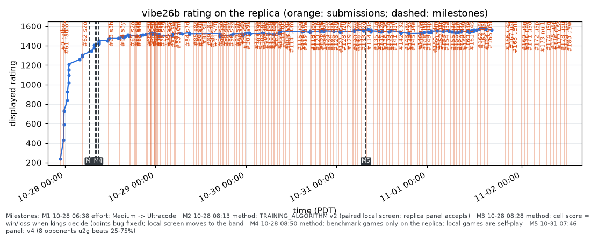

# Rating history (replica)

Our displayed rating on the replica after each rated match, from `/api/compete/bc26/match/historical_rating/`, with each submission marked at its upload. Regenerate with `tools/replica_report.py`; data fetched 2026-11-04 17:41 PDT. Times are Pacific.

Milestones (dashed lines tagged M1, M2, ...; `progress/milestones.csv`):

- M1 2026-10-28 06:38 PDT: effort: Medium -> Ultracode
- M2 2026-10-28 08:13 PDT: method: TRAINING_ALGORITHM v2 (paired local screen; replica panel accepts)
- M3 2026-10-28 08:28 PDT: method: cell score = win/loss when kings decide (points bug fixed); local screen moves to the band
- M4 2026-10-28 08:50 PDT: method: benchmark games only on the replica; local games are self-play
- M5 2026-10-31 07:46 PDT: panel: v4 (8 opponents u2g beats 25-75%)

281 rated matches; latest rating 1,560 (2026-11-04 16:00 PDT).

| Submission | Build | Uploaded (PDT) | Accepted | Rating at upload | Rated matches since |
|---:|---|---|---|---:|---:|
| #9 | ratbot | 2026-10-27 22:49 | yes | 0 | 1 |
| #61 | ratbot | 2026-10-27 23:40 | yes | 237 | 10 |
| #62 | s2o | 2026-10-28 04:40 | yes | 1,258 | 10 |
| #63 | s3h | 2026-10-28 11:33 | yes | 1,451 | 4 |
| #64 | s3y | 2026-10-28 14:38 | yes | 1,479 | 9 |
| #65 | s2o | 2026-10-28 17:17 | yes | 1,507 | 0 |
| #66 | s3y | 2026-10-28 18:27 | yes | 1,507 | 0 |
| #67 | s4b | 2026-10-28 18:41 | yes | 1,507 | 0 |
| #68 | s4d | 2026-10-28 18:56 | yes | 1,507 | 4 |
| #69 | s3y | 2026-10-28 21:42 | yes | 1,515 | 0 |
| #70 | s4j | 2026-10-28 21:53 | yes | 1,515 | 1 |
| #71 | s3y | 2026-10-28 22:41 | yes | 1,527 | 1 |
| #72 | s4i | 2026-10-28 22:52 | yes | 1,531 | 2 |
| #73 | s3y | 2026-10-28 23:43 | yes | 1,531 | 0 |
| #74 | s4t | 2026-10-28 23:44 | yes | 1,531 | 2 |
| #75 | s3y | 2026-10-29 00:11 | yes | 1,515 | 1 |
| #76 | s5g | 2026-10-29 00:28 | yes | 1,519 | 0 |
| #77 | s5e | 2026-10-29 00:33 | yes | 1,519 | 4 |
| #78 | s5g | 2026-10-29 01:17 | yes | 1,495 | 0 |
| #79 | s3y | 2026-10-29 02:39 | yes | 1,495 | 0 |
| #80 | s5r | 2026-10-29 03:19 | yes | 1,495 | 0 |
| #81 | s5w | 2026-10-29 04:10 | yes | 1,495 | 2 |
| #82 | s6j | 2026-10-29 04:54 | yes | 1,518 | 0 |
| #83 | s6m | 2026-10-29 05:26 | yes | 1,518 | 2 |
| #84 | s7d | 2026-10-29 07:44 | yes | 1,525 | 4 |
| #85 | s8c | 2026-10-29 10:07 | yes | 1,521 | 0 |
| #86 | s7h | 2026-10-29 10:49 | yes | 1,521 | 0 |
| #87 | s8a | 2026-10-29 11:30 | yes | 1,521 | 0 |
| #88 | s8j | 2026-10-29 12:21 | yes | 1,521 | 0 |
| #89 | s8k | 2026-10-29 13:33 | yes | 1,521 | 0 |
| #90 | s7w | 2026-10-29 14:30 | yes | 1,521 | 0 |
| #91 | s7q | 2026-10-29 15:11 | yes | 1,521 | 0 |
| #92 | s8o | 2026-10-29 16:38 | yes | 1,521 | 4 |
| #93 | s8t | 2026-10-29 17:23 | yes | 1,497 | 0 |
| #94 | s8u | 2026-10-29 17:55 | yes | 1,497 | 0 |
| #95 | s8x | 2026-10-29 18:47 | yes | 1,497 | 0 |
| #96 | s9a | 2026-10-29 19:31 | yes | 1,497 | 2 |
| #97 | s9b | 2026-10-29 20:59 | yes | 1,520 | 0 |
| #98 | s9k | 2026-10-29 21:40 | yes | 1,520 | 0 |
| #99 | s9i | 2026-10-29 22:18 | yes | 1,520 | 3 |
| #100 | s9r | 2026-10-29 23:11 | yes | 1,507 | 2 |
| #101 | s9s | 2026-10-29 23:55 | yes | 1,530 | 5 |
| #102 | t0a | 2026-10-30 02:13 | yes | 1,520 | 0 |
| #103 | s9s | 2026-10-30 02:46 | yes | 1,520 | 0 |
| #104 | s9z | 2026-10-30 03:49 | yes | 1,520 | 1 |
| #105 | t0c | 2026-10-30 04:28 | yes | 1,531 | 1 |
| #106 | t0h | 2026-10-30 05:12 | yes | 1,526 | 1 |
| #107 | t0g | 2026-10-30 06:03 | yes | 1,522 | 0 |
| #108 | t0o | 2026-10-30 06:45 | yes | 1,522 | 1 |
| #109 | t0i | 2026-10-30 07:26 | yes | 1,517 | 0 |
| #110 | t0p | 2026-10-30 08:20 | yes | 1,517 | 2 |
| #111 | t0f | 2026-10-30 08:56 | yes | 1,530 | 4 |
| #112 | u0f | 2026-10-30 10:02 | yes | 1,550 | 0 |
| #113 | u0e | 2026-10-30 10:35 | yes | 1,550 | 0 |
| #114 | u0m | 2026-10-30 11:25 | yes | 1,550 | 0 |
| #115 | u0q | 2026-10-30 13:38 | yes | 1,550 | 0 |
| #116 | u0z | 2026-10-30 14:37 | yes | 1,550 | 1 |
| #117 | u1a | 2026-10-30 15:02 | yes | 1,546 | 5 |
| #118 | u0o | 2026-10-30 17:05 | yes | 1,542 | 0 |
| #119 | u0y | 2026-10-30 17:23 | yes | 1,542 | 0 |
| #120 | u1p | 2026-10-30 18:25 | yes | 1,542 | 0 |
| #121 | u1o | 2026-10-30 19:26 | yes | 1,542 | 0 |
| #122 | u1r | 2026-10-30 19:37 | yes | 1,542 | 4 |
| #123 | u1v | 2026-10-30 20:56 | yes | 1,554 | 0 |
| #124 | u1y | 2026-10-30 21:43 | yes | 1,554 | 0 |
| #125 | u2b | 2026-10-30 22:19 | yes | 1,554 | 0 |
| #126 | u2g | 2026-10-30 23:13 | yes | 1,554 | 1 |
| #127 | u0m | 2026-10-31 00:34 | yes | 1,549 | 5 |
| #128 | u2g | 2026-10-31 01:20 | yes | 1,546 | 0 |
| #129 | u2s | 2026-10-31 02:45 | yes | 1,546 | 0 |
| #130 | u2v | 2026-10-31 04:22 | yes | 1,546 | 2 |
| #131 | u2w | 2026-10-31 04:56 | yes | 1,559 | 0 |
| #132 | u2y | 2026-10-31 05:38 | yes | 1,559 | 0 |
| #133 | u2g | 2026-10-31 06:33 | yes | 1,559 | 3 |
| #134 | u3c | 2026-10-31 08:01 | yes | 1,554 | 6 |
| #135 | u2g | 2026-10-31 09:50 | yes | 1,554 | 0 |
| #136 | u3c | 2026-10-31 10:46 | yes | 1,554 | 1 |
| #137 | u2g | 2026-10-31 11:18 | yes | 1,549 | 2 |
| #138 | u3c | 2026-10-31 12:14 | yes | 1,549 | 0 |
| #139 | u3q | 2026-10-31 13:06 | yes | 1,549 | 1 |
| #140 | u3d | 2026-10-31 14:03 | yes | 1,544 | 1 |
| #141 | u3v | 2026-10-31 14:44 | yes | 1,556 | 0 |
| #142 | u3z | 2026-10-31 16:23 | yes | 1,556 | 5 |
| #143 | u3v | 2026-10-31 18:01 | yes | 1,536 | 1 |
| #144 | u3z | 2026-10-31 18:52 | yes | 1,532 | 1 |
| #145 | u4e | 2026-10-31 19:39 | yes | 1,527 | 0 |
| #146 | u4k | 2026-10-31 21:24 | yes | 1,527 | 0 |
| #147 | u4l | 2026-10-31 22:01 | yes | 1,527 | 4 |
| #149 | u4p | 2026-10-31 23:45 | yes | 1,538 | 0 |
| #148 | u4o | 2026-10-31 22:54 | yes | 1,536 | 7 |
| #150 | u4m | 2026-11-01 01:28 | yes | 1,549 | 0 |
| #151 | u4v | 2026-11-01 01:10 | yes | 1,549 | 1 |
| #152 | u4r | 2026-11-01 01:57 | yes | 1,553 | 0 |
| #153 | u4q | 2026-11-01 02:45 | yes | 1,553 | 1 |
| #154 | u5a | 2026-11-01 03:36 | yes | 1,549 | 2 |
| #155 | u4e | 2026-11-01 05:11 | yes | 1,549 | 2 |
| #156 | u5a | 2026-11-01 06:02 | yes | 1,547 | 1 |
| #157 | u4y | 2026-11-01 06:49 | yes | 1,535 | 2 |
| #158 | u4n | 2026-11-01 07:40 | yes | 1,541 | 4 |
| #159 | u4z | 2026-11-01 08:26 | yes | 1,544 | 0 |
| #160 | u4e | 2026-11-01 09:12 | yes | 1,544 | 3 |
| #161 | u4s | 2026-11-01 10:09 | yes | 1,538 | 6 |
| #162 | u5i | 2026-11-01 12:26 | yes | 1,559 | 1 |
| #163 | u5j | 2026-11-01 13:17 | yes | 1,570 | 1 |
| #164 | u5k | 2026-11-01 14:08 | yes | 1,582 | 2 |
| #165 | u5l | 2026-11-01 14:54 | yes | 1,573 | 4 |
| #166 | u4s | 2026-11-01 19:42 | yes | 1,546 | 2 |
| #167 | u5l | 2026-11-01 20:38 | yes | 1,538 | 0 |
| #168 | u5m | 2026-11-01 21:35 | yes | 1,538 | 7 |
| #169 | u5n | 2026-11-02 00:03 | yes | 1,564 | 0 |
| #170 | u4s | 2026-11-02 00:50 | yes | 1,564 | 0 |
| #171 | u5o | 2026-11-02 01:31 | yes | 1,564 | 6 |
| #172 | u5p | 2026-11-02 03:22 | yes | 1,588 | 5 |
| #173 | nul1 | 2026-11-02 04:49 | yes | 1,593 | 6 |
| #174 | u5q | 2026-11-02 06:31 | yes | 1,601 | 0 |
| #175 | u5r | 2026-11-02 07:45 | yes | 1,601 | 4 |
| #176 | u5s | 2026-11-02 08:33 | yes | 1,599 | 1 |
| #177 | u5t | 2026-11-02 09:21 | yes | 1,605 | 2 |
| #178 | u5u | 2026-11-02 10:20 | yes | 1,612 | 2 |
| #179 | u5v | 2026-11-02 11:20 | yes | 1,609 | 0 |
| #180 | u5w | 2026-11-02 12:02 | yes | 1,609 | 5 |
| #181 | u5x | 2026-11-02 14:29 | yes | 1,603 | 0 |
| #182 | u5y | 2026-11-02 14:45 | yes | 1,603 | 0 |
| #183 | u6a | 2026-11-02 15:46 | yes | 1,603 | 5 |
| #184 | u6b | 2026-11-02 18:12 | yes | 1,598 | 0 |
| #185 | u6c | 2026-11-02 18:59 | yes | 1,598 | 7 |
| #186 | u6g | 2026-11-02 21:16 | yes | 1,623 | 1 |
| #187 | u6h | 2026-11-02 21:54 | yes | 1,622 | 2 |
| #188 | u6i | 2026-11-02 23:34 | yes | 1,629 | 5 |
| #189 | u6j | 2026-11-03 00:32 | yes | 1,620 | 3 |
| #190 | u6q | 2026-11-03 02:41 | yes | 1,621 | 1 |
| #191 | u6p | 2026-11-03 02:57 | yes | 1,623 | 2 |
| #192 | u6t | 2026-11-03 03:53 | yes | 1,629 | 1 |
| #193 | u6v | 2026-11-03 04:54 | yes | 1,636 | 2 |
| #194 | u6o | 2026-11-03 06:14 | yes | 1,648 | 2 |
| #195 | u6x | 2026-11-03 07:49 | yes | 1,644 | 7 |
| #196 | u6y | 2026-11-03 10:06 | yes | 1,622 | 0 |
| #197 | u7a | 2026-11-03 10:28 | yes | 1,622 | 2 |
| #198 | u7b | 2026-11-03 11:19 | yes | 1,622 | 0 |
| #199 | u7d | 2026-11-03 12:22 | yes | 1,622 | 0 |
| #200 | u6x | 2026-11-03 13:41 | yes | 1,622 | 1 |
| #201 | u7d | 2026-11-03 14:32 | yes | 1,610 | 3 |
| #202 | u7h | 2026-11-03 15:55 | yes | 1,589 | 4 |
| #203 | u7i | 2026-11-03 16:59 | yes | 1,577 | 0 |
| #204 | u7j | 2026-11-03 17:40 | yes | 1,577 | 0 |
| #205 | u7c | 2026-11-03 18:13 | yes | 1,577 | 0 |
| #206 | u7m | 2026-11-03 19:26 | yes | 1,577 | 0 |
| #207 | u7n | 2026-11-03 20:08 | yes | 1,577 | 2 |
| #208 | u7p | 2026-11-03 20:55 | yes | 1,577 | 2 |
| #209 | u7o | 2026-11-03 22:40 | yes | 1,581 | 1 |
| #210 | u7q | 2026-11-03 23:21 | yes | 1,584 | 5 |
| #211 | u7i | 2026-11-04 00:13 | yes | 1,559 | 0 |
| #212 | u7x | 2026-11-04 01:01 | yes | 1,559 | 2 |
| #213 | u7n | 2026-11-04 01:58 | yes | 1,576 | 0 |
| #214 | u7p | 2026-11-04 02:44 | yes | 1,576 | 0 |
| #215 | u8f | 2026-11-04 03:30 | yes | 1,576 | 2 |
| #216 | u8j | 2026-11-04 05:10 | yes | 1,566 | 1 |
| #217 | u8h | 2026-11-04 06:12 | yes | 1,553 | 0 |
| #218 | u8m | 2026-11-04 07:33 | yes | 1,553 | 4 |
| #219 | u8p | 2026-11-04 08:29 | yes | 1,570 | 0 |
| #220 | u8q | 2026-11-04 10:15 | yes | 1,570 | 2 |
| #221 | u8w | 2026-11-04 11:48 | yes | 1,576 | 1 |
| #222 | u8x | 2026-11-04 12:54 | yes | 1,580 | 2 |
| #223 | u6x | 2026-11-04 14:23 | yes | 1,579 | 7 |
| #224 | u9i | 2026-11-04 16:41 | yes | 1,560 | 0 |
| #225 | u8r | 2026-11-04 17:33 | yes | 1,560 | 0 |
