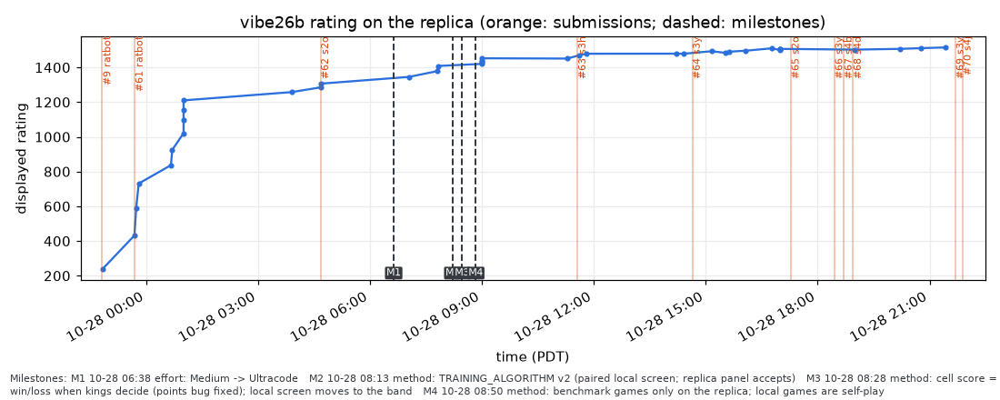

# Rating history (replica)

Our displayed rating on the replica after each rated match, from `/api/compete/bc26/match/historical_rating/`, with each submission marked at its upload. Regenerate with `tools/replica_report.py`; data fetched 2026-10-28 21:54 PDT. Times are Pacific.

Milestones (dashed lines tagged M1, M2, ...; `progress/milestones.csv`):

- M1 2026-10-28 06:38 PDT: effort: Medium -> Ultracode
- M2 2026-10-28 08:13 PDT: method: TRAINING_ALGORITHM v2 (paired local screen; replica panel accepts)
- M3 2026-10-28 08:28 PDT: method: cell score = win/loss when kings decide (points bug fixed); local screen moves to the band
- M4 2026-10-28 08:50 PDT: method: benchmark games only on the replica; local games are self-play

38 rated matches; latest rating 1,515 (2026-10-28 21:25 PDT).

| Submission | Build | Uploaded (PDT) | Accepted | Rating at upload | Rated matches since |
|---:|---|---|---|---:|---:|
| #9 | ratbot | 2026-10-27 22:49 | yes | 0 | 1 |
| #61 | ratbot | 2026-10-27 23:40 | yes | 237 | 10 |
| #62 | s2o | 2026-10-28 04:40 | yes | 1,258 | 10 |
| #63 | s3h | 2026-10-28 11:33 | yes | 1,451 | 4 |
| #64 | s3y | 2026-10-28 14:38 | yes | 1,479 | 9 |
| #65 | s2o | 2026-10-28 17:17 | yes | 1,507 | 0 |
| #66 | s3y | 2026-10-28 18:27 | yes | 1,507 | 0 |
| #67 | s4b | 2026-10-28 18:41 | yes | 1,507 | 0 |
| #68 | s4d | 2026-10-28 18:56 | yes | 1,507 | 4 |
| #69 | s3y | 2026-10-28 21:42 | yes | 1,515 | 0 |
| #70 | s4j | 2026-10-28 21:53 | yes | 1,515 | 0 |
