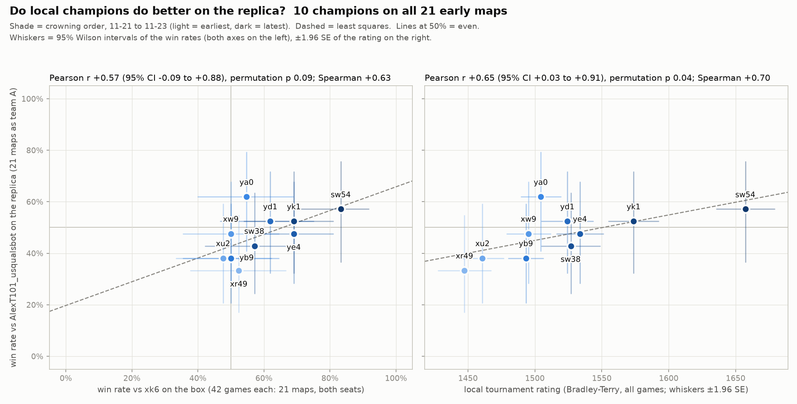
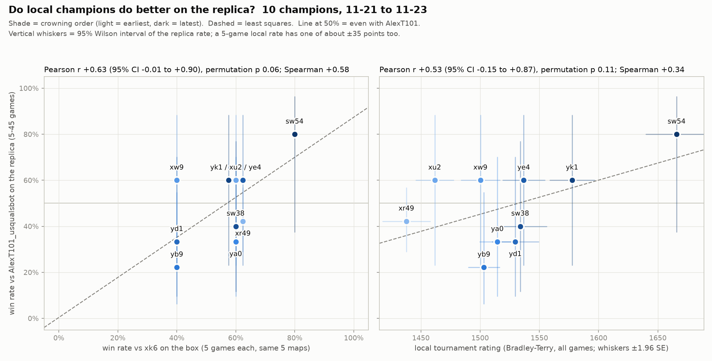

# Local champions vs the replica: win rate vs xk6 against win rate vs AlexT101_usqualsbot

**First owner request (11-23 11:48 PDT):** a scatterplot and correlation between local champions and the panel. For each
champion, compare its win rate vs xk6 (local) with its win rate vs AlexT101_usqualsbot (replica). Use a sample of 10
champions evenly spaced over time, with 5 games against each opponent.

## Results, 21 maps (11-23 14:28 PDT)

**Owner request (12:45 PDT):** firm up the game count. Each of the same 10 champions played all 21 e21 maps: 42 games
locally against xk6 (both seats) and 21 on the replica against AlexT101_usqualsbot (as team A). That is 420 local
and 210 replica games. The scatterplot is also in [progress/champ-corr.png](../../progress/champ-corr.png) (owner 14:04).

| bot | crowned (PDT) | local vs xk6: W-L (as A / as B) | replica vs AlexT101_usqualsbot: W-L | tournament rating |
|---|---|---|---|---|
| xr49 | 11-21 09:13 | 22-20 (52%; 12 / 10) | 7-14 (33%) | 1447 ± 10 |
| xu2 | 11-21 15:07 | 20-22 (48%; 10 / 10) | 8-13 (38%) | 1461 ± 8 |
| xw9 | 11-21 19:55 | 21-21 (50%; 12 / 9) | 10-11 (48%) | 1495 ± 8 |
| ya0 | 11-22 00:55 | 23-19 (55%; 13 / 10) | 13-8 (62%) | 1504 ± 8 |
| yb9 | 11-22 06:17 | 21-21 (50%; 11 / 10) | 8-13 (38%) | 1493 ± 7 |
| yd1 | 11-22 12:56 | 26-16 (62%; 13 / 13) | 11-10 (52%) | 1524 ± 10 |
| ye4 | 11-22 16:57 | 29-13 (69%; 14 / 15) | 10-11 (48%) | 1534 ± 9 |
| sw38 | 11-22 22:36 | 24-18 (57%; 13 / 11) | 9-12 (43%) | 1527 ± 11 |
| yk1 | 11-23 06:36 | 29-13 (69%; 15 / 14) | 11-10 (52%) | 1574 ± 9 |
| sw54 | 11-23 10:34 | 35-7 (83%; 16 / 19) | 12-9 (57%) | 1657 ± 11 |

**Correlations over the 10 champions:**

| pair | Pearson r (95% CI) | permutation p | Spearman ρ (p) |
|---|---|---|---|
| local rate vs xk6 ~ replica rate | **+0.57** (-0.09 to +0.88) | 0.086 | +0.63 (0.058) |
| tournament rating ~ replica rate | **+0.65** (+0.03 to +0.91) | 0.036 | +0.70 (0.027) |
| tournament rating ~ local rate vs xk6 | **+0.93** (+0.73 to +0.98) | 0.000 | +0.91 (0.001) |

- *Leave one out:* local ~ replica +0.46 (without sw54) to +0.81 (without ya0); rating ~ replica +0.55 (without xr49) to +0.87 (without ya0).
- *Split-half reliability over maps* (odd against even maps, Spearman-Brown to 21): local 0.70,
  replica 0.51. No correlation between the two measures can much exceed
  √(0.70 × 0.51) ≈ 0.60.
- *Seats:* 129 local wins of 210 as team A and 121 as team B.
- *Per map:* the maps' local and replica win shares correlate at r +0.26 (p 0.26).

**Per map,** the 10 champions together, sorted from the largest local-over-replica gap:

| map | local wins vs xk6 (of 20) | replica wins vs AlexT101_usqualsbot (of 10) |
|---|---|---|
| evileye | 18 | 0 |
| cheesefarm | 17 | 0 |
| starvation | 11 | 0 |
| Meow | 12 | 2 |
| dirtfulcat | 12 | 2 |
| wallsofparadis | 12 | 2 |
| ZeroDay | 11 | 2 |
| pipes | 8 | 2 |
| keepout | 13 | 5 |
| cheeseguardians | 11 | 5 |
| sittingducks | 11 | 5 |
| DefaultSmall | 1 | 0 |
| popthecork | 17 | 8 |
| DefaultLarge | 12 | 6 |
| Nofreecheese | 5 | 3 |
| dirtpassageway | 19 | 10 |
| DefaultMedium | 11 | 7 |
| trapped | 17 | 10 |
| arrows | 15 | 10 |
| thunderdome | 9 | 10 |
| rift | 8 | 10 |

**What it says:**
- **The local tournament rating predicts the replica.** The rating and the replica rate correlate at r +0.65 (95% CI
  +0.03 to +0.91, permutation p 0.036; Spearman +0.70, p 0.027). The local rate vs xk6 alone gives +0.57 (p 0.086):
  the rating, built on every local game, measures local strength better than 42 games against one opponent.
- **This is close to the most these two measures can show.** With the split-half reliabilities above, the ceiling is
  about 0.60. An r of +0.57 to +0.65 at a ceiling of about 0.6 means nearly all of the replica variation the maps
  can rank is ranked the same way locally. This ceiling is itself noisy (10 champions).
- **The first pass said the same, more weakly:** r +0.63 (local rate) and +0.53 (rating) on about 5 games a side. The
  11-21 study's r −0.36 measured something else: wins against 11 archetypes that every champion already beat, which
  had saturated.
- **ya0 is the outlier.** It is the best of the 10 on the replica (13-8) with a middling rating (1505). Without it, both
  correlations rise above +0.8.
- **Nine maps are decided the same way for every champion on the replica:** DefaultSmall, cheesefarm, evileye and
  starvation always lost (0 of 10), arrows, dirtpassageway, rift, thunderdome and trapped always won (10 of 10). The
  champions' replica rates move on the other 12.
- **Maps that are easy against xk6 are not easy against AlexT101_usqualsbot.** evileye (18 of 20 locally) and
  cheesefarm (17 of 20) are never won on the replica. rift (8 of 20) and thunderdome (9 of 20) are always won. These
  are the flippable maps to study, starting with the replays of evileye and cheesefarm.

## How our king dies (11-23 15:50 PDT)

**Data.** The 21-map study's 189 replica games against AlexT101_usqualsbot: 101 lost, 88 won. All 10 champions lost
every game on evileye, cheesefarm, starvation and DefaultSmall (40 games). Scripts: `kingdmg.py` (king damage by cause,
from actions.tsv) and `grabs.py` (every enemy grab of our babies, the victim's state from turns.tsv). Both run with
tools/.venv/bin/python.

**Almost every game ends in a king kill** (RATKING_DESTROYED in all 40 games on the four always-lost maps).

King damage per game, by cause:

| games | whose king | our own babies thrown into it | bites | rat traps | their babies thrown | total |
|---|---|---|---|---|---|---|
| 40, the 4 always-lost maps | ours | 282 | 194 | 25 | 15 | 516 |
| 101 lost | ours | 244 | 200 | 66 | 24 | 534 |
| 101 lost | theirs | 53 | 35 | 4 | 0 | 92 |
| 88 won | ours | 67 | 45 | 18 | 16 | 145 |
| 88 won | theirs | 201 | 101 | 9 | 0 | 311 |

- **The kill is a throw.** The enemy grabs one of our babies and throws it into our king (about 42 damage a hit, point
  blank). When we win we do the same to theirs.
- **The grabs.** In the 101 losses the enemy grabbed 15,408 of our babies, 152 a game:
  - 63% from behind the victim's 90-degree cone (the engine lets a rat grab an enemy that cannot see it, or a weaker one);
  - 30% by a healthier enemy in view;
  - 7% unclear from the dumps.
- **The ones thrown into our king.** 732 grabs (7 a game) ended there within 12 rounds:
  - 90% were grabbed within 6 tiles of our king, inside its 360-degree view (dist2 25);
  - 65% from behind;
  - not mostly newborns (14% were 5 rounds old or less) nor gatherers carrying cheese (13%); about half had 50 hp or
    less.
- **Hidden rat traps are minor:** 66 a game in losses. Enemy traps are invisible to us, and a king triggers one by moving
  any of its 9 tiles into the trap's dist2 2.
- **The besieged king hoards.** On evileye (38461, 38504) our bank sat at 100-200 with 3-4 babies against their 8 from
  r200. That is under the 200-300 spawn floors, and the king died still holding 89-170 cheese.

**Newcomers from this (one change each on yl19):**
- **sw61, the king's eyes (KING_EYES 3):** the alerting king writes its 3 nearest enemy babies into free slots 20-22. A
  baby's guard facing counts the ones it cannot see.
- **yl23, SIEGE_FLOOR 100:** every spawn floor drops to 100 while enemies are in the king's sight at war.

## How our babies die, and the throws (11-23 16:40 PDT)

These are yl19's 15 replica games since its submission #474 at 14:04 (5 matches, 8 won, 7 lost). The scripts are
`grabs_both.py` (grabs in both directions) and `throws.py` (how each side's throws end), run on the downloaded
replays.

**Deaths.** Our babies die mostly by **throwLand**: grabbed, thrown, and killed by the landing.

| first 300 rounds | our babies killed by their throws | theirs killed by ours |
|---|---|---|
| per lost game | 17-45 | 8-28 |

The two goonv23 losses were rushes. On dirtfulcat (r156) and thunderdome (r141) our 15-19 babies fell to 4 by
r95-r105 while they kept 8-12. Rat traps were about even between the sides (30-38 laid by each in 100 rounds).

**Grabs and throws, 7 lost games (8 won games in brackets):**

| | they grab ours | we grab theirs |
|---|---|---|
| grabs | 1,413 (1,489) | 979 (1,360) |
| from behind the victim's cone | 65% (64%) | 62% (68%) |
| victim mean health | 52 (53) | 55 (53) |
| grabbed rats that die on landing | 55% (44%) | 38% (33%) |
| throws | 1,161 (1,073) | 690 (1,036) |
| throws that hit something the round they are thrown | 36% (38%) | 14% (17%) |

- *Same victims, different throws.* The victims' health is the same on both sides. The enemy's throws hit something
  at once (42 damage at tile 2, the engine's hitTarget) 2.3 times as often as ours.
- *Why ours wait.* Our carriers hold their captive for up to THROW_HOLD 10 rounds for a robot hit worth THROW_MIN
  84. That doctrine won locally against every shorter hold and lower minimum (THROW_HOLD 3-14, THROW_MIN 60-120,
  sw22), so it stays.
- *The newcomer.* yl24 (THROW_KILL 84) ends the hold only when a flight kills the captive, as a point-blank wall
  does to a rat at 42 health or less.

**Mechanism checks (6 local games each vs yl19: evileye, DefaultSmall and starvation, seeds 1-2, the candidate as
team A).**
- *sw61 king's eyes:* no measurable effect. Grabs near our king came from behind 57% of the time with and without the
  eyes (39 and 41 per 1,000 rounds), and our own rats thrown into our king did 356 damage a game against yl19's 348.
  sw62 played the same six games as sw61.
- *yl24:* won 4 of 6 (the yl19 mirror won 2). Throw kills were 257 against 255, on 637 throws against 607.

## Local rating to replica rating (owner 14:33 PDT)

The fit and the projection are in [progress/local-to-replica.md](../../progress/local-to-replica.md) and
[progress/local-to-replica.png](../../progress/local-to-replica.png), written by
[fit_local_replica.py](fit_local_replica.py) ([fit_local_replica.json](fit_local_replica.json)).
- **The mapping**, from this study's 210 games and our 321 ranked ladder games since 11-21 08:20, fitted per game
  with the replica's Elo odds: replica = 1747 + 0.53 × (local − 1550), slope ± 0.28.
  A local point is worth about half a replica point.
- **The projection** runs the champions' local pace (last 24 h or the whole run) through it, against the ladder places
  held at today's rating or drifting at their 48-hour rate.

## First pass: 5 games (11-23 12:19 PDT)

| bot | crowned (PDT) | local vs xk6 | replica vs AlexT101_usqualsbot | replica games: existing + top-up | tournament rating |
|---|---|---|---|---|---|
| xr49 | 11-21 09:13 | 3-2 | 19-26 (42%) | 45 + 0 (n3 panel 42, ranked 3) | 1438 ± 10 |
| xu2 | 11-21 15:07 | 3-2 | 3-2 (60%) | 3 + 2 | 1462 ± 8 |
| xw9 | 11-21 19:55 | 2-3 | 3-2 (60%) | 0 + 5 | 1500 ± 8 |
| ya0 | 11-22 00:55 | 3-2 | 2-4 (33%) | 6 + 0 | 1515 ± 8 |
| yb9 | 11-22 06:17 | 2-3 | 2-7 (22%) | 9 + 0 | 1503 ± 7 |
| yd1 | 11-22 12:56 | 2-3 | 2-4 (33%) | 6 + 0 | 1530 ± 10 |
| ye4 | 11-22 16:57 | 3-2 | 3-2 (60%) | 0 + 5 | 1537 ± 9 |
| sw38 | 11-22 22:36 | 3-2 | 2-3 (40%) | 0 + 5 | 1534 ± 11 |
| yk1 | 11-23 06:36 | 3-2 | 3-2 (60%) | 3 + 2 | 1578 ± 10 |
| sw54 | 11-23 10:34 | 4-1 | 4-1 (80%) | 3 + 2 | 1666 ± 13 |

**Correlations over the 10 champions:**

| pair | Pearson r (95% CI) | permutation p | Spearman ρ (p) | leave one out |
|---|---|---|---|---|
| local rate vs xk6 ~ replica rate | **+0.63** (−0.01 to +0.90) | 0.057 | +0.58 (0.088) | +0.37 (without sw54) to +0.83 (without xw9) |
| tournament rating ~ replica rate | +0.53 (−0.15 to +0.87) | 0.110 | +0.34 (0.335) | +0.10 (without sw54) to +0.67 (without xu2) |
| tournament rating ~ local rate vs xk6 | +0.52 (−0.17 to +0.86) | 0.128 | +0.44 (0.217) | |

**Per map** (local: the 10 champions' games vs xk6; replica: the 21 top-up games vs AlexT101_usqualsbot):

| map | local wins | replica wins |
|---|---|---|
| DefaultLarge | 6 of 10 | 4 of 6 |
| ZeroDay | 1 of 10 | 1 of 6 |
| dirtpassageway | 10 of 10 | 3 of 3 |
| rift | 4 of 10 | 3 of 3 |
| wallsofparadis | 7 of 10 | 0 of 3 |

**What it says:**
- **The association is positive, but this sample cannot confirm it.** Local win rate vs xk6 and replica win rate vs
  AlexT101_usqualsbot correlate at r +0.63, and the tournament rating with the replica rate at +0.53. With 10
  points of about 5 games each, both 95% intervals reach zero (permutation p 0.06 and 0.11).
- **sw54 carries much of it.** It is the best of the 10 on every measure: 4-1 locally, 4-1 on the replica and the top
  rating. Without it, r falls to +0.37 and +0.10.
- **The weakest on both are the 11-22 morning champions,** yb9 and yd1: 2-3 locally, and 22% and 33% on the replica.
- **Pooled,** the 3 champions that went 2-3 locally are 7-13 (35%) on the replica. The 7 that went 3-2 or better are
  36-40 (47%), or 17-14 (55%) without xr49's 45 games.
- **Maps decide many games.** dirtpassageway was won 10 of 10 locally and ZeroDay lost 9 of 10, so a champion's
  5-game score moves on two or three swing maps. That is why the local scores only span 2-3 to 4-1.
  - The binomial noise formula p(1−p)/n overstates the noise on fixed maps. A noise-ceiling estimate built on it
    came out meaningless and was dropped.
  - The replica rates mix map sets: existing ranked games are on random maps, top-ups on the fixed ones. That adds
    noise beyond the binomial.
- **Map difficulty carries over only in part.** ZeroDay is hard and dirtpassageway easy on both sides. rift (4 of 10
  locally, 3 of 3 on the replica) and wallsofparadis (7 of 10 vs 0 of 3) differ, on 3 replica games each.
- **Nothing here contradicts letting the local tournament decide,** and nothing yet proves it predicts the replica.

**What would settle it:** each champion playing the same 21 e21 maps against AlexT101_usqualsbot. That is 10 replica
matches (210 games, under the hourly request limit), and it removes the map mix.

## Method (21 maps)

**The sample:** the same 10 champions as the first pass ([plan.json](plan.json)).

**Local: 42 games vs xk6 on the box.**
- Every champion played xk6 on all 21 e21 maps (tools/galaxy26/maps-early21.txt), once as team A and once as team B,
  with seed 1.
- Runs:
  - cs001: the first pass, 5 maps as team A;
  - cs002-cs004: the other 370 games, at the front of the box queue from 12:50 PDT.
- [plan21.py](plan21.py) writes the cells and [plan21.json](plan21.json).
- Both seats are played because the box's maps are not perfectly fair to both sides. The seat check (results) shows how
  much this matters.

**Replica: 21 games vs AlexT101_usqualsbot, with our bot as team A.**
- *Unranked requests:* each champion played every e21 map it had not yet played as team A, in requests of at most 10
  maps, as 24 requests of 7-10 maps ([replica_full.py](replica_full.py), [full.json](full.json), [full.log](full.log)).
- *Reused games:* the first pass's top-up games were reused, 21 games on 5 maps.
- *Existing ranked games* on random maps are not used here, which removes the map mix of the first pass.
- *The request limit:* the run stopped at 13:04:58 PDT on HTTP 429. siarnaq counts requests plus match participations
  of the past hour against the limit, so the unranked limit of 40 allows 20 requests an hour. With the owner's
  permission (13:24 PDT), the unranked limit was raised to 50 for the remaining requests and restored to 40 at
  13:41:48 PDT.
- *Switching the active submission:*
  - The script waited for a fresh ranked match, then made each old champion the active submission in turn, requested
    its matches, and waited for each match to be created. A match's submission is fixed at creation.
  - At the end it re-submitted the champion named in research/tourney/champion.txt.
  - Ranked matches created while an old champion was active are listed in the results.
- *Package check:* [fetch21.py](fetch21.py) reads every game's winner from the replay (Bc26Tool replay-info). It checks
  that we are team A and that the replay's package is the champion requested ([full_maps.json](full_maps.json)).
- *Determinism check:* xr49 played the same 21 maps as team A against the same opponent on 11-20, in its n3 panel
  (submission 421). The groups were the same as this study's three requests:
  - DefaultLarge to arrows: 1-6 (32916);
  - cheesefarm to pipes: 2-5 (32922);
  - popthecork to wallsofparadis: 4-3 (32899).

  The replica plays one seed per map, so the same code against the same opponent should repeat these scores.

**Statistics** ([analyse21.py](analyse21.py), [results21.tsv](results21.tsv), [stats21.json](stats21.json)).
- As in the first pass: Pearson r with a Fisher 95% interval, a permutation p-value, Spearman ρ, and leave-one-out.
- *Split-half reliability over maps:* the champions' rates on the odd-numbered maps against the even-numbered ones, and
  the Spearman-Brown estimate for all 21. This measures how consistently the maps rank the champions, which bounds any
  correlation between the two measures.
- *Tournament rating:* the Bradley-Terry fit over every local game. xk6 is a retired pool bot, so the study's local
  games enter it too.

## Method (first pass)

**The sample.**
- 10 target times, evenly spaced from the first crowning (xr49, 11-21 09:13 PDT) to the last (sw54, 11-23 10:34).
- Each target takes the champion crowned nearest to it. A tie goes to the one reigning at the target, and no champion
  is taken twice.
- xk6 is the reference opponent, so it is not a sample point ([plan.py](plan.py), [plan.json](plan.json)).

**Local: 5 games vs xk6 on the box.**
- Run cs001: the champion as team A against bots/xk6, seed 1.
- The 5 maps are the same for every champion, evenly spaced over the e21 list (indices 0, 5, 10, 15, 20):
  DefaultLarge, ZeroDay, dirtpassageway, rift, wallsofparadis.
- Before this study, only xr49 (35 games, 21-14) and xs2 (4 games) had played xk6 locally.

**Replica: at least 5 games vs AlexT101_usqualsbot, reusing every game already played.**
- *Existing games.* Every replica match against AlexT101_usqualsbot that a submission with the champion's code (its
  package) played, ranked or not. 13 of 23 champions had 3-9 such games, mostly one ranked 3-game match each, and
  10 had none. xr49 also has the 42-game n3 panel of its candidate submission 421 (11-20).
- *Top-ups.* The shortfall was played on the same fixed maps, skipping maps the champion had already played there:
  21 new games in 6 unranked matches, 11:54-11:56 PDT, with our bot as team A
  ([replica_topup.py](replica_topup.py), [topup.json](topup.json), [topup.log](topup.log)).
  - sw54 was active and played first. Then xu2, xw9, ye4, sw38 and yk1 were each submitted, played one match, and
    the next was submitted.
  - sw54 was re-submitted at the end (submission 460, accepted 11:55:57 PDT).
  - Old champions were the active submission from 11:55:03 to 11:55:57 PDT. No ranked match was created in that
    minute: the last before it was 38344 (11:54 PDT, played by sw54).
- *Checked in the replays.* The package recorded in each top-up replay is the intended champion. The same holds for
  every existing match whose replay is still served (10 ranked matches); xr49's matches are pruned.

**Statistics** ([analyse.py](analyse.py), [results.tsv](results.tsv), [stats.json](stats.json)).
- Pearson r with a Fisher 95% interval, Spearman ρ, and a two-sided permutation p-value (200,000 shuffles of the
  pairing) over the 10 champions.
- The same for the local tournament rating (Bradley-Terry over every local game, ±10 points) against the replica
  rate. It measures local strength far more precisely than 5 games do.
- *Leave one out:* the correlation recomputed without each champion in turn.
- *Per map:* the local record and the replica top-ups on each of the 5 fixed maps ([topup_maps.json](topup_maps.json):
  per-game winners read from the top-up replays, each checked to be the champion's package).

Re-run: `tools/.venv/bin/python research/champ-corr/analyse.py` (it reads the top-up scores from the replica API).
